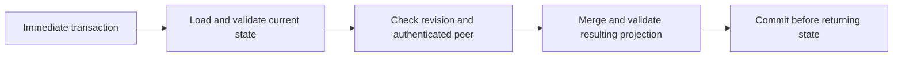

# Membership projection persistence

`persistence::MembershipStore` retains the supported membership projection in a
separate `membership.sqlite3` database. It never opens the session store or treats
a projection as a complete team document. Invitations, link secrets, identity
proofs, configuration and mailbox state are not persisted by this API.

| Operation | Behavior |
| --- | --- |
| `open(root, busy_timeout)` | Open fixed database name in an existing private absolute directory |
| `initialize(state, profile, now_ms)` | Insert verified state once at revision 1 |
| `load(team, founder, profile, now_ms)` | Require expected identity/profile and strictly reconstruct stored state |
| `merge(revision, peer, incoming, profile, now_ms)` | Merge inside an immediate transaction using compare-and-swap revision |

`StoredMembership` exposes `revision` and `state`. `PersistenceError` contains
neutral fixed diagnostics, without raw database errors or payloads. Module
constants expose the filename and 4 MiB payload limit. Busy timeout must be positive
and at most 60 seconds; it bounds SQLite contention, not kernel I/O or scheduling.

The versioned document stores the complete explicit `WireProfile` and exact typed
`MembershipSnapshot`, including team, founder and signing domain. Load compares all
profile fields, verifies signatures and membership rules, and requires reconstructed
state to equal the decoded snapshot. Any rejected or proof-dependent stored record
fails the load; corrupt state is never silently filtered into a smaller valid state.
Missing current member activity is valid and is not automatically reinstated.

Merge requires an authenticated Iroh endpoint ID, not an identity supplied in JSON.
It loads and validates current state inside `BEGIN IMMEDIATE`, compares the caller's
revision, then invokes the existing membership merge rules. Invalid incoming entries
retain the existing rejection-report behavior. Valid changes are strictly checked
again before storage. A merge that cannot be reconstructed on reopen fails without
changing durable state. Successful changes advance the revision once; no-ops leave
it unchanged. Revision overflow fails rather than wrapping. A stale caller must
reload and explicitly reconsider its update; there is no automatic retry.

The combined serialized profile/snapshot is bounded to 4 MiB before merge and
before persistence. Reload checks stored byte length before allocating its payload.
SQLite uses WAL and full synchronization. The schema has a dedicated application
identifier and version; incompatible schemas are rejected instead of migrated or
reinitialized. Only an empty database can receive the initial schema.

On Unix, the directory must be owned by the effective user with mode 0700. The
database, WAL, SHM and rollback journal must be private, single-link regular files
with mode 0600. Final-component symlinks and nonregular entries are rejected;
nonblocking inspection avoids FIFO hangs. The supplied root is opened without
following its final component, then system ancestor aliases are resolved for
SQLite's no-follow open. Database/root inode identity and file protections are
rechecked on operations. Do not replace files or manipulate sidecars while open.
The private directory is trusted against malicious same-user mutation. Extended
ACLs are not audited; these mode checks are not a complete OS sandbox. Platforms
without the implemented Unix protection return `Unsupported`.

An update is returned only after commit and directory synchronization. A later
sync error can occur after the transaction committed: an error is not proof of
rollback, so reopen before deciding what happened. Failed SQL writes roll back;
state is not published to callers before commit. The library itself does not
broadcast snapshots or authorize connection dispatch.

Known removal history survives ordinary reopen and prevents an older member record
from restoring activity. This does not change historical signer authority or make
first-seen admission histories converge. It does not detect restoration of an older
whole database or backup; revisions are not an external anti-rollback counter.
There is no leave/invitation-consumption transaction or claim of full network parity.

Tests cover reopen/removal replay, transactional CAS contention, failed writes,
bounded busy handling, overflow, identity/profile mismatch, invalid signatures and
proof-dependent stored records, schema mismatch, exact payload limits, private
files and sidecars, and abrupt child exit with an uncommitted transaction. They do
not simulate hardware power loss or establish cross-platform durability.
