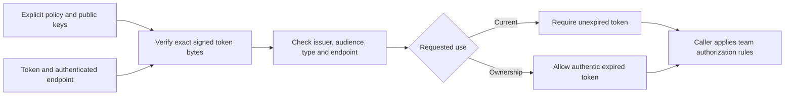

# Configured identity proofs

The network library verifies endpoint-bound identity tokens using an explicitly
configured public key set. This is an internal API; Foundry does not yet provide
a hosted account login flow or a CLI command for configuring this trust policy.
Successful verification alone does not admit a machine to a team.

## Trust configuration

Construct `ProofVerifier::from_jwks` with a `ProofConfig` containing the exact
issuer, audience and token type, plus local JWKS bytes. No server, environment
setting or default authority supplies these values. The verifier never follows
key URLs or fetches replacement keys.

The key set must contain 1–64 uniquely identified RSA public keys within 256 KiB.
Moduli must be 2,048–8,192 bits. Conflicting algorithm or usage declarations,
duplicate key IDs and private key parameters reject the configuration. Key
rotation requires an explicit replacement configuration; retaining an old key
permits verification of tokens signed by that key.

## Verification and use

`verify` accepts the endpoint, token, `ProofUse` and clock snapshot. Tokens are
limited to 4,096 bytes before trimming. The verifier requires three unpadded
base64url segments, a strict header and an RS256 signature over the original
encoded header and payload. It checks exact configured claims and the canonical
endpoint identity. Person names contain 1–40 lowercase ASCII letters, digits or
hyphens. Required subject and email claims are strings.

`Current` requires expiration strictly after the supplied time. `Ownership` skips
only that expiration check. Both reject issuance more than one day into the
future. An ownership result therefore cannot stand in for a current identity
badge. Callers must independently bind account subject and person to the relevant
active team member before granting ownership-based access.

`VerifiedProof` has private fields and records the verification use and time.
Reverify stored tokens under the selected policy when authorizing an operation;
the returned object is not perpetual authorization. Replacement ordering is by
issuance time and trimmed token bytes, not expiration.

## Privacy and availability

Ordinary debug output omits claims, token bytes and policy values. The explicit
raw-token accessor exists for private storage and wire transfer; do not include
its output in status, diagnostics or logs.

Tests use real signatures and synthetic public fixtures. They cover signature
tampering, endpoint and claim binding, expiration boundaries, key selection and
malformed configuration. They do not establish compatibility with a deployed
identity service. The in-memory team engine can select this verifier, reverify
tokens during admission and merge, and compute current identity status. It binds
ownership to matching subject and person on another active machine; email equality
alone does not grant access. Full team persistence, account lifecycle and persistent
trust configuration remain separate work.
