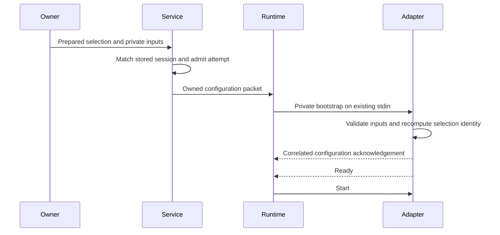
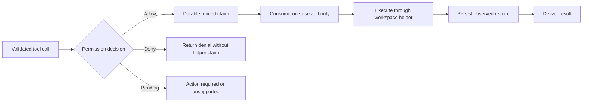
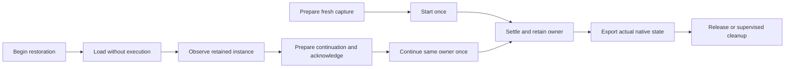

# Explicit adapter configuration

The service library provides `PreparedLocalAdapter` and `Service::run_prepared`
for an explicitly provisioned adapter. The CLI selects this path with
`FOUNDRY_ADAPTER_CONFIG` alongside its fixed `FOUNDRY_ADAPTER` executable; see
[local adapter setup](../user/local-adapter.md). The repository does not bundle
a model provider or discover credentials from account files or the environment.

## Preparation and startup

The caller supplies the executable, public selection, private inputs and trusted
tool settings. Preparation validates absolute executable/helper paths, opens the
selected workspace directory, checks grant limits and constructs a single-use
configuration packet. Before admitting an attempt, the service requires the
stored directory, provider, model and effort to match the selection exactly.

Configuration acknowledgement precedes Start, but follows the existing service
attempt transaction. A rejected SDK configuration can therefore leave an admitted
attempt that must settle through normal failure handling. An acknowledgement does
not establish provider execution, tool permission or durable native validation.

The public identity includes provider, model, effort, workspace and resource
identities, selected profile, tool catalog, policy generation and output bounds.
It uses versioned length framing independent of JSON key ordering. Opaque
identities are owner-issued labels; they must not be hashes of credentials or
private system text. The concrete binding must reject unsupported selections
without silently substituting defaults.

Private inputs contain an explicit API key or no credential, system text and an
absolute agent directory. They travel on the existing stdin pipe, never in
arguments, environment variables or ordinary events. The body is limited to
64 KiB; the canonical prelude is limited to 96 KiB including its newline. The
adapter independently recomputes the selection digest before acknowledging the
runtime's fresh challenge. The original readiness deadline includes this exchange.
Cloned runtime specifications share the packet's one-use slot; failed startup
does not restore it or fall back to unconfigured execution.

The neutral TypeScript package exposes `runConfiguredAdapter` for a trusted,
explicitly linked factory. That factory validates private inputs and owns cleanup
if partial construction fails. It must not call a provider or tool during
preparation. The wrapper retains one input iterator across bootstrap and ordinary
commands and disposes a returned facade if configuration acceptance fails.
These controls do not sandbox the adapter or guarantee erasure of memory copies.

## Consuming tool permissions

Tool availability is distinct from execution authority. Preparation derives the
maximum helper operations from the selected catalog and requires explicit grants
to be a subset. The service binds each request to its actual session, attempt,
typed input, tool, policy and configuration generation.

Immediately before helper admission, consumption rechecks the retained request,
policy identity, generation, revocation, observed cancellation and live lease
deadline. A late heartbeat cannot revive expired authority. Explicit denial
continues with a denial result; Pending follows the configured noninteractive
policy. Interactive approval is unsupported by this path.

Retain `PreparedLocalAdapter::revocation()` before moving the prepared value into
execution. The trusted configuration owner must invalidate this handle before
publishing a changed selection or grants. Constructing a new generation alone
does not revoke an already running selection; cancellation remains separate.

Consumption is an admission boundary, not an atomic transaction with filesystem
effects. Cancellation cannot undo completed writes. Lost replies, uncertain effects
and failed receipt persistence retain the existing explicit recovery requirements;
they do not trigger automatic permission reissue or tool replay. See the
[service lifecycle](service.md) and [tool permission model](../../crates/tools/PERMISSIONS.md).

## Retained native lifecycle

A concrete binding may implement the typed `ContextFacade` hooks in addition to
ordinary execution. The neutral controller advertises only complete hook groups.
It retains the same facade after settlement when capture was requested, and keeps
one reader, one bounded writer and one cleanup owner throughout the operation.
Hooks supply native data; they cannot write protocol frames or grant tool access.

Restoration never substitutes an ordinary Start. The controller waits for the
continuation acknowledgement write before invoking the prepared continuation and
rechecks cancellation before execution. The Rust service retains durable
continuation authorization and publication ownership. A wire receipt alone does
not establish either permission or publication.

The concrete binding must validate its independently selected restore plan,
preserve the real native instance and historical associations, and provide actual
observation/export bytes. Injected-hook tests establish neutral routing, bounds
and lifecycle behavior; they do not establish a provider's native semantics.
Private native exports may contain conversation and system text and must be
treated as confidential.

Trusted native service composition can select
`FreshCaptureOwner::start_with_permissions` or
`RestorationOwner::open_capture_with_permissions`. Supply permissions created for
the exact selected configuration and runtime policy identity, and use that policy
in required-authorization mode. These entrypoints retain the same lease and
consuming-request checks as ordinary execution and reject permission/publication
configuration digest mismatches before admission.

For Pending approval configured as ActionRequired, capture returns an opaque
`CaptureActionRequired` proof after checked process and helper cleanup. Submit it
to the same owner's `finish_action_required` method and wait for its ActionRequired
reply. Fresh and restored owners finalize the attempt with the fixed result
`permission_action_required`; they leave the checkpoint head unchanged. An ordinary
stop result cannot substitute for this proof. Unsupported approval modes remain
errors.

Terminal admission checks the matching proof, current configuration, cancellation
and live lease before entering the database transaction. After admission, a later
local cancellation, configuration revocation or conservative lease expiry can lose
to the commit. The transaction still checks durable cancellation and its lease
fence. A committed result cannot be rolled back by a late local request. No helper
claim, checkpoint or publication witness is created for the pending call.
