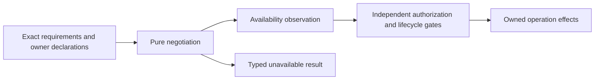

# Capability negotiation contract

A requested operation is available only when every required owner declares the
exact capability version and acknowledges the selected operation and effective
profile. Missing support must fail before the operation's effects. Do not change
model, backend, adapter, profile or target to make an unavailable request succeed.

The contracts crate supplies a pure target negotiation helper in
[capability.rs](../../crates/contracts/src/capability.rs). It checks caller-supplied
descriptors; it does not discover capabilities, authenticate an advertisement,
launch a process, grant permission, admit an attempt or validate native state.
Production service/runtime consumers are not wired to this helper by this change.

## Current interfaces and target descriptors

Ordinary subprocess protocol version 1 retains `Ready { version, capabilities }`
with `Vec<String>` capabilities. An omitted list still decodes as empty. Existing
runtime checks use exact capability strings for their current operation. These
strings do not encode the target's four owner roles or complete profile agreement;
no automatic conversion or new wire advertisement is introduced.

| Current surface | What it establishes | What it does not establish |
| --- | --- | --- |
| `message_ack_v2` | Adapter receipt acknowledgement support for the current message path | Capture, native validation or permission to activate a restored message |
| `context_capture_v1`, `context_export_v1` | Private capture/export transport required by coordinated startup | Complete native checkpoint fidelity or durable publication |
| `context_restore_v1`, `context_continue_v1` | Older context transport identities, distinct from version 2 | Compatibility with loading version 2 or an implicit upgrade |
| `context_restore_v2` | Inert loading transport requirement checked by loading startup | An admitted attempt, native validation, execution or a Continue permit |
| `context_continue_v2` | Separate continuation frame contract | Acceptance in storage, activation authority or an integrated restored execution path |

Private context framing, ordinary protocol version and operation/capability versions
are distinct domains. A version 2 private frame does not increment ordinary protocol 1.
The new enums are semantic target dimensions, not strings to add to Ready. An
integration owner must explicitly define any future authenticated advertisement
transport and codec rather than translating arbitrary labels by resemblance.

## Owners and exact requirements

| Owner | Declaration responsibility | Cannot stand in for |
| --- | --- | --- |
| Backend | Selected service/storage operation implementation and durable behavior | Adapter transport, configured model support or policy |
| Adapter | Selected bridge implementation and frame/receipt/native-state mechanisms | Backend durability or permission |
| Model | Capabilities of the exact configured provider/model binding | Another model, SDK support in general or adapter availability |
| Policy | Whether the selected effective policy permits exposing an operation | A per-request authorization, user decision, grant or attempt fence |

`OperationRequirements` binds a canonical operation ID, positive operation version,
complete effective-profile identity and explicit owner/capability/version dependencies.
Each `OwnerAdvertisement` acknowledges that same operation/version/profile and
supplies its own declarations. A capability from one role never satisfies another.
Multiple roles can require the same semantic capability at different exact versions.

Capability dimensions are execution, message receipt, capture, export, inert restore,
continuation, native validation, permission requests and durable acceptance. This
small vocabulary is not a claim that all dimensions are implemented or a complete
catalogue of future operations. The service contract owner must publish a reviewed
requirement set for each exposed operation. Omitting a dependency from a supplied
set cannot be detected by this helper and is not authorization to omit it in a real
integration. Unknown operations must not be exposed merely because a caller can
construct a syntactically valid operation ID.

A profile identity must bind the complete selected current/legacy behavior and
relevant effective configuration, not just a display label. Canonical identity
construction belongs to the configuration owner. The helper compares bytes without
normalization or fallback. An absent acknowledgement fails distinctly from a
mismatching profile. Existing-session observations retain the recorded profile;
restoration must not silently cross profiles. See the [CLI contract](cli-contract.md)
and [restoration design](restoration.md).

## Pure matching and failure behavior

`negotiate` first validates all descriptors, including extra supplied owners and
unknown declarations. Every supplied owner must acknowledge the requested operation
and profile. It then checks each dependency in requirement order. The result is
`Availability` containing only the requested operation, version and profile, or a
typed failure. Failure messages do not echo descriptor IDs or configuration values.

| Input condition | Required result |
| --- | --- |
| Exact known capability, version and supported=true for the required role | Satisfies that dependency only |
| Exact version explicitly unsupported | Unsupported, even if another version is supported |
| Only other known versions | IncompatibleVersion; no downgrade, upgrade or range inference |
| Only an unversioned known declaration | LegacyOnly; requires explicit integration, not assumed support |
| Unknown named declaration | Never satisfies a known requirement, including a matching-looking name |
| No relevant declaration | MissingCapability |
| No required role | MissingOwner |
| Missing or different effective profile | ProfileNotAcknowledged or ProfileMismatch |
| Different operation identity/version | OperationMismatch |
| Duplicate requirements, owners or capability/version declarations | Reject, including equal or conflicting duplicates |

A legacy declaration and an explicit versioned declaration may coexist. A supported
exact version can satisfy the dependency; the legacy declaration adds no authority.
Several distinct known versions can be listed. Unknown declarations are retained
only as inputs and never inferred to mean a known capability. First unmet dependency
is reported; the helper does not aggregate failures or retry with alternatives.

Inputs are bounded to 64 requirements, four owners and 64 declarations per owner.
Identifiers are 1–128 ASCII bytes drawn from letters, digits, underscore, hyphen,
period and colon. They are canonical IDs, not raw configuration or secret payloads.
Versions are positive `u32`; an empty requirement set is invalid. Duplicate
requirements for an owner/capability are invalid even with different requested
versions. Each operation must select one exact version per dependency. These are
owned target descriptor constraints, not new restrictions on current Ready strings.

## Required operation families and dependencies

The following families remain service-contract obligations. This table defines
semantic separation and owner handoffs, not new current RPCs or a fully populated
capability catalogue. Each implementation must bind its exact operation/version,
profile and dependency set before exposing executable availability.

| Family | Required owner coordination and independent gates |
| --- | --- |
| Session creation, task execution and target/model selection | Backend lifecycle, adapter execution, exact configured model and effective policy; permission and admission still required |
| Session reads, events, conversation/message projections and observation | Backend projection/version support and policy; observing cannot manufacture execution authority |
| Message enqueue, steer, withdraw and receipt | Backend state transition and adapter receipt capability where delivery is requested; receipt is distinct from execution completion |
| Graceful/hard cancellation and settlement | Backend attempt ownership, adapter cancellation and policy; waiting or observer interruption does not acquire cancellation authority |
| Capture and checkpoint publication | Backend current-cut/durable evidence, adapter capture and export, model/native representation and policy; native completeness and publication are separately checked |
| Inert restoration | Backend retained checkpoint, adapter loading transport, exact model/native format and policy/profile compatibility; load without an attempt, then actual native validation |
| Continue after restoration | Backend durable acceptance, adapter continuation/receipt, validated native/model state and policy; one-shot permit, fence and exact instruction required independently |
| Tool permission request/decision | Backend correlation/state, adapter tool-request support and authorized policy owner; availability never substitutes for an allow decision or static trusted grant |
| Client/CLI/MCP exposure and richer lifecycle operations | Service-owned exact capability requirement sets for reviews, schedules, forks/rewind, attachments and other advertised families; unsupported dependencies remain unavailable |

An adapter's tool list, CLI parser success or MCP tool schema is not executable
backend support. Clients must expose effective negotiated availability for their
selected backend/model/profile, distinguish unsupported from denied, and never
advertise an unavailable operation as ready merely because its syntax is known.
The model role cannot be satisfied by a generic SDK descriptor. None of these
requirements authorizes silent model or target substitution.

## Availability is not authority

The runtime/service integration must evaluate availability before the requested
operation's effects and keep it bound to the selected owner instances, model and
profile. An observation becomes stale if those bindings change; this pure helper
contains no lease, clock, signed claim or revocation mechanism. Consumers must
recheck or fence changes rather than cache availability as permanent authority.

Successful negotiation cannot create a permission grant, admitted attempt, native
validation result, receipt, checkpoint seal or Continue permit. For restoration,
reserve and load without an attempt; inspect native state under the trusted loader;
confirm the preserved baseline; consume the actual one-shot granted authority;
transition the same live loading process; persist exact Continue acceptance before
activation. An acknowledgement, inert frame or historical acceptance lookup cannot
replace these gates. Native validation binding is distinct from historical capture
binding. Read-only recovery after a lost reply does not reissue authority.

Storage schema 11 and its accepted restore/Continue APIs remain unchanged. The
metadata-only historical acceptance path and bounded current-witness validation
remain required; capability matching must not create recursive ancestor loading.
Actual native import, validation, loading-to-admitted supervision, permit ownership,
cleanup and activation belong to the runtime/adapter integration, not this helper.

## Acceptance and implementation handoff

[Capability fixtures](../../crates/contracts/tests/capability.rs) cover exact support,
all four role distinctions, incompatible/unsupported/missing/unknown/legacy inputs,
complete profile matching, duplicate conflicts, bounds and positive versions,
independence of semantic dimensions and unchanged Ready serialization. A local
counter demonstrates gating on a pure result; it is not production dispatch proof.

Existing capture-handshake/context codec fixtures establish only their framed
contracts. Runtime coordinated startup and loading fixtures establish their current
checks. Store restoration/acceptance/lineage fixtures establish their durable
boundaries. No passing negotiation fixture renews those results or proves native
fidelity. Integration acceptance additionally requires unavailable requests to have
no effects, owner/profile/model changes to invalidate stale observations, and each
actual authority gate to remain enforced independently of advertised availability.
