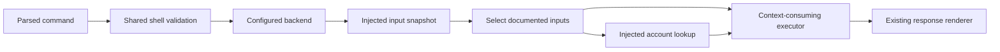
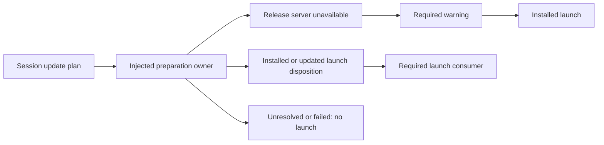

# CLI configuration boundary

The CLI library provides `configuration::ConfiguredBackend` for injected account
and connection settings. It implements the ordinary `Backend` interface, so
`dispatch` and `execute` apply shell validation and output formatting as usual.
The shipped executable still uses its local database/adapter backends; this
interface does not enable login, enrollment or remote execution.

## Selection and consumption

The caller supplies three implementations: `Inputs` captures one command-scoped
snapshot, `Accounts` associates a selected credential and endpoint selection
with a workspace, and
`Executor` consumes the request together with its typed configuration context.
No default executor drops that context. These interfaces do not read process
environment variables, files or credential stores by themselves.

For supported session requests, a supplied nonempty environment key is selected
ahead of the selected login; key absence selects the login. Account lookup
supplies the workspace rather than deriving it from credential text. Lookup
failure returns a fixed configuration error without retrying another identity.
Empty values and missing or competing candidates remain explicit pending
selections for the owner. Pending selection is not successful authentication.

Task and session contexts accept an injected environment endpoint. Nonempty bytes
remain a private endpoint candidate; absence remains unspecified, and an empty
value remains an explicit pending owner-policy selection. No endpoint is guessed
from a credential or selected login. The wrapper does not normalize URLs or read
an environment variable itself. Account lookup receives this selection before
associating the credential with a workspace; the executor receives it with the
resulting identity. This keeps endpoint policy visible to both consumers.

Connection requests preserve distinct explicit, environment and saved candidates.
A single eligible key can be resolved through account lookup. Competing inputs
remain distinct even if their bytes match; this interface imposes no universal
flag/environment/saved precedence. Enrollment-token and saved-identity policy
remain owner decisions. Endpoint selection has no fabricated default. Both account lookup and the
executor receive the same endpoint selection, including unresolved candidates.

Connection proxy context always excludes `HTTPS_PROXY`. Explicit and saved proxy
candidates are retained; no supplied candidate is replaced by that environment
value. The executor must honor this exclusion when constructing a transport.
Fixture coverage proves delivery of the policy to the executor, not HTTP-client
behavior or rules for other proxy variables.

## Connection profile settings

The caller can supply fresh or retained connection facts, personal or machine
classification, platform, and home, working-directory and hostname values.
These are injected facts; the wrapper does not inspect the host or read saved
settings itself. Missing facts remain unresolved.

Fresh defaults use the hostname for the name, the home directory for personal
connections and the working directory for machine connections. macOS fresh
Chrome and keep-awake settings default on. Local logins default off with a
selected API key and on when absence of an API key is confirmed. Ambiguous
identity and explicit or retained login-on with a key remain owner-policy
questions. Retained missing fields do not silently become fresh defaults.

The executor receives selections with provenance and separate explicit change
intent, including the proxy CA path. Empty scalar settings and unsupported or
unknown platform combinations remain pending; no path, URL or PEM validation is
claimed. For direct configured requests, an empty scalar retains saved values
and any injected fresh default as conditional candidates for the owner. This does not make that default
applicable to an empty value or choose clearing, retention or fallback. The
wrapper does not read certificate files or collect login tokens.

Keep-awake and folder-change intent retains its immediate-application semantics,
including preservation of running sessions in other folders. Folder lists retain
bytes, repetitions and conflicts; the wrapper does not invent cross-flag order.
Minimal mode remains distinct from Chrome settings and preservation of an
existing desktop installation. These describe what a future connection executor
must honor; they do not perform native changes, reconnect workers or prove that
an installation exists.

## Serve enrollment settings

For `serve` enrollment requests, the caller supplies environment-token,
saved-worker and selected-login candidates plus working-directory and hostname
facts. The wrapper reads none of those from the host. Explicit tokens leave the
forwarded request and enter only private context; injected tokens never enter
request JSON. As with connect, generic parsing may have serialized an explicit
token before this wrapper receives it.

The executor receives distinct identity candidates. A sole token identifies a
token-bound enrollment request without decoding or asserting its machine name.
A sole saved worker identifies reconnect intent. A sole selected login can use
the explicit machine name or injected hostname. Missing, empty and competing
inputs remain explicit policy states; a name plus a token does not silently
select one. A saved worker's association with an explicit name is not guessed.
Serve descriptors do not perform account lookup or authenticate any candidate.

Directory selection preserves an explicit value or injected working directory.
Empty values retain conditional alternatives without resetting or normalizing a
path. `--once` expresses no new saved state and preserves unrelated existing
state. Normal enrollment carries the conditional intent to retain a verified
worker identity only after a successful join; saved-worker reconnect carries
reuse intent without overwriting that identity. Unresolved input does not grant
permission to join. Tokens must never be persisted. Service mode expresses foreground join
followed by background-worker intent; it does not install or start a service.
The `--yes` and `--sandbox` flags remain intent, not verified permission or
hosting capability.

`serve --stop` and root `stop` remain unsupported by this configured interface.
They do not read enrollment inputs or invoke its executor. Malformed consumed
field shapes also fail before input access. The shipped local backend is
unchanged and does not implement enrollment or worker control.

## Updates before session launch

Prompt, run and Serve enrollment contexts carry injected update and notice
settings. A prompt's explicit `--update` and an environment value of exactly `1`
record a positive update request. Both sources together request one preparation.
Other bytes, including empty strings, remain private unresolved observations for
the update owner; they are not trimmed or interpreted as booleans. No update
flag is added to run or Serve by this interface.

A consuming executor separates preparation, categorized diagnostics and launch.
An updated result carries an owner-supplied launch handle to the launcher; it
must not silently launch the installed version instead. A specifically classified
unreachable release server emits a warning before continuing with the installed
version. Other failures and unresolved policy do not acquire that fallback.

The separate notice setting suppresses only daily update notices when its value
is exactly `1`. It does not disable requested updates, warnings or errors.
Notice availability is supplied by its owner; this library neither schedules
checks nor queries a release server. Diagnostics use a separate sink and do not
insert update objects into the task's JSON response. Sink delivery failures are
explicit errors, not silent success.

Session queries, connection settings, standalone updates and ACP do not inherit
pre-session updates through shared configuration types. The executable's local
backend does not use this composition. Release discovery, verified installation,
process replacement and the policy for unrecognized values remain separate
updater responsibilities. Synthetic launch handles demonstrate orchestration;
they are not evidence of an installed or verified release.

## Private values and limits

Private configuration values and contexts have no printable or serializable
implementation. The configured wrapper removes explicit key, token, endpoint
and proxy fields from its owned request before forwarding the sanitized request
with private context. Environment credentials are never added to request JSON.
Input/account failures use fixed, value-free errors.

Ordinary parsing and generic request serialization already handle explicit CLI
values before this wrapper runs. This is not global CLI redaction, and other
backend implementations must protect the values they receive. Likewise, an
injected executor owns its response and diagnostics; it must not echo credentials.

Supported configured routes are positional tasks, `run`, `connect`/`device`,
nested `session` operations, serve enrollment, and root `ls`, `watch`, `send`
and `cancel`. Task
options, including model and effort, are preserved for the injected executor.
This does not enable them in the executable's local execution backend. ACP, worker-control requests,
MCP and other unsupported operations are rejected
without consulting configuration. Help/version bypass the backend entirely;
invalid shell combinations fail before input access. The binary's local watch
path and MCP service do not use this account interface.

Use normal parsed dispatch for shell validation. Direct `Backend::execute`
callers must supply valid version-1 requests; the wrapper checks supported
families, object argument envelopes (including nested prompt options) and private
connect and serve field types, not every
command's complete schema.
Remote authentication, credential persistence, workspace authorization, effective
transport settings and unresolved conflict policies remain separate integrations.
