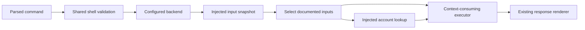

# CLI configuration boundary

The CLI library provides `configuration::ConfiguredBackend` for injected account
and connection settings. It implements the ordinary `Backend` interface, so
`dispatch` and `execute` apply shell validation and output formatting as usual.
The shipped executable still uses its local database/adapter backends; this
interface does not enable login, enrollment or remote execution.

## Selection and consumption

The caller supplies three implementations: `Inputs` captures one command-scoped
snapshot, `Accounts` associates a selected credential with a workspace, and
`Executor` consumes the request together with its typed configuration context.
No default executor drops that context. These interfaces do not read process
environment variables, files or credential stores by themselves.

For supported session requests, a supplied nonempty environment key is selected
ahead of the selected login; key absence selects the login. Account lookup
supplies the workspace rather than deriving it from credential text. Lookup
failure returns a fixed configuration error without retrying another identity.
Empty values and missing or competing candidates remain explicit pending
selections for the owner. Pending selection is not successful authentication.

Connection requests preserve distinct explicit, environment and saved candidates.
A single eligible key can be resolved through account lookup. Competing inputs
remain distinct even if their bytes match; this interface imposes no universal
flag/environment/saved precedence. Enrollment-token and saved-identity policy
remain owner decisions. Endpoint selection has no fabricated default.

Connection proxy context always excludes `HTTPS_PROXY`. Explicit and saved proxy
candidates are retained; no supplied candidate is replaced by that environment
value. The executor must honor this exclusion when constructing a transport.
Fixture coverage proves delivery of the policy to the executor, not HTTP-client
behavior or rules for other proxy variables.

## Private values and limits

Private configuration values and contexts have no printable or serializable
implementation. The configured wrapper removes explicit key, token, endpoint
and proxy fields from its owned request before forwarding the sanitized request
with private context. Environment credentials are never added to request JSON.
Input/account failures use fixed, value-free errors.

Ordinary parsing and generic request serialization already handle explicit CLI
values before this wrapper runs. This is not global CLI redaction, and other
backend implementations must protect the values they receive. Likewise, an
injected executor owns its response and diagnostics; it must not echo credentials.

Supported configured routes are `connect`/`device`, nested `session` operations,
and root `ls`, `watch`, `send` and `cancel`. Other operations are rejected
without consulting configuration. Help/version bypass the backend entirely;
invalid shell combinations fail before input access. The binary's local watch
path and MCP service do not use this account interface.

Use normal parsed dispatch for shell validation. Direct `Backend::execute`
callers must supply valid version-1 requests; the wrapper checks supported
families, object argument envelopes and private connect field types, not every
command's complete schema.
Remote authentication, credential persistence, workspace authorization, effective
transport settings and unresolved conflict policies remain separate integrations.
