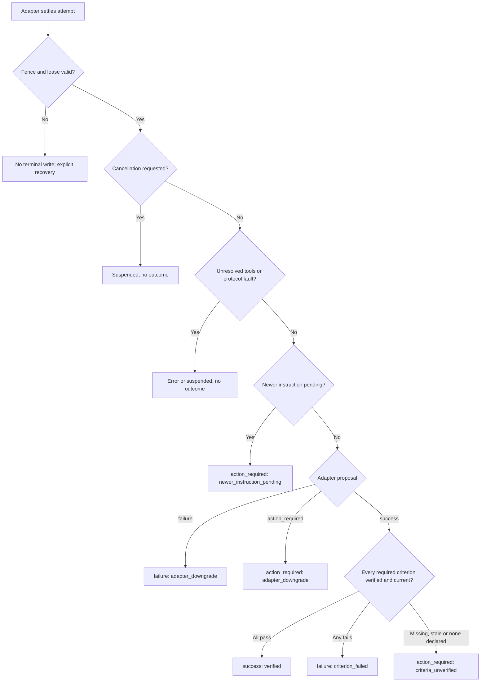

# Task completion policy

Status: **approved 2026-11-04; not yet implemented.** Policy identifier
`foundry.completion.v1`. This page defines when a finished attempt may be stored
as `success`, `failure` or `action_required`. It separates what Foundry enforces
today from what the policy adds. Until the policy is implemented, the current
behavior described under "Implemented today" stays in place.

## Scope and non-goals

The policy classifies one attempt against criteria declared before the attempt
ran. It is not a correctness oracle for arbitrary natural-language tasks. It does
not judge provider quality. It does not change lifecycle semantics: `error` and
`suspended` still carry no outcome (see [session contracts](contracts.md)).

None of these is completion evidence: an SDK stop signal or settled turn, model
text such as "done", every tool returning success, a child process exiting 0, or
a fixture that hard-codes an outcome. A model may propose completion. It cannot
produce the evidence that authorizes success.

## Decision binding

Each classification is a decision record bound to this tuple:

| Field | Meaning |
| --- | --- |
| `policy_version` | `foundry.completion.v1`. A record under another version is not reinterpreted. |
| `session_id`, `attempt_id` | The fenced attempt that owns finalization. |
| `configuration_digest` | Effective adapter/model/permission configuration admitted for this attempt. |
| `criteria_digest` | The criteria set fixed when the attempt was admitted. It is immutable for the attempt. |
| `work_revision`, `event_sequence` | The durable work cut the evidence evaluated. |
| `checkpoint_cut` | Native publication only: the witnessed cut that carries the terminal. |

The record also stores the outcome, its basis (`verified`, `adapter_downgrade`
or `default`), a fixed cause code and per-criterion results. The result string
remains display data, not evidence.

## Evidence and its authority

| Source | Examples | Authority |
| --- | --- | --- |
| Adapter-reported | Settled `outcome`, `result` text, completion summary | May always lower the outcome to `failure` or `action_required`. Never sufficient for `success`. |
| Runtime-observed | Fence and lease validity, cancellation state, pending or in-flight messages, unresolved or uncertain tool calls, current work revision and configuration | Gates whether any `exit` outcome may be written at all. |
| Runtime-verified criteria | Result of an explicitly authorized, bounded check that the runtime ran under the attempt fence and recorded with the binding tuple | The only basis for `success` and for criterion-driven `failure`. |

A verification check must already appear in the admitted criteria set. The model
cannot add, select or widen one. Running a check grants no new permissions.

### Rejection rules

- **Stale:** the evidence's `work_revision`, `configuration_digest`,
  `criteria_digest` or `policy_version` differs from the values current when the
  attempt finalizes, or it belongs to an earlier attempt. The evidence is ignored.
  The affected criterion counts as missing.
- **Missing:** a required criterion has no current result. The outcome is
  `action_required` with cause `criteria_unverified`.
- **Forged:** the evidence was not written by the runtime under this attempt's
  fence. That covers anything embedded in adapter result text, model text, tool
  output or event data, and any event carrying another attempt ID. It is ignored
  as evidence. A wrong attempt ID on the wire stays a protocol error, so the
  attempt ends in `error`.

## Decision procedure

The owner evaluates these steps in one store transaction. It rechecks the fence,
cancellation, messages and work revision before committing, so a check that
passed earlier cannot be overtaken by a later change.

Rules the diagram compresses:

1. Lifecycle comes first. Cancellation, lease loss, protocol faults and
   unresolved tools decide the lifecycle before any outcome is considered.
2. A failed intermediate tool call that the attempt later recovered from is not a
   task failure. Only a failed required criterion, or an adapter's explicit
   `failure`, produces `failure`.
3. A permission request that needs the user stays `action_required` with cause
   `permission_action_required`.
4. If no criteria were declared, an attempt can never be classified `success`.

## Races and continuation

- **Cancellation versus settlement:** if cancellation commits before the terminal
  transaction, the attempt ends `suspended` with no outcome, even if the adapter
  already settled with `success`. Once a decision commits, a later cancellation
  request does not rewrite it.
- **New instruction versus settlement:** if a message is pending or in flight for
  the session when the decision commits, the criteria set no longer reflects the
  whole instruction. The attempt ends `action_required` with cause
  `newer_instruction_pending`. The message stays pending for a later attempt and
  is never redelivered automatically.
- **Same-session continuation:** each attempt gets its own decision record and
  its own criteria set. A continuation never reclassifies an earlier attempt's
  record. Restoring a checkpoint preserves the stored outcome unchanged (see
  [restoration](restoration.md)). `Session.outcome` reflects the latest finished
  attempt's decision.

## Presentation mapping

Every frontend reads the stored session. None reclassifies the outcome from text,
process status or event history.

| Stored state | CLI `run`/`prompt` | CLI `watch` | MCP `session_get` |
| --- | --- | --- | --- |
| `exit` + `success` | 0 | 0 | `isError: false`, `outcome: "success"` |
| `exit` + `failure` | 1 | 1 | `isError: false`, `outcome: "failure"` |
| `exit` + `action_required` | 3 | 3 | `isError: false`, `outcome: "action_required"` |
| `error` | 2 (execution error) | 2 | `isError: false`, `lifecycle: "error"`, no outcome |
| `suspended` | 130 | 130 | `isError: false`, `lifecycle: "suspended"`, no outcome |

MCP `isError` reports a failed tool invocation, such as an unknown session or a
storage error. It never reports a task outcome.

## Implemented today

- **Lifecycle and outcome are separate types.** `Lifecycle` and `Outcome` are
  distinct enums and `Session.outcome` is optional
  (`crates/contracts/src/lib.rs`). `validate_terminal` requires an outcome for
  `exit` and forbids one for `error` and `suspended`
  (`crates/store/src/attempts.rs`).
- **Fenced finalization.** `check_terminal` checks the attempt fence. It forces
  `suspended` once cancellation is recorded and refuses `exit` while tool calls
  are unresolved or uncertain (`crates/store/src/attempts.rs`). The service
  re-reads cancellation after the adapter settles and retries a failed finish as
  `suspended` when cancellation won (`crates/service/src/execution.rs`). The test
  `success_after_observed_cancellation_is_suppressed`
  (`crates/service/tests/control.rs`) covers this.
- **Attempt correlation.** Events naming another attempt are protocol errors.
  Adapter failures are stored with fixed, sanitized diagnostics
  (`crates/runtime/src/lib.rs`). Settling with outstanding tool work is rejected
  (`crates/runtime/src/coordinated/engine_events.rs`).
- **Explicit outcomes are only transported.** The adapter rejects outcomes outside
  the enum, pending tool calls and unaccepted messages. A missing completion
  defaults to `action_required`. An explicit `success` passes through unverified
  (`packages/adapter/src/controller.ts`; `packages/adapter/test/controller.test.ts`).
- **Native terminal binding.** On the native path the outcome and result are
  encoded into the checkpoint terminal digest
  (`crates/runtime/src/coordinated/capture/terminal.rs`). A permission stop
  becomes `action_required` with `permission_action_required`
  (`crates/runtime/src/coordinated/engine_exit.rs`).
- **Exit mapping.** `terminal_response` maps 0/1/3/130
  (`apps/cli/src/runner.rs`) and `emit_result` adds 2 for `error`
  (`apps/cli/src/watch.rs`). `outcomes_map_to_task_exit_codes` in
  `apps/cli/tests/local_execution.rs` proves the **mapping only**: its fixture
  adapter hard-codes the outcome, so the test is not evidence of classification.

## Not yet implemented

This list is the scope of the implementation child:

1. Today an adapter's explicit `success` is stored as `success`. Under this
   policy it requires verified criteria and otherwise becomes `action_required`.
2. There is no criteria set, admission-time criteria digest or runtime-run
   verification check.
3. There is no persisted decision record: policy version, binding tuple, basis,
   cause code and criterion results.
4. The terminal transaction does not bind configuration digest or work revision,
   except through the native checkpoint cut.
5. The store does not check for pending or in-flight messages at finalization.
   Today only the adapter rejects messages it received but never accepted.
6. There are no acceptance tests for the policy cases: verified success with CLI 0
   and matching MCP and checkpoint state; a failed criterion; a settled turn with
   no criteria; forged and stale evidence; cancellation and new-instruction
   races; continuation preserving the earlier record.

## Approved decisions

The user approved these on 2026-11-04:

1. **No adapter attestation.** An adapter's `success` never counts without
   runtime-verified criteria. With no criteria checked, the attempt is stored as
   `action_required` with cause `criteria_unverified`. This changes current
   behavior, where adapter-reported success is stored as `success`.
2. **Criteria source and v1 check kinds.** A configuration profile supplies default
   criteria, and the session create request may add to or override them. The
   admitted set is fixed when the attempt is admitted. v1 allows two check kinds:
   a bounded command that must exit with status 0, and a file that must exist or
   match a recorded digest.
3. **Newer instruction.** A message pending at settlement ends the attempt as
   `action_required` with cause `newer_instruction_pending`. The message stays
   queued for the next continuation and is never redelivered automatically.
4. **Continuation criteria.** A continuation inherits the session's criteria unless
   its new instruction declares its own.
5. **Adapter downgrade.** An adapter's explicit `failure` is accepted without
   verified evidence, because adapter reports may only lower an outcome.
6. **Existing records.** Records written before this policy keep their stored
   outcome and expose `policy_version: null`. They are never rewritten.
