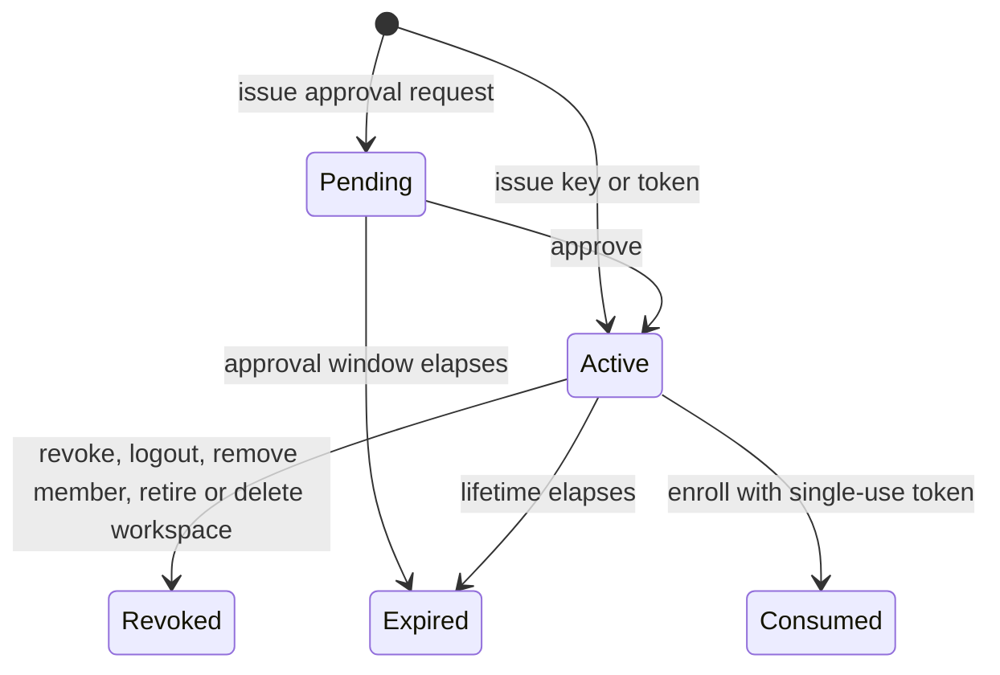
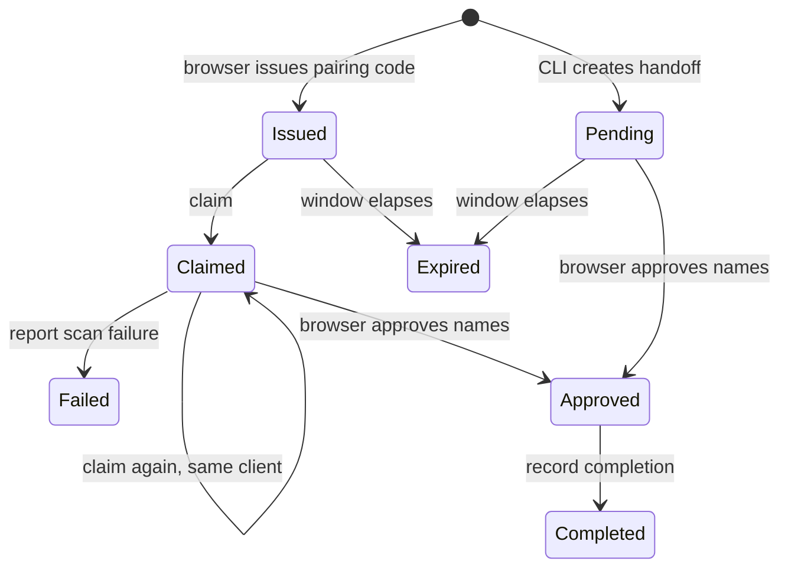

# Account, workspace and authorization specification

This page specifies the observable behavior of every account, workspace,
membership and authorization capability that the external capability audit still
lists as not verified. For each operation it records inputs, limits, error
classes, idempotency and state transitions, and it separates what Foundry
implements today from behavior that is only specified. A specified operation is
not available until its implementation and tests land. Nothing here claims parity
with another product.

The neutral fixtures in [`tests/identity`](../../tests/identity/README.md) encode
the same rules as request, response, authorization and transition vectors. Their
offline validator runs in the shared Python check group.

## Authority and naming

The authority for scope is the external audit file
`~/.local/share/foundry-audit/capabilities.json`, rows whose
`owner.proposed_ticket_group` is `GAP-003`. Row identifiers such as `CLI-024` and
`API-X001` are neutral and appear below; source identities, evidence and the wire
mapping stay in that external directory. Every row remains `not_verified` there.
A label on this page does not change that status.

Operation names such as `workspace.get`, scope names such as `workspace.read`,
role names and credential kinds are neutral Foundry names. **All wire names are
provisional pending NIC-36 C2 and the naming decisions NIC-34 D1 and D6.** That
covers transport paths, HTTP methods, field names, scope strings, error strings
and cause codes. HTTP status numbers are given only as the provisional mapping
for an HTTP transport, which is itself decision C2.

## Status labels

| Label | Meaning |
| --- | --- |
| Local foundation | Foundry implements a narrower local behavior, cited to tests in `apps/cli/tests`. The full specified behavior is still missing. |
| Specified | Behavior is defined here; no Foundry implementation exists. Building it still waits on the shared prerequisites C1 and C2 below. |
| Held | Specified as far as possible, but implementation waits on a further user decision named in the section. |

## User decisions

The NIC-36 grooming comment records six user decisions. None is inferred here.

| ID | Decision | Effect on this page |
| --- | --- | --- |
| C1 | Identity authority: a Foundry-owned local authority, a hosted-service client, or both behind one interface | Shared prerequisite for every row. Also holds invitation delivery, budget accounting and the effective role of service principals. |
| C2 | Whether to ship a local HTTP API, and its wire names | Shared prerequisite for every API row; all wire names stay provisional. |
| C3 | A user-created hosted account for read-only checks, or accepting the 31 API rows as an unverified deviation | Holds parity verification of every API row. Nothing on this page is verified against a hosted service. |
| C4 | Local equivalents for hosted-only rows, or recorded deviations | Holds deployment identity, the API description document, local secret import and single-use workspace budgets. |
| C5 | Keychain-first or file-first credential storage, and whether third-party single sign-on is in scope | Holds login storage, logout cleanup and the single sign-on path. |
| C6 | Whether feedback goes to a real endpoint, with user approval, or only to a local sink | Holds the feedback operation. |

## Coverage index

| Row | Operation | Label | Section |
| --- | --- | --- | --- |
| CLI-024 | `cli.login`, `cli.logout`, `cli.whoami` | Local foundation | [CLI login, logout and whoami](#cli-login-logout-and-whoami) |
| CLI-049 | `credential.select` | Local foundation | [Credential handling](#credential-handling) |
| API-X001 | `identity.self` | Specified | [Caller identity](#caller-identity) |
| API-EAB209C8A1D60 | `service.deployment` | Held | [Deployment identity and API description](#deployment-identity-and-api-description) |
| API-EC4FFB7B71B06 | `service.api_description` | Held | [Deployment identity and API description](#deployment-identity-and-api-description) |
| API-E0586F6A81366 | `feedback.submit` | Held | [Feedback](#feedback) |
| API-E27CB8EB997A3 | `workspace.list` | Specified | [Workspaces](#workspaces) |
| API-E0D1C7603B534 | `workspace.create` | Specified | [Workspaces](#workspaces) |
| API-E0E38EF1D33B5 | `workspace.get` | Specified | [Workspaces](#workspaces) |
| API-EAF0E25F70675 | `workspace.rename` | Specified | [Workspaces](#workspaces) |
| API-E1AC5E5AB1846 | `workspace.delete` | Specified | [Workspaces](#workspaces) |
| API-E95EC0DE5F113 | `audit.list` | Specified | [Audit log](#audit-log) |
| API-E3A0BCD747FD5 | `single_use.create` | Held | [Single-use workspaces](#single-use-workspaces) |
| API-E8DF08D5E6646 | `single_use.retire` | Specified | [Single-use workspaces](#single-use-workspaces) |
| API-E33A028E187F8 | `member.list` | Specified | [Membership](#membership) |
| API-EC9FBB1DF9FC2 | `member.invite` | Held | [Membership](#membership) |
| API-E2B9A6E28934A | `member.get` | Specified | [Membership](#membership) |
| API-E601F50E4D8E6 | `member.remove` | Specified | [Membership](#membership) |
| API-E60D270D99806 | `member.set_role` | Specified | [Membership](#membership) |
| API-E7E243FCBA7B1 | `network_policy.get` | Specified | [Network policy](#network-policy) |
| API-EAA5699B6D3B4 | `network_policy.replace` | Specified | [Network policy](#network-policy) |
| API-EFB31B0659144 | `secret_import.handoff` | Held | [Local secret import and pairing](#local-secret-import-and-pairing) |
| API-E843B640767A6 | `secret_import.decision` | Held | [Local secret import and pairing](#local-secret-import-and-pairing) |
| API-E13ACC3718754 | `secret_import.complete` | Held | [Local secret import and pairing](#local-secret-import-and-pairing) |
| API-E41EA65B1CA27 | `pairing.claim` | Held | [Local secret import and pairing](#local-secret-import-and-pairing) |
| API-E24F092B775EF | `pairing.fail` | Held | [Local secret import and pairing](#local-secret-import-and-pairing) |
| API-E1CDD60FB362E | `tier.list` | Specified | [Roles and product tiers](#roles-and-product-tiers) |
| API-E0C3977E00304 | `tier.set` | Specified | [Roles and product tiers](#roles-and-product-tiers) |
| API-ED93BBEF3087E | `tier.get` | Specified | [Roles and product tiers](#roles-and-product-tiers) |
| API-E32A027BC37BF | `role.own` | Specified | [Roles and product tiers](#roles-and-product-tiers) |
| API-ECC992D1449F3 | `settings.list` | Specified | [Workspace settings](#workspace-settings) |
| API-E4FC8A3AFAC6D | `settings.get` | Specified | [Workspace settings](#workspace-settings) |
| API-EA06C6C5F5B80 | `settings.replace` | Specified | [Workspace settings](#workspace-settings) |

## Shared rules

### Error classes

Every failure carries one neutral class and, where listed, a cause code. Clients
decode the class tolerantly: a string class and a nested object form are both
acceptable until the wire format is fixed. Unknown classes are treated as
`unavailable` for retry purposes, never as success.

| Class | Provisional HTTP | Meaning | Foundry today |
| --- | --- | --- | --- |
| `invalid_request` | 400 | Malformed body, unknown or conflicting fields, out-of-range value, unusable pairing | Configuration requests fail with the fixed `configuration` code |
| `unauthenticated` | 401 | Missing, invalid, expired, revoked or consumed credential | No authentication |
| `quota_exhausted` | 402 | The paying workspace cannot fund a single-use workspace budget | Not implemented |
| `forbidden` | 403 | Authenticated caller lacks the scope or role, or a cause code forbids the action | Not implemented |
| `not_found` | 404 | Workspace, member, pairing or namespace is absent or outside the credential's workspace | Not implemented |
| `conflict` | 409 | Key reuse with a different request, last-owner protection, retention-blocked deletion, retired or saturated single-use workspace, stale network policy revision | Not implemented |
| `retired` | 410 | The operation is permanently withdrawn | Not implemented |
| `rate_limited` | 429 | Caller must wait; carries a retry delay in seconds | Not implemented |
| `sink_failed` | 502 | A feedback report could be neither stored nor delivered | Not implemented |
| `unavailable` | 503 | Temporarily unable: writes disabled, document unavailable, deletion still erasing | Not implemented |
| `unsupported` | none yet | Operation not built in this binary | CLI backends report `does not implement` with exit status 2 |

Cause codes are neutral and provisional: `last_owner`, `owner_required`,
`grant_workspace_bound`, `personal_workspace`, `deletion_blocked`,
`name_mismatch`, `key_reused`, `workspace_retired`, `active_limit`,
`pairing_invalid`, `import_not_approved` and `not_member`.

### Check order

Every API operation evaluates the request in this order and reports the first
failure:

1. Authenticate the credential: missing, invalid, expired, revoked or consumed is
   `unauthenticated`.
2. Apply throttling: `rate_limited` with a delay.
3. Bind the workspace: a target workspace outside the credential's binding is
   `not_found`, so a workspace-bound credential cannot probe for other
   workspaces. Whether the reference service answers 403 or 404 here is unknown.
4. Check the operation's scope: a missing scope is `forbidden`.
5. Refuse a retired operation with `retired`.
6. Check the caller's role against the [matrix](#role-and-permission-matrix): a
   `deny` cell is `forbidden`.
7. Validate the body and apply operation rules, which may report `invalid_request`,
   `not_found`, `conflict` or `forbidden` with a cause code.

### Idempotency

- Reads have no side effects and are freely retryable.
- State-setting writes (rename, role change, network policy replacement, settings
  replacement) are naturally repeatable and report the resulting state.
- Creating a single-use workspace takes a caller trial key. An equivalent replay
  returns the original workspace and key without a new side effect and reports
  `replayed`; a different request with that key is `conflict` with `key_reused`.
- Retirement is idempotent and returns the saved result.
- A pairing claim repeated by the same client returns the same pairing.
- Workspace creation, invitations and feedback have no caller key. A retry may
  duplicate the effect, so clients must not retry them automatically. Whether a
  repeated invitation to the same address creates a second invitation is unknown.
- Idempotency records are durable and survive restart.

### Limits and defaults

| Limit | Value | Behavior outside the range |
| --- | --- | --- |
| Workspace name | Not blank after trimming; maximum length unknown | Blank: `invalid_request` |
| Audit page | Default 50, at most 200 | Larger values are capped, not rejected |
| Single-use trial key | 1 to 200 characters from letters, digits and `.`, `_`, `:`, `-` | `invalid_request` |
| Single-use lifetime | 5 to 720 minutes, default 240 | `invalid_request` |
| Network policy hosts | 0 to 50 entries | `invalid_request` |
| Feedback text | 1 to 4,000 characters | `invalid_request` |
| Pairing failure code | 1 to 80 characters | `invalid_request` |
| Detected secret entries in a handoff | 0 to 500 | `invalid_request` |
| Detected secret name | 1 to 128 characters, an uppercase letter then uppercase letters, digits or `_` | `invalid_request` |
| Detected secret source description | 1 to 500 characters | `invalid_request` |
| Scanned file and project counts | 0 to 10,000 each | `invalid_request` |
| Imported secret count on completion | 0 to 500 | `invalid_request` |

Workspace and member lists return every item in one page; their cursors are
always absent. The single-use workspace budget has a default and maximum that are
held under C4, because Foundry has no billing ledger.

### Throttling

Any authenticated operation may return `rate_limited` with a delay in seconds;
clients wait at least that long. Clients retry reads freely, retry keyed
mutations with the same key, and never retry an unkeyed mutation automatically.

## Authorization model

### Principals and credential kinds

A principal is either a user or a service principal. Each credential resolves to
exactly one principal and is bound to exactly one workspace. Credential bytes are
private values: they are never logged, echoed in responses after issue, decoded
to derive a workspace, or placed in a URL.

| Kind | Principal | Scopes | Workspace binding | Lifetime and revocation |
| --- | --- | --- | --- | --- |
| `scoped_key` | Service principal | Explicit subset chosen at issue | The workspace it was issued in; later workspaces never join the binding | Valid until revoked. Revocation applies to every later request. |
| `login_grant` | User | Granted at browser approval, further limited by the user's role | One workspace chosen at approval | Short-lived approval window, then a revocable stored login. Logout revokes only the caller's own login. |
| `admin_grant` | User who is owner or admin | One administrative scope | One workspace | Revocable. Its exact capability set is unknown and held under C1. |
| `machine_token` | Service principal for one machine or one single-use workspace | Fixed restricted set: `sessions.read`, `sessions.run`, `machines.read`, `machines.write`, `machines.use`, `deployment.read` | One workspace | An enrollment token is single-use and consumed on enrollment. A single-use workspace key is deleted at retirement. |

The effective role of a service principal for role-gated operations is unknown
and held under C1. Vectors therefore assert role outcomes only for user
principals.

### Scope vocabulary

Scope strings are provisional wire names. A credential grants only the scopes it
lists; no scope implies another, and the administrative scope's coverage is
unknown.

| Scope | Grants |
| --- | --- |
| none | Caller identity, feedback and the API description; any valid credential |
| `deployment.read` | Deployment identity |
| `workspace.read` | Workspace, member, own-role, settings and product-tier reads |
| `workspace.write` | Workspace, single-use workspace, membership, settings, product-tier and local secret import writes |
| `audit.read` | The audit log |
| `network_policy.read` | Reading the workspace network policy |
| `network_policy.write` | Replacing the workspace network policy |
| `sessions.read`, `sessions.run` | Session operations, specified in the [session API](session-api.md) |
| `machines.read`, `machines.write`, `machines.use` | Machine operations, owned by NIC-37 |

### Roles

Workspace roles are `owner`, `admin`, `member` and `viewer`. A role belongs to a
membership in one workspace. A product tier is an account-wide attribute and is
never a permission: it does not appear in any authorization decision here. The
`viewer` role appears in caller role reports but not among assignable roles; how
it is granted is unknown.

Invariants:

- A workspace always keeps at least one owner. Removing or demoting the last
  owner is `conflict` with `last_owner`.
- Only an owner grants the owner role, changes an owner's role or removes an
  owner. An admin attempting it gets `forbidden` with `owner_required`.
- Removing a membership never deletes the user's account or other memberships.

### Role and permission matrix

Cells: `allow`; `deny` (`forbidden`); `partial` (allowed with withheld data);
`any` (not gated by a workspace role); `retired` (every role receives `retired`);
`unknown` (the audit evidence does not establish it, so no vector may assert it).

| Operation | Scope | owner | admin | member | viewer |
| --- | --- | --- | --- | --- | --- |
| `identity.self` | none | any | any | any | any |
| `service.deployment` | `deployment.read` | unknown | unknown | unknown | unknown |
| `service.api_description` | none | any | any | any | any |
| `feedback.submit` | none | any | any | any | any |
| `workspace.list` | `workspace.read` | allow | allow | allow | allow |
| `workspace.create` | `workspace.write` | any | any | any | any |
| `workspace.get` | `workspace.read` | allow | allow | allow | unknown |
| `workspace.rename` | `workspace.write` | allow | allow | deny | deny |
| `workspace.delete` | `workspace.write` | allow | deny | deny | deny |
| `audit.list` | `audit.read` | allow | allow | partial | unknown |
| `single_use.create` | `workspace.write` | unknown | unknown | unknown | unknown |
| `single_use.retire` | `workspace.write` | allow | allow | deny | deny |
| `member.list` | `workspace.read` | allow | allow | partial | unknown |
| `member.invite` | `workspace.write` | allow | allow | deny | deny |
| `member.get` | `workspace.read` | allow | allow | allow | unknown |
| `member.remove` | `workspace.write` | allow | allow | deny | deny |
| `member.set_role` | `workspace.write` | allow | allow | deny | deny |
| `network_policy.get` | `network_policy.read` | unknown | unknown | unknown | unknown |
| `network_policy.replace` | `network_policy.write` | allow | allow | deny | deny |
| `secret_import.handoff` | `workspace.write` | unknown | unknown | unknown | unknown |
| `secret_import.decision` | `workspace.write` | unknown | unknown | unknown | unknown |
| `secret_import.complete` | `workspace.write` | unknown | unknown | unknown | unknown |
| `pairing.claim` | `workspace.write` | unknown | unknown | unknown | unknown |
| `pairing.fail` | `workspace.write` | unknown | unknown | unknown | unknown |
| `tier.list` | `workspace.read` | retired | retired | retired | retired |
| `tier.set` | `workspace.write` | retired | retired | retired | retired |
| `tier.get` | `workspace.read` | retired | retired | retired | retired |
| `role.own` | `workspace.read` | allow | allow | allow | allow |
| `settings.list` | `workspace.read` | unknown | unknown | unknown | unknown |
| `settings.get` | `workspace.read` | unknown | unknown | unknown | unknown |
| `settings.replace` | `workspace.write` | allow | allow | deny | deny |

`partial` for `audit.list` withholds the target identity and names of another
member's personal secrets while keeping the action, actor and time, and marks
the entry as withheld. `partial` for `member.list` returns members but an empty
pending-invitation list. Admins are additionally limited by the owner
invariants above.

### Revocation timing

- A revocation, logout, member removal, role change, workspace retirement or
  deletion takes effect for every request authorized after the revoking write
  commits. There is no grace period. A request that already passed authorization
  may finish.
- Authorization decisions are not cached across requests. Any future cache
  needs a recorded bound on this page first.
- Member removal revokes that user's login grants for the workspace. Whether it
  also stops sessions the user already started is unknown and held under C1.
- Revoking a scoped key does not change sessions it already created; whether
  they keep running is unknown and held under C1.
- Network policy changes apply at the next execution start. They do not revoke
  network access of execution that is already running.
- Retiring a single-use workspace cancels its live work, revokes its machines and
  deletes its key in one operation; the key is invalid for the next request.
- Approval windows for login and pairing are short-lived; their exact durations
  are unknown.

### Workspace isolation

- Every credential is bound to one workspace, and every workspace-scoped
  operation checks the binding before scope or role.
- Creating a workspace never extends existing credentials. A `login_grant` bound
  to a workspace cannot create another one: `forbidden` with
  `grant_workspace_bound`.
- Workspace listing returns only workspaces the credential can act on; a bound
  credential sees exactly its own.
- Members, invitations, audit entries, settings, network policy, pairings and
  single-use workspaces belong to one workspace and are never visible through
  another. A single-use workspace is a separate workspace whose parent only pays
  for and retires it.
- Account lookup supplies the workspace; it is never derived from credential
  bytes. Foundry already enforces this in the configuration boundary.

## State machines

### Credential lifecycle



| From | Event | To | Foundry today |
| --- | --- | --- | --- |
| pending | approve | active | Specified |
| pending | expire | expired | Specified |
| active | revoke, logout, remove_member, retire_workspace, delete_workspace | revoked | Specified |
| active | expire | expired | Specified |
| active | enroll | consumed | Specified; the CLI already treats tokens as transient private values |

Revoked, expired and consumed are terminal; any use is `unauthenticated`.

### Membership lifecycle

| From | Event | To | Foundry today |
| --- | --- | --- | --- |
| invited | accept | member | Specified |
| member | set_role | member | Specified, subject to the owner invariants |
| member | remove | removed | Specified, subject to the owner invariants |

Invitation expiry and withdrawal are unknown.

### Workspace lifecycle

| From | Event | To | Foundry today |
| --- | --- | --- | --- |
| active | rename | active | Specified |
| active | delete | deleted | Specified |
| active | delete_partial | erasing | Specified: a large workspace erases in steps and reports `unavailable` |
| erasing | delete | deleted | Specified: repeating the request continues the erase |

### Single-use workspace lifecycle

| From | Event | To | Foundry today |
| --- | --- | --- | --- |
| live | retire | retired | Specified, cause `requested` |
| live | expire | retired | Specified, cause `expired` |
| retired | retire | retired | Specified: returns the saved result |

### Pairing and import handoff lifecycle



| From | Event | To | Foundry today |
| --- | --- | --- | --- |
| issued | claim | claimed | Held (C4) |
| issued | expire | expired | Held (C4) |
| claimed | claim | claimed | Held (C4) |
| claimed | fail | failed | Held (C4) |
| claimed | approve | approved | Held (C4) |
| pending | approve | approved | Held (C4) |
| pending | expire | expired | Held (C4) |
| approved | complete | completed | Held (C4) |

## Operations

### CLI login, logout and whoami

Audit rows (external `capabilities.json`, group GAP-003): CLI-024.
Vectors: `tests/identity/vectors/cli.json`.

**Foundry today.** `f5y login`, `f5y logout` and `f5y whoami` parse to argument-free
routes that reach the backend as unit operations. No backend implements them.
An unimplemented route fails as `unsupported` with exit status 2 and no output;
that mechanism is tested with other routes, not with these three. The
configured backend can carry a selected login as a private credential candidate,
but nothing issues, stores or revokes one. Evidence:
[`computer_contract.rs`](../../apps/cli/tests/computer_contract.rs)
(`account_desktop_and_queue_commands_parse`),
[`computer_routes.rs`](../../apps/cli/tests/computer_routes.rs)
(`desktop_permissions_accounts_and_update_routes_preserve_exact_shapes`),
[`contract.rs`](../../apps/cli/tests/contract.rs)
(`unsupported_commands_fail_without_stdout_or_side_effects`).

**Specified.**

- Login opens a browser approval for one workspace and waits within a
  short-lived approval window. Approval stores a revocable `login_grant`; an
  expired window stores nothing and reports `unauthenticated`. The exact pairing
  and setup grammar remains an acceptance gate in the
  [CLI contract](cli-contract.md).
- An explicit or environment key overrides the stored login's workspace for that
  command; the login is unchanged.
- Logout revokes only the caller's own login on a computer used by several
  accounts, and leaves other accounts' logins and scoped keys intact. Logout
  without a stored login succeeds and reports that nothing was removed.
- Whoami reports the same principal, workspace and granted scopes as
  [caller identity](#caller-identity), without printing credential bytes.
- Errors: `unauthenticated`, `rate_limited`, `unavailable`; `unsupported` until
  built.

**Held.** Where the login is stored and how logout clears it is C5. Whether login
runs against a local authority, a hosted one or both is C1. Third-party single
sign-on is C5.

### Credential handling

Audit rows (external `capabilities.json`, group GAP-003): CLI-049.
Vectors: `tests/identity/vectors/cli.json`.

**Foundry today.** The configuration boundary keeps credential origins distinct:
explicit key, environment key, selected login, enrollment token, explicit and
environment tokens, saved worker identity and saved identity. Credential bytes are
private values that cannot be printed or serialized. For session commands a
nonempty environment key is selected ahead of the selected login; an empty key or
competing connection inputs remain pending owner decisions rather than falling
back. Account lookup supplies the workspace, and its failure returns a fixed error
without trying another identity. Tokens are consumed without decoding or
forwarding. An explicit local-login setting is separate from plain login.
Connection transport excludes the ambient HTTPS proxy. Evidence:
[`configuration_dispatch.rs`](../../apps/cli/tests/configuration_dispatch.rs)
(`session_selection_reaches_consumer_for_each_supported_route`,
`empty_and_absent_identity_remain_unresolved_owner_inputs`,
`injected_failures_are_safe_and_never_fallback_or_invoke_executor`,
`unresolved_connect_candidates_are_consumed_without_precedence_or_coalescing`,
`connect_single_keys_and_proxy_exclusion_reach_consumer`),
[`serve_configuration.rs`](../../apps/cli/tests/serve_configuration.rs)
(`private_tokens_are_consumed_without_decoding_or_forwarding`),
[`connect_profile.rs`](../../apps/cli/tests/connect_profile.rs)
(`key_and_unknown_authentication_leave_login_on_unresolved`). The boundary is
described in [CLI configuration](cli-configuration.md).

**Specified.**

- Credential kinds and lifetimes follow the
  [credential table](#principals-and-credential-kinds): short-lived browser
  approval, revocable login, single-use machine enrollment, and a retained key
  used only to renew a machine connection.
- Provider subscription setup uses its own isolated provider configuration and
  never reads or writes workspace credentials.
- Refresh tokens are never retained by the CLI.
- An explicit option that grants access to local logins is a separate operation
  from plain login and never follows from it.

**Held.** Credential storage (keychain-first or file-first) and single sign-on
are C5. The empty-key fallback and the precedence among competing connection
inputs stay owner decisions recorded in the configuration boundary.

### Caller identity

Audit rows (external `capabilities.json`, group GAP-003): API-X001.
Vectors: `tests/identity/vectors/account.json`.

**Foundry today.** None.

**Specified.**

- Inputs: none. Any valid credential may call; no scope is required.
- Response: principal kind (`user` or `service`), the principal ID and display
  name, the user's email when the principal is a user, granted scopes, and the
  bound workspace's ID, name and handle. An `admin_grant` additionally reports
  where its capabilities are described. A `login_grant` reports its active client
  connections.
- Errors: `unauthenticated`, `rate_limited`. No side effects.

### Deployment identity and API description

Audit rows (external `capabilities.json`, group GAP-003): API-EAB209C8A1D60,
API-EC4FFB7B71B06.
Vectors: `tests/identity/vectors/account.json`.

**Foundry today.** `f5y version --json` reports the local binary version; there
is no service deployment.

**Held specification (C4).**

- Deployment identity, scope `deployment.read`: non-secret release metadata of
  the answering replica: service name, release version, environment name, source
  revision and artifact identity (null when not recorded), the time of the answer,
  and supported options. It describes only the replica that answered.
- API description: the machine-readable description of every operation, its
  scope and its error responses. Any valid credential may read it; it is
  cacheable. An unavailable document is `unavailable`.
- Errors: `unauthenticated`, `forbidden` for a missing scope, `rate_limited`.
- Whether Foundry builds local equivalents or records both rows as deviations is
  C4; the description format also depends on C2.

### Feedback

Audit rows (external `capabilities.json`, group GAP-003): API-E0586F6A81366.
Vectors: `tests/identity/vectors/account.json`.

**Foundry today.** None.

**Held specification (C6).**

- Inputs: required kind, one of `defect`, `documentation_mismatch`, `friction`,
  `missing_capability` or `other`; required text of 1 to 4,000 characters, which
  must not contain secrets; optional session ID.
- Any valid credential may report, whatever its scopes.
- Response: accepted flag, receipt time and a report ID when the report was
  stored. A report that could be neither stored nor delivered is `sink_failed`.
- Not idempotent: clients send one report per distinct problem and do not retry
  automatically.
- Errors: `invalid_request`, `unauthenticated`, `rate_limited`, `sink_failed`.
- Whether reports reach a real endpoint, which needs user approval, or only a
  local sink is C6. Until then no implementation sends data anywhere.

### Workspaces

Audit rows (external `capabilities.json`, group GAP-003): API-E27CB8EB997A3,
API-E0D1C7603B534, API-E0E38EF1D33B5, API-EAF0E25F70675, API-E1AC5E5AB1846.
Vectors: `tests/identity/vectors/workspaces.json`.

**Foundry today.** None. The configuration boundary resolves a workspace through
injected account lookup only.

**Specified.**

- List: every workspace the credential can act on, each with ID, name, handle and
  the caller's role, in one page. A bound credential lists exactly one.
- Create: required nonblank name. The server derives the handle; a supplied
  handle is ignored. The caller becomes owner. The response is the workspace and
  the number of invitations sent with it (provisional HTTP 201). A `login_grant`
  is `forbidden` with `grant_workspace_bound`. Existing credentials stay bound to
  their original workspace.
- Get: the bound workspace with the caller's role; another workspace is
  `not_found`.
- Rename: owner or admin, nonblank name. The handle is derived again from the new
  name; nothing else changes. Repeating the same name is a no-op that reports the
  same state.
- Delete: owner only, with a confirmation name equal to the current name
  (otherwise `invalid_request` with `name_mismatch`). A personal workspace is
  `forbidden` with `personal_workspace`. Pending settlement or retained records
  block deletion with `conflict` and `deletion_blocked`; clients resolve the
  blocker instead of retrying. A large workspace erases in steps: the request
  reports `unavailable` and a repeat continues. Deletion revokes every credential
  bound to the workspace.
- Errors: `invalid_request`, `unauthenticated`, `forbidden`, `not_found`,
  `conflict`, `rate_limited`, `unavailable`.

### Audit log

Audit rows (external `capabilities.json`, group GAP-003): API-E95EC0DE5F113.
Vectors: `tests/identity/vectors/audit.json`.

**Foundry today.** None.

**Specified.**

- Inputs: page size (default 50, capped at 200), an exclusive upper time bound,
  an inclusive lower time bound, an action filter and an actor filter. The next
  page uses the previous page's end position as its upper bound.
- Response: entries newest first, each with ID, workspace, action, actor and the
  actor's email at the time (null actor for system actions), target kind, target
  identity and label, action details and time; plus whether a next page exists
  and its end position.
- Owners and admins read every entry in full. Members receive entries about other
  members' personal secrets with the target identity, label and secret names
  withheld and a withheld flag set.
- Every identity write on this page records an entry.
- Errors: `invalid_request` for malformed bounds, `unauthenticated`, `forbidden`,
  `rate_limited`.

### Single-use workspaces

Audit rows (external `capabilities.json`, group GAP-003): API-E3A0BCD747FD5,
API-E8DF08D5E6646.
Vectors: `tests/identity/vectors/single_use.json`.

**Foundry today.** None. The isolated session mode that runs inside such a
workspace is specified in the [session API](session-api.md#isolated-prestart-and-experimental-options).

**Specified.**

- Create: required trial key (1 to 200 characters); lifetime 5 to 720 minutes,
  default 240; optional budget. It creates an empty workspace owned by the caller
  with one `machine_token` restricted to the fixed scope set, and returns the
  workspace ID, the paying parent's ID, the trial key, the expiry, a null
  retirement time and the token. The workspace admits exactly one session, in the
  isolated mode. An equivalent replay reports `replayed` with the same workspace
  and token; a different request with that key is `conflict` with `key_reused`.
  A retired workspace's key is `conflict` with `workspace_retired`; reaching the
  active limit is `conflict` with `active_limit`.
- Retire: owner or admin of the parent. It cancels live work, revokes machines and
  deletes the token, keeping transcripts until purged. The response includes the
  saved outcome: cause (`requested` or `expired`), cancelled run and revoked
  machine counts, and failed cleanup steps. Repeating returns the saved result.
  An unknown ID, or one that belongs to another parent, is `not_found`.
- Expiry retires the workspace automatically with cause `expired`.
- Errors: `invalid_request`, `unauthenticated`, `quota_exhausted`, `forbidden`,
  `not_found`, `conflict`, `rate_limited`.

**Held.** Budget units, default, maximum and settlement depend on a billing
ledger Foundry does not have (C4). The role required to create one is unknown.
The exact error class when the parent cannot fund the budget is provisional.

### Membership

Audit rows (external `capabilities.json`, group GAP-003): API-E33A028E187F8,
API-EC9FBB1DF9FC2, API-E2B9A6E28934A, API-E601F50E4D8E6, API-E60D270D99806.
Vectors: `tests/identity/vectors/members.json`.

**Foundry today.** None. Peer teams in the network crate have their own
admission and removal model, described in [teams](teams.md); it is not workspace
membership.

**Specified.**

- List: every member with user ID, email, role, avatar address and join time, in
  one page. Owners and admins also receive pending invitations, oldest first;
  other callers receive an empty invitation list.
- Invite: one or more email addresses and a role, `admin` (default) or `member`.
  Owner role is granted only after joining. The response counts recorded
  invitations and delivered notices; fewer deliveries than invitations means some
  notices were not sent.
- Get: one member by user ID; a non-member is `not_found` with `not_member`.
- Remove: ends the membership only; repeating it is `not_found` with
  `not_member`. Owner invariants apply.
- Set role: `owner`, `admin` or `member`; repeating the same role reports the
  same state. Owner invariants apply. It never changes product tiers or credential
  scopes.
- Errors: `invalid_request`, `unauthenticated`, `forbidden`, `not_found`,
  `conflict`, `rate_limited`.

**Held.** Who delivers invitation notices, and through which sink, depends on
the identity authority (C1). Until decided, a local authority records invitations
and reports zero deliveries.

### Network policy

Audit rows (external `capabilities.json`, group GAP-003): API-E7E243FCBA7B1,
API-EAA5699B6D3B4.
Vectors: `tests/identity/vectors/network_policy.json`.

**Foundry today.** The pure document rules and egress evaluator in
`crates/identity/src/network_policy`, which replay the vectors. There is no
storage, transport or enforcement yet. Peer network configuration is unrelated,
see [network command interface](../user/network.md).

**Specified.**

- Get: the saved list of extra allowed hosts and its `revision`, which starts
  at 0 and rises by one with every change.
- Replace: owner or admin; replaces the whole list with 0 to 50 hosts, and an
  empty list clears it. The request must carry the `revision` the caller last
  read: a missing one is `invalid_request`, and one that is no longer current
  is `conflict`. The store commits only if the revision is still current, so
  of two concurrent replaces from one revision exactly one succeeds. The
  response is the stored list. Repeating a replace that already took effect
  is safe: it returns the stored list unchanged, even with the older revision.
- Hosts are fully qualified DNS names, matched exactly and case-insensitively.
  Wildcards, ports, schemes, IP literals (including hex and mixed numeric
  forms), single-label names and duplicates are `invalid_request`.
- Workspace hosts extend a platform baseline; an empty list never removes
  baseline access.
- Changes apply at the next execution start and do not revoke access already
  granted to running execution.
- The policy restricts hosts only, not ports or schemes, and a listed name
  may still resolve to a private address. Enforcement must check the resolved
  addresses.
- Errors: `invalid_request`, `unauthenticated`, `forbidden`, `conflict` for a
  stale revision, `rate_limited`, `unavailable` when writes are disabled.
  Enforcement belongs to the network policy child of NIC-36.

### Local secret import and pairing

Audit rows (external `capabilities.json`, group GAP-003): API-EFB31B0659144,
API-E843B640767A6, API-E13ACC3718754, API-E41EA65B1CA27, API-E24F092B775EF.
Vectors: `tests/identity/vectors/secret_import.json`.

**Foundry today.** None.

**Held specification (C4, C5).**

- Handoff: the CLI reports the counts of scanned files and projects and the names
  and coarse source descriptions of detected secrets. Secret values and local
  paths are never accepted. The response is an opaque, short-lived handoff token.
- Decision: a read-only poll by handoff token or pairing, reporting `pending`,
  `expired`, `approved` with the approved names, or `completed` with the imported
  count. Values stay on the local computer until approval.
- Complete: records the imported count after an approved import, by handoff
  token or by a consumed pairing. It never carries values. An unapproved or
  invalid state is `invalid_request` with `import_not_approved`.
- Claim: attaches the caller's current `login_grant` to a browser pairing code.
  The pairing must match the user, workspace and client. A plain `scoped_key`, an
  expired code or an unusable code is `invalid_request` with `pairing_invalid`.
  The same client repeating the claim gets the same pairing.
- Fail: records a failure code on a pairing owned by the same user, workspace and
  client. It imports nothing.
- Errors: `invalid_request`, `unauthenticated`, `forbidden`, `rate_limited`.
- Whether Foundry builds a local equivalent is C4; how imported values are stored
  locally is C5.

### Roles and product tiers

Audit rows (external `capabilities.json`, group GAP-003): API-E1CDD60FB362E,
API-E0C3977E00304, API-ED93BBEF3087E, API-E32A027BC37BF.
Vectors: `tests/identity/vectors/roles.json`.

**Foundry today.** None.

**Specified.**

- Own role: the caller's user ID, workspace role and account-wide product tier.
  The workspace role decides what the caller may do; the product tier does not.
- Product-tier list, set and get are retired. After authentication and the scope
  check they always answer `retired`; platform-wide tier administration is not
  available. Foundry builds no tier administration.
- Errors: `unauthenticated`, `forbidden`, `retired`, `rate_limited`.

### Workspace settings

Audit rows (external `capabilities.json`, group GAP-003): API-ECC992D1449F3,
API-E4FC8A3AFAC6D, API-EA06C6C5F5B80.
Vectors: `tests/identity/vectors/settings.json`.

**Foundry today.** None. Local CLI settings are specified separately in the
[settings contract](cli-settings-contract.md).

**Specified.**

- List: a map from each stored, readable namespace to its value object. Unset and
  sensitive namespaces are absent.
- Get: one namespace and its value, null when unset. A sensitive namespace is
  `not_found`.
- Replace: owner or admin. The body is the complete new value; there is no merge.
  An unknown or non-writable namespace, or a value that fails the namespace's
  validation, is `invalid_request`. Repeating it is safe.
- The writable namespace list belongs to the features that own each namespace and
  is unknown here.
- Errors: `invalid_request`, `unauthenticated`, `forbidden`, `not_found`,
  `rate_limited`.

## Fixture vectors

Each vector file lists cases with an operation, audit rows, an optional caller, an
optional given state, a request and the expected result. A case marked
implemented must cite a test that exists; the validator checks the file and
function name. Authorization cases must match the check order and the matrix
above, and may not assert an `unknown` cell. Limit cases name the limit and value.
Transition cases must match the state tables. Run the validator with:

```sh
python3 -m unittest discover -s tests/identity -v
```

## Open questions

These are not user decisions but stay unknown until evidence exists:

1. The role a service principal acts with, and the administrative scope's
   coverage (held under C1).
2. Every `unknown` matrix cell, including how the `viewer` role is granted.
3. Approval window durations for login and pairing.
4. Invitation expiry, withdrawal and duplicate handling.
5. Whether member removal or key revocation stops already-running sessions.
6. The maximum workspace name length and the writable settings namespaces.
7. Whether a workspace outside the credential's binding answers 403 or 404 in the
   reference service.
