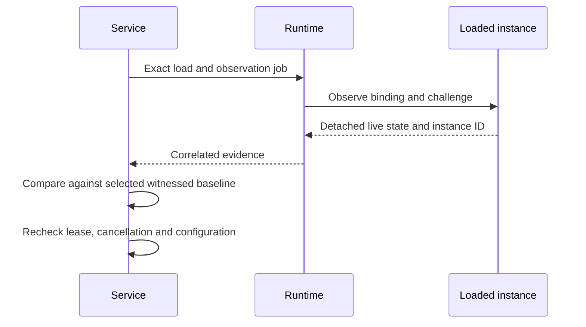
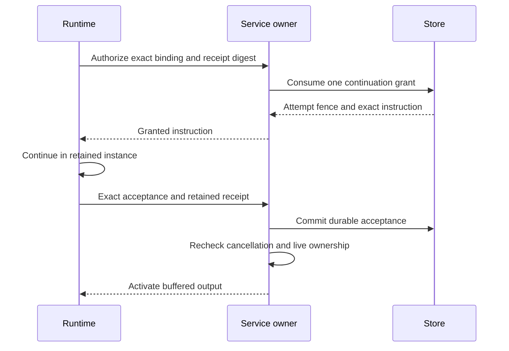

# Live loading observations

A successful private loading handshake establishes framing and correlation. It
does not establish that a backend imported the checkpoint, stayed inert or retained
its native history. The additive `context_observe_v1` capability defines a separate
private exchange for a detached observation of the same live loaded instance.
Ordinary protocol 1 and the six context-v2 frames are unchanged.

## Correlation and private bytes

The request binds the loading scope, a fresh UUIDv4 job ID, the existing Begin
binding and the selected comparison-profile digest. The Begin binding already
covers the checkpoint, record, witness, configuration and retention identities.
The execution owner supplies a fresh unpredictable UUIDv4 challenge for each job.

| Frame | Contents and meaning |
| --- | --- |
| `context_observe_v1` | Binding and challenge; asks the retained owner to inspect live state without execution. |
| `context_observed_v1` | Exact binding, instance UUID, detached observation length/digest/base64 and final challenge. All returned content is evidence requiring trusted validation. |
| `context_observation_rejected_v1` | Exact binding, fixed failure category and final challenge; no observation, grant or diagnostic payload. |

Request and response decoding are directional. Unknown and duplicate fields fail,
including nested bindings. Bodies are nonempty and limited to 1 MiB; the frame
limit is 2 MiB. Base64 must be canonical, with exact byte length and SHA-256.
Oversized observations fail rather than dropping records. No raw native data is
stored in public events or diagnostic messages by this codec. Private frame and
payload wrappers have no ordinary debug or serialization implementation.

## Evidence and authority

The instance UUID is correlation metadata, not proof of process continuity. The
runtime must retain one loaded child and one output reader from import through
validation and continuation. The adapter must inspect that retained live instance,
return detached data, and prevent mutation while validation is pending. Reading
submitted checkpoint bytes or echoing their digest is insufficient.

The registered trusted comparator must validate the actual observed native prefix,
identity, input/tool/result mappings, model/configuration and inert import under its
explicit supported profile. Hash agreement only checks transport integrity. A
correlated rejection is still rejection; `check_response` does not produce native
approval. Unsupported inspection must terminate the loading workflow with checked
cleanup, without confirming restoration or admitting an attempt.

Potentially blocking import and inspection require supervised process ownership,
bounded deadlines and explicit stop/join on failure. A detached thread timeout or
best-effort destructor cannot establish successful cleanup. A later valid native
comparison still grants no continuation: the service must consume the actual store
permit and persist exact acceptance before activating tool or message effects.

## Implementation status

### Service loading ownership

`RestorationOwner` owns the store connection and loading fence on a separate
thread. Its watchdog starts before database acquisition, so lock contention counts
against the lease budget. Only successful heartbeats extend that budget; an expired
watchdog cannot be revived by a late database response. Local cancellation remains
sticky, including hard cancellation followed by a weaker request.

The owner returns correlated reservation metadata and one selected baseline.
`bind_plan` checks the selected checkpoint, record, witness, configuration and
payload identities before pinning the loading descriptor. `register_loaded`
matches the retained runtime owner's scope and Begin binding and retains its
cleanup observer. These checks do not authenticate a native comparison or prove
that a trusted caller never created another identically described process.

Runtime polling remains independent of database operations. After handing off the
baseline, the actor releases the reservation only after matching runtime cleanup
reports Complete. Missing, failed or unfinished cleanup leaves an explicit release
error and may require lease-expiry recovery. Explicit shutdown reports operation,
release, expiry and watchdog failures; a destructor is only a fallback. Joining the
database actor can still wait on SQLite's busy handling after the runtime child has
been stopped.

### Registered validation and continuation

The application registers a trusted native comparator and selects its policy and
historical associations before requesting an observation. A dedicated worker
receives the actor's retained baseline and the runtime's correlated observation.
The database actor continues heartbeating while comparison runs. Comparator code
must either perform bounded work without blocking I/O or supervise its own process
with cancellation, deadlines and checked cleanup. Registration trusts that code;
an arbitrary successful callback is not independent evidence of native correctness.

The actor matches the result to its exact job, input, registration and instance,
then rechecks the selected baseline, live lease and runtime cleanup state before
confirming restoration. Historical checkpoint configuration remains separate from
the effective continuation configuration. Both commitments are retained in the
validation binding; changing the effective policy requires a new validated selection.

The continuation endpoint selects one exact queued instruction. Runtime supplies
the digest of its retained receipt before authorization. The actor consumes the
actual Store grant and retains the attempt fence before returning the instruction.
A lost reply cannot produce a second permit. Exact acceptance is committed under
that fence before activation; cancellation and lease expiry can still reject
activation after the database commit.

Service tests exercise actual storage ownership, grant and acceptance with fixture
comparators and adapters. They do not establish support for a native provider.
Separate integration evidence covers a bounded native text-only profile: fresh
capture, inert restoration, one authorized continuation, witnessed child publication
and a second inert restoration. The provider response is scripted and tools are
disabled. This evidence does not enable CLI checkpoint resume or establish support
for arbitrary providers, tools, configuration changes or native disposal callbacks.
Native code may begin continuation after its acceptance frame; runtime gates
persistence and tool/message dispatch on durable acceptance and owner activation.

### Capture and witnessed publication

`FreshCaptureOwner` consumes the store's one-use fresh admission before returning
runtime capture ports. A missing checkpoint or a zero version counter alone cannot
authorize fresh execution. If setup fails after admission, the owner retains the
attempt fence while reporting cleanup and release results.

Publication uses a registered native comparator with the current capture snapshot,
runtime validation job, selected policy and historical associations. For restored
execution, it also supplies the selected witnessed baseline and durable continuation
acceptance. The comparator must check the complete native history and its mappings;
matching a candidate digest alone is insufficient.

Runtime cleanup must complete before the service accepts a prepared capture for
finalization. The store then checks the live fence, cancellation, current cut and
witness facts in the atomic checkpoint transaction. Associations returned by a
comparator remain provisional until matched to that successful checkpoint commit.
A failed comparison or failed commit cannot become the next restoration baseline.

### Runtime inspection

The contracts crate supplies the private codec and pure correlation checks.
The runtime library provides ordered loading and one observation job through the
same retained process and output reader. Its immutable `Inspect` purpose requires
restore support; `PrepareContinuation` additionally requires continuation support.
Inspection cannot upgrade to continuation. Both modes retain the exact payload,
scope and descriptor checks, and callers can require additional capabilities.

The service must keep polling the retained owner while storage or native validation
runs separately. Observation never extends the original retained deadline.
Cancellation, owner disconnection, malformed or unexpected output and correlated
rejection stop loading through checked process cleanup. An explicit close reports
cleanup errors; a surviving cleanup observer also records failed fallback cleanup.
Neither successful cleanup nor the instance ID proves native semantic correctness.

Codec fixtures exercise direction, every correlation field, rejection distinctions,
strict nested decoding, canonical body integrity and exact size boundaries. They
are not proof of native restoration. Runtime subprocess fixtures additionally
cover sequencing, capability requirements, same-process routing and revocation.
Trusted service validation, continuation admission and witnessed publication remain
required by the [session contracts](contracts.md) and
[restoration workflow](restoration.md).
