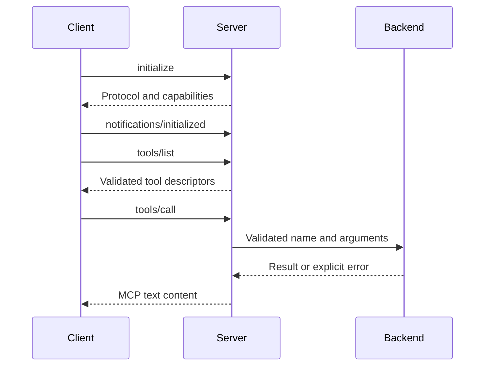

# MCP library boundary

`foundry-mcp` exposes a synchronous local MCP server library. A caller supplies a
backend and invokes `serve_stdio`, or supplies in-memory streams through `serve`.
The executable exposes this transport through `f5y mcp`, with an explicit
`--database PATH` or `FOUNDRY_DATABASE`. Executable integration tests cover stdio
framing and persistence across processes. The official Python SDK has also been
tested against the executable. Native Claude and Codex clients have exercised all
five tools through prepared packages using local protocol fixtures; those checks
do not establish model interpretation or GUI editor setup.

## Connection lifecycle

The supported protocol versions are `2025-06-18` and `2025-11-25`. Initialization
requires a string protocol version, client name, client version and capabilities.
The server echoes a supported requested version; otherwise it selects its latest
supported version, `2025-11-25`. A client unable to use that selection should
disconnect. An accepting client sends its initialized notification before tools
are available. Missing or non-string versions are invalid parameters. Both
versions use the same advertised tools, schemas, metadata and result encoding.
Ping is available during the handshake. Notifications do not dispatch tools or
receive responses.

## Exposed tools

| Tool | Required fields | Optional fields |
| --- | --- | --- |
| `session_create` | `prompt`, `directory` | `idempotency_key` |
| `session_list` | None | None |
| `session_get` | `session_id` | None |
| `session_send` | `session_id`, `message`, `message_id` | None |
| `session_cancel` | `session_id`, `mode` | None |

Fields are strings. Cancellation mode is `graceful` or `hard`. Prompts and
messages accept 1 to 65,536 Unicode scalar values at this interface. Backend
validation can be stricter, including rejecting blank prompts or lifecycle
conflicts. A schema-valid call does not imply the backend implements it. The executable
backend supports create, list, get, cancel and send against local storage. Create
returns a queued session without starting execution, even when
`FOUNDRY_ADAPTER` is configured. `session_send` enqueues a durable instruction
without starting or resuming execution. Its explicit `message_id` is idempotent
within the session: identical retries retain current state; conflicting text is
rejected. It does not reset an in-flight or withdrawn record.

A newly queued instruction returns state `pending`, `delivery_not_confirmed: true`
and `completion: "not_confirmed"`. The delivery flag is false only for a record
already marked delivered. Completion remains unconfirmed even then. Queue
submission does not itself perform adapter delivery or establish that work
finished. A separate running service can consume the same durable queue after
receipt capability negotiation.

Successful backend values are encoded as JSON inside MCP text content. Backend
failures set `isError` and include a code and message. Backend implementations
must keep sensitive diagnostic data out of these messages.

## Transport and missing capabilities

The stream transport accepts newline-delimited UTF-8 JSON with a 2 MiB payload
limit. Malformed JSON receives a parse error. Oversized or unterminated frames
receive an error and end the connection. Clean EOF between frames ends normally.
Stdout contains protocol messages; diagnostics use stderr.

Unknown methods, bad arguments, invalid request envelopes and batch requests
are rejected. Oversized serialized responses are replaced by an error, but the
backend value has already been allocated. The single-frame `handle` API does
not provide the transport's output allocation check.

This interface does not implement remote authentication, an HTTP endpoint,
OAuth, subscriptions, pagination, resources, prompts, sampling or a tool-execution
cancellation channel. A `session_cancel` backend call is distinct from cancelling
an in-flight protocol request. Model selection is not exposed in these tools.

Protocol tests use an in-memory backend and streams to verify handshake, routing,
validation, error encoding and frame limits. Separate executable tests now verify
stdio startup and [stored sessions](storage.md), including creating a queued
record and reading it from a later process. No provider calls occur. Editor
configuration recipes still require GUI-client verification. The
[official SDK check](../../tests/mcp-sdk/README.md) covers initialization, tools,
metadata, optional progress callbacks and persistence across server processes.
The server does not promise progress notifications. This is scoped stdio
interoperability evidence, not full protocol conformance or hosted authentication.
