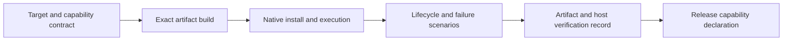

# Native platform target contract

Foundry requires six native OS/architecture targets. A target declaration, successful
cross-build, parser test or development environment is not proof of native product
support. Each target needs implementation and verification for its applicable
capabilities. An unavailable implementation remains a delivery gap.

Current implementation includes CLI parsing, local runtime/configuration foundations
and durable storage/network library work. Network CLI execution, plugin installation,
complete client/backend integration and native release verification remain separate
work. The [development environment](../development/environment.md) declares four
Unix environments and does not provide native Windows support. That limitation does
not remove Windows from this product contract. The [runtime architecture](runtime-decision.md)
selects a Rust service with an injected SDK adapter; architecture selection does not
approve every dependency or establish provider/native platform readiness.

## Required artifact targets

| Native target | Artifact requirements | Verification that cannot be substituted |
| --- | --- | --- |
| macOS aarch64 | ARM64 binary and applicable signed replacement identity | Native ARM64 install, runtime, permissions, IPC, clients and service lifecycle |
| macOS x86_64 | Intel binary with independently qualified dependencies | Native Intel results; ARM64 success does not transfer |
| Linux aarch64 musl | ARM64 musl-qualified network artifact | Native musl package/startup/dependency evidence, not an unqualified Linux test run |
| Linux x86_64 musl | x86_64 musl-qualified network artifact | Native musl package/service evidence, not just a configured CI target |
| Windows aarch64 MSVC | Native ARM64 artifact, static CRT for network binary | Native ARM64 Windows process, IPC, install and client evidence; x64 emulation is insufficient |
| Windows x86_64 MSVC | Native x64 artifact, static CRT for network binary | Native Windows evidence; WSL, Unix CI and cross-compilation are insufficient |

Additional declared Linux aarch64/x86_64 GNU artifacts retain their own libc,
build, package and execution obligations. They do not replace musl targets.
Minimum OS versions, CPU features and exact libc baselines remain release-owner
decisions requiring recorded dependency and native-host checks. CI runner names
must not be presented as minimum supported versions.

Windows distribution qualification must explicitly record beta/stability and
unsigned/signed status. Preserve beta and unsigned constraints in any applicable
profile until independently qualified; never turn them into a claim of signing,
general availability or an exemption from Windows support. Worker metadata must
represent Windows distinctly rather than labeling it Linux or macOS. Personal
Windows connection and named-machine enrollment/service are separate capabilities;
an enrollment schema limited to other OS values is an unresolved interface gap.

## Prerequisites are not verification

| Layer | Required distinction |
| --- | --- |
| Compiled binary | Verify actual linked dependencies and host ABI; do not impose development Node/Bun tooling on every binary user |
| JavaScript package installation | The applicable package profile retains Node 18-or-newer prerequisite; this does not select the production service language or prove SDK operation |
| SDK adapter | Record its actual runtime, dependency versions, native support and subprocess requirements separately from the binary |
| Windows local execution | Retain Git Bash and Python prerequisites where the local workflow needs them; identify supported versions/paths and quoting behavior before release |
| Windows initial sandbox setup | Keep elevated first-connect setup distinct from ongoing user operation and personal versus named-worker enrollment |
| Desktop/browser features | Discover installed components, versions, permissions and supported host APIs; installation alone is not ready status |
| Client adapters | Record supported client/version/OS/architecture and scope; a package descriptor or shared layout is not installation proof |
| Developer and CI tooling | Supply pinned native Windows tooling with equivalent required checks; Unix environment declarations and package availability are not native activation evidence |

Missing, outdated, needs-permission, unavailable/not-applicable and ready outcomes
must remain distinguishable. Unsupported capability must fail explicitly before
partial installation or launch, without silently changing OS, client, worker or
execution target. Do not substitute WSL for requested native Windows execution.
An OS-specific feature can report not-applicable only for that feature, not for
the entire CLI/network platform.

## Capability obligations on both architectures

Every cell applies independently to both architectures for the OS. Required means
target scope; it does not claim implementation or successful verification.

| Capability | macOS | Linux | Windows |
| --- | --- | --- | --- |
| CLI grammar/help/configuration/text/JSON and plugin management | Required | Required | Required |
| Local prompt/run and persistent session list/watch/send/resume/cancel | Required, selected lifetime profile explicit | Required, selected lifetime profile explicit | Required with native shell/process handling |
| Cloud/API/accounts/providers, TUI/ACP and client continuation | Required | Required | Required |
| Network identity/team/invites/proofs/routing/attachments/held approval/relay | Required | Required | Required |
| Private state and local network IPC | Unix socket, selected-home isolation | Unix socket, selected-home isolation | Named pipe bound to canonical home and per-user ACLs |
| Network service lifecycle | launchd | systemd user service; explicit absent-systemd result | Per-user logon Run entry |
| Named workers and connect/disconnect/stop/serve | Required; enrollment/lifetime profile explicit | Required; enrollment/lifetime profile explicit | Required interface work; do not infer named-service support from personal connect |
| Desktop install/minimal/status, browser/computer operations | Required applicable capabilities | Required applicable capabilities | Required applicable capabilities |
| Privacy and personal browser readiness | Screen/accessibility/disk permission APIs and qualified Chrome support | Applicable host APIs; macOS panes not applicable | Applicable host APIs and initial sandbox setup obligations |
| Network tray | macOS menu bar | No menu-bar tray requirement established | No menu-bar tray requirement established |
| Notifications and user approval | Required | Required | Required |
| Client adapters/hooks/MCP/native bridge | Required per supported installed client | Required per supported installed client | Required per supported installed client |
| Client packages for Claude/Codex/Cursor/Grok | Required where client supports host | Required where client supports host | Required where client supports host |
| Install/update/uninstall and notices | Signed replacement identity and recovery | libc-qualified artifacts and recovery | Archive/PowerShell/shims, waiting-copy for locked executables and recovery |
| Native product build/test route | Required | Required | Required independently of Unix developer environments |

Unix IPC must retain a short-path fallback for long selected homes without losing
state-root identity. All platforms isolate private identity, databases and sidecars,
inbox, locks, logs, caches and service endpoints. Permission bits and Windows ACLs
need separate checks. A service launch must select the same home/configuration as
the CLI that installed it. Service removal must not erase unrelated startup entries,
client configuration or identities.

Network adapter availability is per client and capability. Preserve push delivery
versus hook/inbox retrieval, client-native protocol allowlists and notification
approval semantics. Unavailable client/host combinations need explicit diagnostics,
not a fictitious installation or silent switch to another adapter. Network tray
limits do not remove cross-platform notification and approval requirements.

## Profiles that must remain distinct

The platform contract does not collapse differing lifetime, privacy or enrollment
profiles into whichever one is easiest to implement:

- Command-owned local workers and background-persistent workers have different
  terminal-close, cancellation and reconnect requirements.
- Confined personal desktop access and personal unsandboxed connection require
  distinct disclosure, permission and execution boundaries.
- A named-machine sandbox request that cannot host sessions is not a successful
  session-capable worker. Retain the sandbox intent and explicit capability result.
- Windows elevated first-connect setup is separate from normal user operation.
- Older capacity 1–4 profiles and current deprecated no-op capacity inputs remain
  separate behaviors; parsing an ignored value is not enforcement of capacity.
- Chrome/desktop/mentions support claims limited to macOS, covering macOS/Windows,
  or covering all three OS families require explicit capability/profile selection.
  Do not announce universal readiness from one host's permission checks.
- Unix named-worker service requirements do not settle Windows named enrollment
  or service behavior. General Windows support and beta/unsigned distribution
  qualifications are recorded independently.

The configuration/state/profile-policy owners define selection and shared DTOs.
Platform code must preserve these distinctions and surface unresolved combinations;
it must not invent a universal sandbox switch, enrollment mapping or fallback.

## Verification and release acceptance

Keep per-target implementation status separate from verification status. Each
release record binds the exact commit and artifact digest, target triple,
compiler/toolchain, libc or CRT, minimum tested host, applicable client/runtime
versions, test scope and result. A build can pass while installation or service
behavior remains unavailable. Evidence for one architecture, libc, client or
synthetic adapter cannot be promoted to another cell. A synthetic artifact identity
is not a final release identity.

| Scenario group | Required observations on each applicable native target | Owner |
| --- | --- | --- |
| Grammar and dispatch | Entire command contract, including hidden network routes, wrappers and six client workflows; no architecture skips concealed by aggregate counts | CLI and functional owners |
| Packaged startup and state | Correct architecture/libc/CRT, dependencies, state-root identity, file permissions/ACLs, IPC permissions, long paths, Unicode, spaces and case collisions | Release and network |
| Shell and replacement | Shell/PowerShell/package-shim quoting, executable paths, atomic replacement limits, locked executable waiting-copy and failed-update recovery | Release and runtime |
| Service lifecycle | Isolated-user install/start/login/restart/crash/stop/remove; absent systemd; Windows Run isolation; unchanged unrelated startup state | Network, workers and release |
| Process and session lifetime | Cancellation and whole process-tree cleanup, terminal close, reconnect and persistence under each selected profile; Windows console events | Runtime and workers |
| Packages and clients | User/project/all discovery, registration/removal, exact ownership, rollback, reload, each supported client/version/host and explicit missing-client outcome | Client adapters and release |
| Desktop and permissions | Missing/outdated/permission/ready distinctions; capability-specific privacy, browser and sandbox profiles; no readiness inferred from installation | Desktop and workers |
| Network behavior | Identity/admission, all message destinations, acknowledgments, attachments, held/approval, relay/discovery, root isolation, protocol failures and notifications | Network |
| Distribution | Exact artifact manifests, checksums/signature policy, install/update/uninstall, recovery and mandatory notices; only owned/configured services contacted | Release |

Unknown minimum versions, native dependency support and discovery paths require a
bounded native probe and recorded decision by the release/developer-tooling owners.
Desktop portability requires isolated host capability/permission probes. Windows
named-machine enrollment requires a concrete schema and native lifecycle fixtures.
Client adapters require a supported-version/path/scope/reload table. None of these
records is supplied by merely listing a target or running shared parser fixtures.

These are acceptance scenarios, not tests executed by this document. See the
[network and plugin contract](cli-network-plugin-contract.md) for command/backend
requirements and [CLI configuration](cli-configuration.md) for injected settings.
