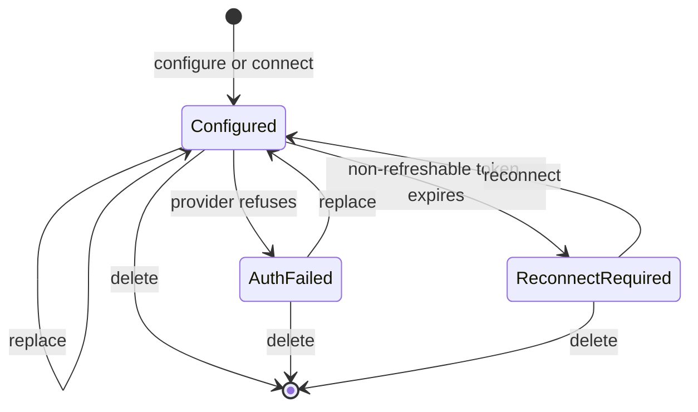
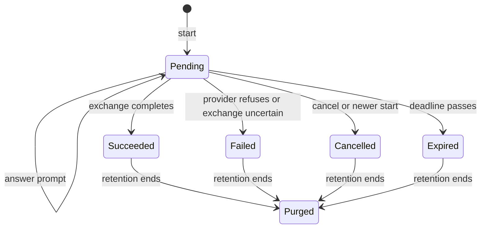

# Provider, model and budget behavior specification

This page specifies the observable behavior of provider setup, model selection,
budgets and consumption reporting that the external capability audit still lists
as not verified. For each operation it records inputs, limits, defaults, error
classes, idempotency, ordering and state transitions, and it separates what
Foundry implements today from behavior that is only specified. A specified
operation is not available until its implementation and tests land. Nothing here
claims parity with another product.

The neutral fixtures in [`tests/providers`](../../tests/providers/README.md)
encode the same rules as request, response and transition vectors. Their offline
validator runs in the shared Python check group.

## Authority and naming

The authority for scope is the external audit file
`~/.local/share/foundry-audit/capabilities.json`, rows whose
`owner.proposed_ticket_group` is `GAP-013`. Row identifiers such as `CLI-032`,
`AG-12` and `API-E5297A5569474` are neutral and appear below; source identities,
evidence and the wire mapping stay in that external directory. Every row remains
`not_verified` there. A label on this page does not change that status.

Operation names such as `providers.catalog` are neutral Foundry names. **All wire
names are provisional pending the naming decision** (NIC-34 D1 and D6, and NIC-46
D46-7). That covers transport paths, HTTP methods, field names, error strings,
provider identifiers and cursor encodings. Provider identifiers are neutral
Foundry labels such as `fixture`, `hosted-a` or `local-a`; the mapping to any real
service stays external. HTTP status numbers are given only as the provisional
mapping for an HTTP transport, which is itself an open decision.

## Status labels

| Label | Meaning |
| --- | --- |
| Local foundation | Foundry implements a narrower local behavior, cited to tests. The full specified behavior is still missing. |
| Specified | Behavior is defined here; no Foundry implementation exists. |
| Held | Specified, but implementation waits on a user decision or another ticket. |

## Coverage index

| Row | Operation | Label | Section |
| --- | --- | --- | --- |
| CLI-027 | `cli.providers_connect` | Local foundation | [Connect a provider from the CLI](#connect-a-provider-from-the-cli) |
| API-E5297A5569474 | `providers.catalog` | Local foundation | [Provider catalog and inference status](#provider-catalog-and-inference-status) |
| API-E1BC704592670 | `providers.status` | Specified | [Provider catalog and inference status](#provider-catalog-and-inference-status) |
| API-E12E38D9F7C28 | `credentials.list` | Local foundation | [Provider credentials](#provider-credentials) |
| API-E5BEDB65EA9B9 | `credentials.configure` | Local foundation | [Provider credentials](#provider-credentials) |
| API-EE72FDBBD3375 | `credentials.validate` | Local foundation | [Provider credentials](#provider-credentials) |
| API-E817CF68A9E53 | `credentials.delete` | Local foundation | [Provider credentials](#provider-credentials) |
| API-EBD6CBFF835BE | `credentials.connect_subscription` | Held | [Subscription connection](#subscription-connection) |
| API-EFAE326F7F539 | `oauth_logins.start` | Held | [Provider OAuth logins](#provider-oauth-logins) |
| API-E40CE908FFC7A | `oauth_logins.start_keyed` | Held | [Provider OAuth logins](#provider-oauth-logins) |
| API-E90F0EE28B9DB | `oauth_logins.list_pending` | Held | [Provider OAuth logins](#provider-oauth-logins) |
| API-E2A7C9B425D67 | `oauth_logins.get` | Held | [Provider OAuth logins](#provider-oauth-logins) |
| API-E2CBA38EEBB25 | `oauth_logins.respond` | Held | [Provider OAuth logins](#provider-oauth-logins) |
| API-E4881077B6501 | `oauth_logins.cancel` | Held | [Provider OAuth logins](#provider-oauth-logins) |
| API-E28E3F3BCFA6D | `accounts.check` | Local foundation | [Account checks and provider usage](#account-checks-and-provider-usage) |
| API-E7619AD9B11AD | `accounts.usage` | Held | [Account checks and provider usage](#account-checks-and-provider-usage) |
| API-EA0E3BF6C25F6 | `models.list` | Local foundation | [Model availability, auto resolution and effort](#model-availability-auto-resolution-and-effort) |
| AG-09 | `session.model_selection` | Local foundation | [Model availability, auto resolution and effort](#model-availability-auto-resolution-and-effort) |
| AG-12 | `budget.*`, `session.rollover` | Specified | [Budgets, reservations, deadlines and review rounds](#budgets-reservations-deadlines-and-review-rounds) |
| API-E288021BA77EC | `consumption.daily` | Specified | [Consumption reports](#consumption-reports) |
| API-EB9835E1A1E93 | `consumption.metrics` | Specified | [Consumption reports](#consumption-reports) |
| API-E2F0CEEFEB828 | `consumption.quota` | Held | [Consumption reports](#consumption-reports) |
| CLI-032 | `endpoint.admit`, `endpoint.failure` | Local foundation | [Local and custom endpoints](#local-and-custom-endpoints) |

Benchmark and live-model campaign equivalence (audit deviation DEV-003) is not a
row here. It stays unverified unless D46-4 authorizes a campaign; deterministic
fixtures cannot establish it.

## Shared rules

### Error classes

Every failure carries one neutral class, decoded tolerantly as in the
[session API](session-api.md#error-classes): a string class and a nested object
form are both acceptable. Unknown classes are treated as `unavailable` for retry
purposes, never as success.

| Class | Provisional HTTP | Meaning | Foundry today |
| --- | --- | --- | --- |
| `invalid_request` | 400 | Malformed body, unknown field, out-of-range value, effort the model does not offer | `SelectionError`, CLI parse errors |
| `insecure_transport` | 400 | A public endpoint without HTTPS | `ConnectorError::InsecureTransport` (connector client), `EndpointError::InsecureTransport` (local endpoint client) |
| `unauthenticated` | 401 | Missing, invalid or expired caller credential | No authentication |
| `budget_exhausted` | 402 | A local budget ceiling or deadline refuses the work; carries the budget ID and cause | Not implemented |
| `quota_exhausted` | 402 | A provider account, hosted plan or billing refuses the work; carries a cause code | Not implemented; hosted billing Held D46-5 |
| `forbidden` | 403 | Caller lacks scope, role or ownership of the account or login | `CredentialError` (provider credentials) |
| `endpoint_not_permitted` | 403 | A loopback, LAN or tailnet endpoint without its explicit opt-in | `ConnectorError::UnsafeHost` (connector client), `EndpointError::NotPermitted` (local endpoint client) |
| `not_found` | 404 | Provider, account, login or model is absent or not visible | `CredentialError` (provider credentials) |
| `conflict` | 409 | Key reused with a different intent; stale prompt; login not pending | `CredentialError` (provider credentials), for a slot state an operation does not apply to |
| `model_unavailable` | 409 | The named model exists but cannot run now | Not implemented |
| `gone` | 410 | A keyed login's receipt survives but its result was purged | Not implemented |
| `unsupported_provider` | 422 | The provider or credential kind cannot serve this operation | `CredentialError` (provider credentials) |
| `rate_limited` | 429 | Caller must wait; carries a retry delay in seconds | Not implemented |
| `endpoint_failure` | 502 | An endpoint call failed; carries one category from the table in [local and custom endpoints](#local-and-custom-endpoints) | `EndpointError::Failure` (local endpoint client) |
| `unavailable` | 503 | Credential or login storage temporarily unavailable | `CredentialError` (provider credentials) |
| `unsupported` | none yet | Operation or capability not built in this binary | CLI `unsupported`, exit status 2 |

### Provider descriptors

A provider descriptor is public, secret-free configuration. Every operation that
names a provider uses its `provider_id`.

- `provider_id`: 1 to 64 characters, lowercase ASCII letters, digits and hyphens,
  starting with a letter. It is a neutral Foundry label, never a vendor name, and
  stays within the 128-byte provider bound that
  [`AdapterSelection`](../../crates/contracts/src/adapter_selection.rs) admits.
- `kind`: `hosted_api`, `local_endpoint` or `fixture`.
- `auth_kinds`: a nonempty subset of `api_key`, `oauth` and `none`; `none` is
  valid only for `local_endpoint` and `fixture`.
- `config_fields`: the non-secret settings an API-key connection takes, each with
  a name, label and required flag. A field marked secret is not a config field.
- `oauth_login`: either available, with `methods` drawn from `browser`,
  `device_code` and `interactive`, a `default_method` from that list and an
  `account_mode` of `single` or `multiple`; or unavailable with cause
  `not_supported` or `not_enabled`. Registry support alone never implies that a
  login can start.
- `efforts`: the effort vocabulary the provider's models may offer, a subset of
  the contract vocabulary `off`, `minimal`, `low`, `medium`, `high`, `xhigh`,
  `max`.
- `endpoint`: for `local_endpoint`, the network class rules below.

Descriptors carry no keys, tokens, account labels or usage. Display labels for
real services stay in the external mapping (D46-7).

### Credential states

A saved credential is an account slot: a `provider_id`, an `account_key` (1 to
512 characters), a credential kind and a state. Values are write-only. A read
returns kind, state, configured non-secret field names, timestamps, and for a
failure the failure code and time; it never returns a key, token or secret
answer, not even masked.



| From | Event | To |
| --- | --- | --- |
| absent | configure | configured |
| configured | replace | configured |
| configured | provider_refused | auth_failed |
| configured | token_expired | reconnect_required |
| auth_failed | replace | configured |
| reconnect_required | reconnect | configured |
| configured, auth_failed, reconnect_required | delete | absent |

A refreshable OAuth credential refreshes silently while it stays `configured`.
A failed refresh becomes `auth_failed`. A long-lived token that cannot refresh
becomes `reconnect_required` when it expires or is refused; it is never retried
with the old value.

### Secrets and redaction

- Keys, tokens, refresh tokens and secret prompt answers are write-only. No
  response, event, log line, error text or vector expectation contains them.
- The CLI reads a token from standard input only when asked, without echo, and
  never from an argument.
- Credentials are selected explicitly. Foundry never discovers them from account
  files, ambient environment variables or symbolic links; see
  [adapter configuration](adapter-configuration.md).
- Endpoint error text never contains the endpoint URL, a key or a response body.

### Consumption units

Every recorded or reported amount names its unit. Floats are not used.

| Unit | Representation | Notes |
| --- | --- | --- |
| `input_tokens`, `output_tokens` | Unsigned 64-bit integer | Counted per model call, as the provider reports them |
| `compute_ms` | Unsigned 64-bit integer, milliseconds | Execution wall time charged to a budget |
| `money` | Decimal string, at most 9 fractional digits, nonnegative, with an ISO 4217 currency code | Never a binary float; `0.1` plus `0.2` is exactly `0.3` |
| `credits` | Decimal string as for money | Held D46-5: only hosted billing defines a credit |

Reports are read-only. Daily series use UTC calendar days. A window's start is
included and its end is excluded.

### Limits and defaults

| Limit | Value | Behavior outside the range |
| --- | --- | --- |
| `provider_id` | 1 to 64 characters | `invalid_request` |
| `account_key` | 1 to 512 characters | `invalid_request` |
| API key or token | 1 to 8,192 bytes | `invalid_request` |
| OAuth prompt answer | 0 to 8,192 bytes | `invalid_request` |
| Model ID | 1 to 256 bytes, no NUL | `invalid_request` |
| Budget wall clock | 0 (no deadline), or 60,000 to 3,600,000,000 ms | `invalid_request` |
| Review rounds | 1 to 16, default 4, including the first pass | `invalid_request` |
| Consumption window | at most 366 days, default the last 30 days | `invalid_request` |
| Money amount | at most 9 fractional digits | `invalid_request` |

## Operations

### Connect a provider from the CLI

Audit rows (external `capabilities.json`, group GAP-013): CLI-027.
Vectors: `tests/providers/vectors/cli.json`.

**Foundry today.** `f5y providers connect PROVIDER` parses into an exact request
with `pair`, `browser` and `token_stdin`. `--pair` excludes `--browser` and
`--token-stdin`, and `--browser` excludes `--token-stdin`. No backend implements
the request, so nothing is connected; no test covers its execution yet. Evidence:
[`computer_routes.rs`](../../apps/cli/tests/computer_routes.rs)
(`desktop_permissions_accounts_and_update_routes_preserve_exact_shapes`) and
[`computer_contract.rs`](../../apps/cli/tests/computer_contract.rs)
(`credential_modes_and_worker_lifetime_are_exclusive`).

**Specified.**

- The positional argument is a neutral `provider_id` from the catalog. An unknown
  provider is `not_found` before any prompt, browser or network call.
- `--token-stdin` reads one token from standard input without echo and stores it
  through `credentials.connect_subscription` or `credentials.configure`. An empty
  input is `invalid_request`.
- `--browser` starts an `oauth_logins.start_keyed` login with method `browser`
  and a loopback callback. When the callback cannot bind, the CLI prints the
  authorization link and accepts a pasted code through `oauth_logins.respond`.
- `--pair CODE` completes a login started on another device. Its semantics and
  the default flow with no option are deployment decisions.
- Output never contains the token, the code or the authorization link's state
  parameter.

**Held.** Subscription and browser flows wait on D46-2. The pairing default and
isolated setup-token configuration wait on D46-2 and the CLI deployment decision.

### Provider catalog and inference status

Audit rows (external `capabilities.json`, group GAP-013): API-E5297A5569474,
API-E1BC704592670.
Vectors: `tests/providers/vectors/descriptors.json`.

**Foundry today.** The `foundry-providers` catalog validates secret-free
descriptors (kind, auth kinds, config fields, login availability, effort
vocabulary and endpoint format, with `chat` as the local endpoint default) and
lists them in `provider_id` order. Availability comes from an injected
credential source, which the credential store provides per workspace. No operation, transport or
authentication exposes the catalog, and `providers.status` is not implemented.
Execution still takes its provider identity only from the explicit
`selection.provider` string in private adapter configuration. Evidence:
[`catalog.rs`](../../crates/providers/tests/catalog.rs)
(`providers_are_listed_in_id_order_without_credential_state`,
`oauth_login_needs_oauth_and_a_listed_default_method`,
`local_endpoint_format_defaults_to_chat_and_fixtures_take_none`,
`availability_follows_configured_credentials_of_an_accepted_kind`) and
[`adapter_selection.rs`](../../crates/contracts/tests/adapter_selection.rs)
(`unsupported_or_unbounded_selection_never_gets_an_identity`).

**Specified.**

- `providers.catalog` lists descriptors for providers a caller may newly connect,
  ordered by `provider_id`. It contains no credential values and no account
  state. Each `oauth_login` entry follows the descriptor rules.
- `providers.status` reports whether each provider kind can serve sessions now:
  `available`, `unavailable` or `unknown`, with the time it was observed. It never
  reads or reveals credentials, and `unknown` is never reported as available.
  Compatibility flags for retired providers are not part of the Foundry surface.
- Errors: `unauthenticated`, `forbidden`, `rate_limited`.

### Provider credentials

Audit rows (external `capabilities.json`, group GAP-013): API-E12E38D9F7C28,
API-E5BEDB65EA9B9, API-EE72FDBBD3375, API-E817CF68A9E53.
Vectors: `tests/providers/vectors/credential_slots.json`.

**Foundry today.** A private adapter configuration file holds one explicit
credential, `api_key` with a provider and value or `none`. Links, wrong
permissions and non-regular files never supply a credential, and errors never
echo the value. Evidence:
[`configuration_tests.rs`](../../apps/cli/src/runner/configuration_tests.rs)
(`explicit_selection_and_private_values_are_preserved`,
`links_permissions_and_nonregular_files_do_not_supply_credentials`,
`file_and_private_value_limits_reject_without_echoing_input`).

The `foundry-providers` credential store implements configure, list, validate
and delete for API keys as a library, with several account slots per provider.
Every slot belongs to one workspace and is invisible from others. Config names
are checked against the provider's own descriptor, and reads return only names
and state. Viewers only read; members manage slots they connected; owners and
administrators manage any slot. Validation runs through an injected validator,
and only the deterministic, offline fixture validator exists. A configured key
leaves the store only through a handoff into the adapter's private inputs. Keys
never appear in `Debug` output, errors or check results, and a replaced or
deleted key is removed from the database file and its WAL.

The store is its own SQLite file with its own version and application ID,
created owner-only (0600). A link, a non-regular, shared or foreign-owned file
or sidecar, and a foreign or newer database are refused before anything is
written. **Keys are stored in plaintext inside that file**: there is no
keychain or at-rest encryption, so protection rests on the file permissions
and the directory the caller chooses. No transport, CLI command or runtime
path uses the store yet; `f5y providers connect --token-stdin` is not wired to
it. Evidence:
[`credentials_lifecycle.rs`](../../crates/providers/tests/credentials_lifecycle.rs)
(`configure_stores_key_and_returns_only_names`,
`several_accounts_per_provider_list_in_provider_then_account_order`,
`config_is_checked_against_and_kept_with_its_own_provider`,
`provider_events_follow_the_state_table`,
`delete_targets_one_slot_or_every_slot_of_the_provider`),
[`credentials_access.rs`](../../crates/providers/tests/credentials_access.rs)
(`members_manage_only_slots_they_connected`,
`workspaces_never_see_or_change_each_others_slots`),
[`credentials_secrets.rs`](../../crates/providers/tests/credentials_secrets.rs)
(`canary_never_appears_in_debug_display_or_errors`,
`delete_and_replace_remove_secret_material_from_disk`,
`handoff_feeds_the_adapter_private_inputs`),
[`credentials_checks.rs`](../../crates/providers/tests/credentials_checks.rs)
(`fixture_validation_is_deterministic_and_saves_nothing`) and
[`credentials_database.rs`](../../crates/providers/tests/credentials_database.rs)
(`new_file_is_owner_only_wal_with_its_own_identity`,
`newer_or_unversioned_credential_files_are_refused_before_wal`).

**Specified.**

- `credentials.list`: every account slot visible to the caller, with the state
  fields from the shared rules, plus a readiness block saying whether the
  credential store is available and which operations the caller may perform.
  Ordered by `provider_id` then `account_key`.
- `credentials.configure`: stores or replaces an API key and optional non-secret
  config for a provider. A config name the descriptor does not list is
  `invalid_request`. Replacing a slot someone else connected needs an owner or
  administrator role, otherwise `forbidden`. The response names the slot and
  configured field names and reports `configured`. Repeating the same request is
  naturally idempotent.
- `credentials.validate`: tests a key without saving it. The outcome is
  `verified`, `rejected` or `unverified`; only `verified` means the key works, and
  `unverified` never means invalid. Against the `fixture` provider the outcome is
  deterministic.
- `credentials.delete`: removes one slot when `account_key` is given, otherwise
  every slot of that provider visible to the caller. Deleting an absent slot is
  `not_found`. A member may delete only slots they connected. Delete never
  cancels a running attempt; that attempt fails at its next provider call.
- Errors: `invalid_request`, `unauthenticated`, `forbidden`, `not_found`,
  `unsupported_provider`, `rate_limited`, `unavailable` when the store is
  unavailable.

**Held.** Validation against a real provider is a paid or live call and waits on
D46-1. Hosted plan gating (`quota_exhausted` for API keys) waits on D46-5.

### Subscription connection

Audit rows (external `capabilities.json`, group GAP-013): API-EBD6CBFF835BE.
Vectors: `tests/providers/vectors/subscription.json`.

**Foundry today.** None.

**Held specification.** Waits on D46-2 and D46-7.

- Accepts either a refreshable OAuth credential (access token, refresh token and
  expiry together) or one long-lived setup token, never both. A partial OAuth set
  is `invalid_request`.
- A long-lived token has no refresh token, is never refreshed, and moves the slot
  to `reconnect_required` when it expires or is refused.
- An optional `account_key` reconnects an existing slot; reconnecting a slot
  someone else connected needs an owner or administrator role.
- The response names the provider and slot and reports kind `oauth`, state
  `configured`. Token values are never returned.

### Provider OAuth logins

Audit rows (external `capabilities.json`, group GAP-013): API-EFAE326F7F539,
API-E40CE908FFC7A, API-E90F0EE28B9DB, API-E2A7C9B425D67, API-E2CBA38EEBB25,
API-E4881077B6501.
Vectors: `tests/providers/vectors/oauth_logins.json`.

**Foundry today.** None. A local OAuth fixture is planned under NIC-111; this
flow is built on it under NIC-121.

**Held specification.** Waits on D46-2 and NIC-111.



| From | Event | To |
| --- | --- | --- |
| pending | respond | pending |
| pending | exchange_completed | succeeded |
| pending | exchange_failed | failed |
| pending | exchange_uncertain | failed |
| pending | cancel | cancelled |
| pending | superseded | cancelled |
| pending | deadline_passed | expired |
| succeeded, failed, cancelled, expired | purge | purged |
| succeeded, failed, cancelled, expired | cancel | unchanged |

- Ownership: a login and its challenges are private to the user who started it.
  Every login operation needs a user OAuth grant of a workspace member; an API key
  is `forbidden`. A member reconnects only slots they connected.
- `oauth_logins.start`: takes a provider and optional method and `account_key`.
  An omitted method uses the descriptor's `default_method`; a method it does not
  list is `invalid_request`; a provider whose login is unavailable is
  `unsupported_provider`. Starting again cancels only the caller's own previous
  pending login for that provider. The response is the login view below.
- `oauth_logins.start_keyed`: as start, plus a caller-chosen `idempotency_key`
  that the caller persists before sending. A replay with the same key and intent
  returns the same login in its current state, including a retained terminal
  result, and never extends expiry or repeats a provider exchange. The same key
  with a different provider, method or account is `conflict`, and the original
  login is unaffected. When the result was purged but the receipt survives, the
  replay is `gone` (provisional HTTP 410, cause `login_result_expired`); new
  intent needs a new key. A client never falls back to an unkeyed start.
- `oauth_logins.get`: the login view: ID, provider, method, optional account,
  status, `expires_at`, events (information, authorization link, device code,
  progress), the current prompt if any, and `next_action`, one of `prompt`,
  `authorize`, `device_code`, `wait` (with a poll delay), `complete`, `failed`
  or `cancelled`. A purged or foreign login is `not_found`.
- `oauth_logins.list_pending`: the caller's own unexpired pending logins as
  metadata only (ID, provider, method, account, status, expiry), ordered by
  provider then login ID, optionally filtered by provider. No challenges, codes
  or prompts. Listing never renews a login.
- `oauth_logins.respond`: answers the current prompt by its ID. A stale prompt
  ID or a login that is no longer pending is `conflict`. The answer is
  write-only and acceptance means only that it was recorded; the caller reads
  the login for the next step.
- `oauth_logins.cancel`: cancels a pending login. Cancelling a retained terminal
  login succeeds and leaves it unchanged. Cancel never disconnects an existing
  account.
- An uncertain token exchange is never replayed. The login fails with cause
  `restart_required`; the caller starts a fresh login and keeps `account_key`.
- Logins are durable across restart until `expires_at`. Provider device codes
  may expire sooner than the login.
- Shared errors: `unauthenticated`, `forbidden`, `not_found`, `rate_limited`,
  `unavailable` when login storage is unavailable.

### Account checks and provider usage

Audit rows (external `capabilities.json`, group GAP-013): API-E28E3F3BCFA6D,
API-E7619AD9B11AD.
Vectors: `tests/providers/vectors/accounts.json`.

**Foundry today.** The credential store's `check_account` implements
`accounts.check` against an injected validator; only the deterministic fixture
validator exists, so no live provider is ever asked. Viewers are refused before
any read. `accounts.usage` is not implemented. Evidence:
[`credentials_checks.rs`](../../crates/providers/tests/credentials_checks.rs)
(`check_reports_metadata_evidence_without_persisting_a_verdict`,
`check_reports_missing_and_unreadable_slots_as_states`).

**Held specification.** Real checks are live provider calls and wait on D46-1
and D46-6; the `fixture` provider makes them deterministic.

- `accounts.check`: checks one saved slot with provider metadata only, never a
  model call. The result reports `connected` (true, false, or null when storage
  cannot be read), `authentication` (`accepted`, `rejected` or `unverified`),
  `capacity` (`available`, `blocked` or `unknown`, for a key budget or a
  subscription quota), each with a cause code, plus `inference: not_tested` and
  the observation time. A missing slot reports `connected: false`, not an error.
  Accepted authentication never establishes model access. No health verdict is
  persisted.
- `accounts.usage`: provider-reported usage windows for one slot, each with a
  label, remaining percentage (0 to 100) and a reset time or null, or
  `unavailable` with cause `unsupported`, `not_connected`, `provider_unavailable`
  or `no_usage`. Exhausted usage never establishes credential validity.
- Errors: `invalid_request`, `unauthenticated`, `forbidden`, `rate_limited`.

### Model availability, auto resolution and effort

Audit rows (external `capabilities.json`, group GAP-013): API-EA0E3BF6C25F6,
AG-09.
Vectors: `tests/providers/vectors/models.json`.

**Foundry today.** Execution admits only an explicit `AdapterSelection`: a
nonblank provider of at most 128 bytes, a nonblank model of at most 256 bytes
without NUL, and an effort from `off`, `minimal`, `low`, `medium`, `high`,
`xhigh`, `max`. Any other effort, including `automatic`, gets no identity.
Provider, model and effort are all part of the selection identity, so a changed
model is a different selection. The CLI accepts `--effort low|medium|high|xhigh`,
rejects other values before configuration, and never chooses a default. The
contract still accepts the literal model string `auto` as an ordinary name.
Evidence:
[`adapter_selection.rs`](../../crates/contracts/tests/adapter_selection.rs)
(`every_mutable_selection_field_changes_the_identity`,
`unsupported_or_unbounded_selection_never_gets_an_identity`) and
[`effort.rs`](../../apps/cli/tests/effort.rs)
(`missing_and_invalid_effort_reject_before_dispatch_or_configuration`).

The `foundry-providers` catalog implements the model list and admission as a
library, not yet wired into session create, follow-up or the runtime. It lists
non-hidden models by provider then model ID with availability, and refuses
unknown, hidden, ambiguous and unavailable models and unoffered efforts with
distinct errors. It resolves `auto` once to the workspace default with a
recorded resolution and no fallback, never drops a session effort silently,
and reports a model or effort override as a new attempt decision. The
Foundry-configured versus connected-account grouping of `models.list` waits on
the credential store. Evidence:
[`catalog.rs`](../../crates/providers/tests/catalog.rs)
(`model_list_is_ordered_flags_availability_and_omits_hidden_models`,
`model_efforts_stay_within_the_provider_and_name_a_default`),
[`catalog_admission.rs`](../../crates/providers/tests/catalog_admission.rs)
(`unknown_unavailable_and_ambiguous_models_are_refused_distinctly`,
`effort_the_model_does_not_offer_is_refused_before_execution`,
`auto_and_an_omitted_model_resolve_once_and_are_recorded`,
`auto_never_falls_back_to_another_model_or_provider`) and
[`catalog_follow_up.rs`](../../crates/providers/tests/catalog_follow_up.rs)
(`model_override_on_a_follow_up_starts_a_new_attempt`,
`session_effort_is_never_dropped_for_a_model_without_efforts`,
`hidden_model_only_continues_a_session_that_uses_it`).

**Specified.**

- `models.list`: models the caller can run, Foundry-configured providers first,
  then connected accounts, ordered by provider then model ID. Each has an ID,
  label, `provider_id`, the efforts it offers (empty when it takes none),
  `available` now, and `hidden` for a model kept only so existing sessions can
  continue. A model is never listed with an effort outside the contract
  vocabulary.
- Explicit admission: session create and follow-up take an optional model,
  provider and effort. A named model must be listed and available, otherwise
  `not_found` or `model_unavailable`. A hidden model is accepted only to
  continue a session that already uses it.
- `auto`: omitting the model or sending `auto` asks for the workspace default.
  Foundry resolves it once, at admission, to a concrete listed model and records
  a resolution with the requested value, the resolved provider and model, the
  catalog revision and the rule applied. The resolution is returned and stored
  on the attempt; `auto` never reaches an adapter or a selection identity. When
  nothing can be resolved the request fails with `model_unavailable`; there is
  no silent fallback to another provider.
- Effort: an effort the selected model does not offer is `invalid_request` before
  any execution. Omitting effort keeps the session's effort, or the model's
  default for a new session, and the effective effort is recorded.
- Changes: a model or effort override on a follow-up starts a new continuation
  attempt. A running attempt's model never changes mid-attempt.

**Held.** Verifying resolution against a real catalog waits on D46-1; benchmark
equivalence of model choice waits on D46-4.

### Budgets, reservations, deadlines and review rounds

Audit rows (external `capabilities.json`, group GAP-013): AG-12.
Vectors: `tests/providers/vectors/budgets.json`.

**Foundry today.** None. Output and pending-text byte ceilings in
`AdapterSelection` bound a single adapter's buffers; they are not budgets.

**Specified.**

- A task budget is optional and has a spend ceiling in one unit from the
  consumption table and a wall-clock deadline. Omitted fields keep account
  limits. Automatic continuations and delegated child sessions share the
  parent's budget; a child can narrow it but never widen it.
- Reservation: before each dispatch Foundry atomically reserves the call's
  maximum cost. A reservation succeeds only when committed spend plus open
  reservations plus the new amount stays within the ceiling. Concurrent
  reservations are serialized; when only one fits, exactly one succeeds and the
  other fails with `budget_exhausted`.
- Settlement: an actual cost at or below the reservation commits the actual
  amount and releases the rest. A cost above the reservation commits the actual
  amount, records an overrun and refuses further dispatch. A cancelled or failed
  call settles what was consumed and releases the rest.
- Deadline: measured from execution admission and includes recovery waits and
  automatic continuations. Zero selects no deadline. When it passes, no new call
  is dispatched, the running attempt is cancelled gracefully and settles
  `suspended` with cause `deadline_exceeded`; it is never `success`.
- Review rounds: when long-running work is enabled, later rounds examine and
  continue the first pass, and a reviewer checks the work against its derived
  acceptance criteria. `rounds_max` counts the first pass. An end the reviewer
  cannot verify settles `exit` with outcome `failure` and cause `needs_review`,
  following the [completion policy](completion-policy.md). Follow-up messages run
  single passes. Unsupported targets are `invalid_request`.
- Rollover: off by default and enabled only by an explicit request field. When
  the session's account is exhausted (`quota_exhausted`, a plan or billing quota
  refusal) or rate limited (`rate_limited`), a later call may continue with
  the same model on another connected account of the same provider. An
  authentication refusal (`unauthenticated`, `forbidden` or an `auth_failed`
  account) never triggers rollover. Each rollover is recorded with the source
  and target account. Without rollover the call fails and the attempt records
  the cause. Isolated benchmark sessions never roll over.
- Tests and audits never trigger automatic charges.

**Held.** Hosted fallback after the last account and credit-denominated ceilings
wait on D46-5; rollover across subscription accounts waits on D46-2.

### Consumption reports

Audit rows (external `capabilities.json`, group GAP-013): API-E288021BA77EC,
API-EB9835E1A1E93, API-E2F0CEEFEB828.
Vectors: `tests/providers/vectors/consumption.json`.

**Foundry today.** None.

**Specified.**

- `consumption.daily`: one entry per UTC day with activity, oldest first, over a
  window that defaults to the last 30 days, plus window totals. Grouping by
  session or by user returns whole-window totals instead, highest spend first,
  with `unattributed` for usage without a session or user. Amounts follow the
  consumption units.
- `consumption.metrics`: a time series of `input_tokens`, `output_tokens` and
  `compute_ms` per bucket, default bucket one day, default window the last 30
  days. Reading it changes nothing.
- A window whose start is not before its end, or longer than 366 days, is
  `invalid_request`.

**Held.** `consumption.quota` reports which hosted quota applies, the percentage
used, the reset time and whether it is exhausted, each null when unknown. It
needs hosted billing and waits on D46-5 and D46-6. Purchased credits in daily
reports also wait on D46-5.

### Local and custom endpoints

Audit rows (external `capabilities.json`, group GAP-013): CLI-032.
Vectors: `tests/providers/vectors/endpoints.json`.

**Foundry today.** The `foundry-providers` local endpoint client applies the
network classes below to model endpoints. It takes the wire format from the
catalog descriptor and serves only explicitly listed model IDs. Each call
resolves once, admits every answer and connects only to those addresses, so a
rebound name or mixed answers never connect. Redirects are reported as `http`
failures and never followed, and proxy variables are ignored. One bounded
timeout (at most 300 seconds) covers lookup, connection and reply. The client
is not yet wired into the runtime, and only non-streaming text completions are
built. Tests use a loopback stub and a fixture resolver, never a real service.
Evidence:
[`local_endpoint.rs`](../../crates/providers/tests/local_endpoint.rs)
(`private_classes_need_their_own_opt_in`,
`link_local_and_reserved_addresses_are_always_refused`,
`alternate_ipv4_spellings_are_classified_as_loopback`,
`mixed_dns_answers_are_refused`),
[`local_endpoint_client.rs`](../../crates/providers/tests/local_endpoint_client.rs)
(`every_format_round_trips_through_the_stub`,
`resolution_is_pinned_and_rebinding_is_refused`,
`redirects_are_never_followed`,
`connect_dns_and_tls_failures_are_categorized`),
[`local_endpoint_tls.rs`](../../crates/providers/tests/local_endpoint_tls.rs)
(`self_signed_certificate_is_rejected_by_the_verifier`) and
[`local_endpoint_proxy.rs`](../../crates/providers/tests/local_endpoint_proxy.rs)
(`proxy_environment_is_ignored`).

The connector client keeps its own narrower rule: it admits one explicit
loopback HTTP origin and nothing else, and otherwise refuses private, link-local
and mapped peers. Evidence:
[`http_policy.rs`](../../crates/connectors/tests/http_policy.rs)
(`explicit_loopback_policy_cannot_authorize_other_ports_or_hosts`,
`proxy_environment_is_ignored`),
[`auth.rs`](../../crates/connectors/tests/auth.rs)
(`cleartext_and_private_resolved_peers_are_not_accepted`) and
[`network.rs`](../../crates/connectors/src/network.rs)
(`mixed_dns_answers_fail_before_any_transport_is_built`).

**Specified.**

- A custom endpoint is a provider of kind `local_endpoint` with a base URL, a
  wire format (`chat`, `response` or `message`, default `chat`; names
  provisional) and an explicit list of model IDs. Foundry never guesses or
  discovers a model ID for it.
- Requests go from the worker that runs the session, not from a service.
- Network classes and their rules:

| Class | Addresses | Rule |
| --- | --- | --- |
| loopback | 127.0.0.0/8, ::1 | Explicit opt-in `loopback`; HTTP allowed |
| lan | 10/8, 172.16/12, 192.168/16, fc00::/7 | Explicit opt-in `lan`; HTTP allowed |
| tailnet | 100.64.0.0/10 | Explicit opt-in `tailnet`; HTTP allowed |
| link_local | 169.254/16, fe80::/10, and known cloud metadata addresses in other ranges | Always refused |
| reserved | unspecified, multicast, 240/4, 6to4, NAT64 and IPv4-compatible IPv6 | Always refused |
| public | any other address | HTTPS only; no opt-in needed |

An IPv4-mapped IPv6 address takes the class of its IPv4 address. The cloud
metadata addresses outside 169.254/16 are 100.100.100.200 and fd00:ec2::254; no
opt-in admits them.

- The class is decided from every resolved address before connecting. Answers
  that span classes, or a class the endpoint did not opt into, are
  `endpoint_not_permitted`. A public endpoint over HTTP is `insecure_transport`.
  User information in the URL, a fragment, or control characters are
  `invalid_request`.
- Failures are `endpoint_failure` with one category: `dns`, `connect`,
  `timeout`, `tls`, `http` (with the status number, including an unfollowed
  redirect) or `protocol` (a 200 reply that is oversized, encoded, not JSON or
  missing the format's text). Error text contains the category and the
  endpoint's provider ID, never the URL, a key or a body.
- Proxy variables are ignored unless a proxy is configured explicitly.

**Held.** Downloading and running local model weights, locally or in CI, waits on
D46-3.

## Fixture vectors

Each vector file lists cases with an operation, audit rows, an optional given
state, a request and the expected result. A case marked implemented must cite a
test that exists; the validator checks the file and function name. The
validator also checks credential and login transitions against the tables
above, that write-only values never appear in an expectation, decimal money and
reservation arithmetic, `auto` resolution records, per-model effort, and the
endpoint network classes. Run it with:

```sh
python3 -m unittest discover -s tests/providers -v
```

## Open decisions

These need a user or owner decision before the held parts are built. D46-1 to
D46-7 are recorded on NIC-46.

1. D46-1: live provider runs: none, one capped smoke run, or a recurring CI job.
   Until then every provider call in tests uses the `fixture` provider.
2. D46-2: API keys only, subscription OAuth, or both. Holds subscription
   connection, every OAuth login operation, and the CLI browser and pairing
   flows.
3. D46-3: permission and choice of local model weights, locally or in CI.
4. D46-4: a benchmark campaign, or accepting DEV-003 as unverified.
5. D46-5: local budgets only, or hosted billing and quota parity. Holds
   `consumption.quota`, credits and `quota_exhausted`.
6. D46-6: a hosted account for read-only credential and consumption checks, or a
   recorded deviation. Holds account checks and usage reads.
7. D46-7: neutral provider IDs with an external mapping, or branded route and
   field names, shared with NIC-34 D1, D5 and D6.
8. Whether an unverifiable review end is `failure` or `action_required` under the
   completion policy.
9. Whether deadline expiry settles `suspended` or `exit` with `failure`.
10. Whether the literal model name `auto` should be rejected by
    `AdapterSelection` itself once resolution exists.
