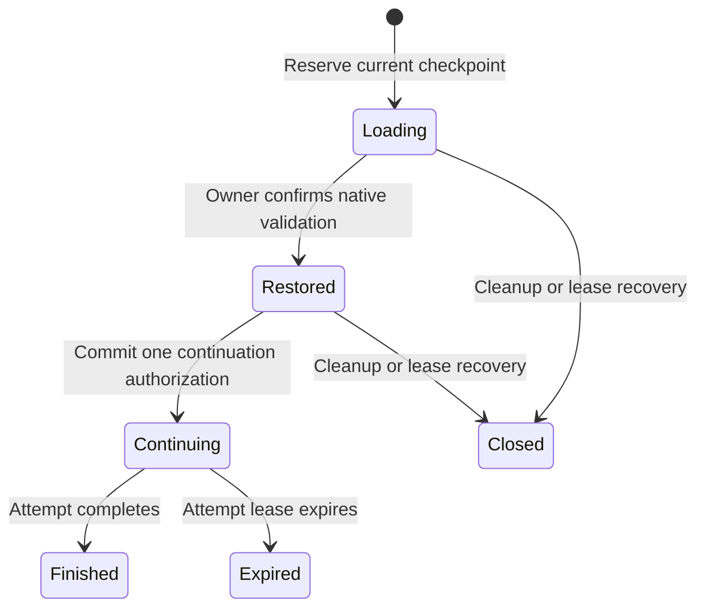
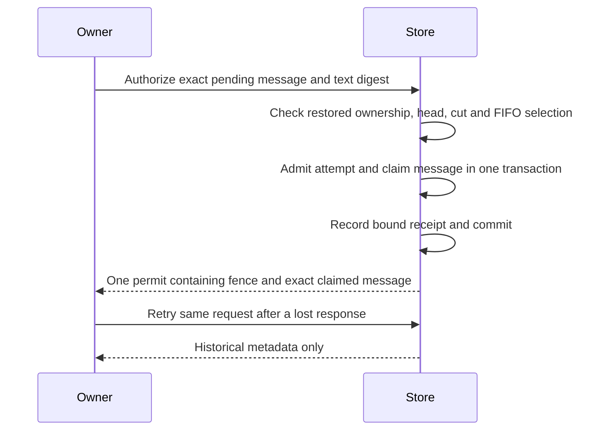
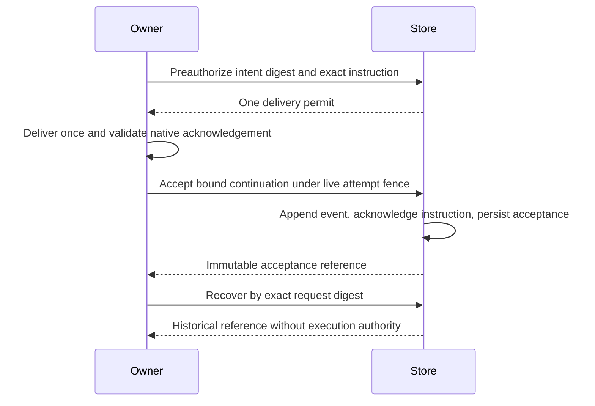

# Checkpoint restoration

Schema version 11 separates loading saved context, authorizing another turn and
recording acceptance of an exact queued instruction.
These are storage APIs for an execution owner. They do not enable CLI resume or
provide native model-context validation. See [checkpoint storage](storage.md#opaque-context-checkpoints)
for capture and publication guarantees.

## Loading does not start work

`begin_restore` reserves a session under a new restore lease. It requires the
current checkpoint head, expected session version, matching configuration digest
and an unchanged durable work cut. Ordinary attempt admission and restore
reservation exclude each other in the same database transaction, including an
expired owner that has not yet been recovered.

The execution owner loads the private bytes without running a turn or dispatching
tools. After independently validating the native state, it calls
`confirm_restored`. This records the owner's confirmation; storage cannot verify
that native loading occurred. Neither call changes the prior session body,
outcome, result or work revision.

The diagram groups pre-execution closure outcomes. Stored phases distinguish
closed, failed, cancelled and expired reservations. Closing or recovering a
loading/restored reservation preserves the prior session body exactly. A
cancellation request retains its reservation until cleanup or expiry recovery;
another owner cannot acquire the session while that reservation remains active.

## One authorization, no automatic replay

`authorize_continue` rechecks the restore lease, cancellation, checkpoint head,
configuration, session version and durable cut. It then creates an ordinary
attempt, advances the work revision, changes the session to running and records
the continuation receipt in one transaction. Only the first committed call
returns a `ContinuePermit`, consumed to obtain the new attempt fence.

An exact retry returns `AlreadyAuthorized` metadata, even after the attempt
ends. It never returns another permit. Reusing a request with different content
is a conflict. Begin retries likewise return metadata without renewing or
reissuing the loading credential. Retain the original credentials while their
owner remains alive; lookup is not execution authority.

| Failure point | Durable result and required handling |
| --- | --- |
| Before continuation commit | No work admitted; close or recover the loading reservation |
| Commit succeeds but its response is lost | Authorization is spent; lookup cannot recover a delivery permit |
| Command delivery or execution becomes uncertain | Do not automatically resend; recover the expired attempt and reconcile effects |
| A later attempt changes the session | Historical receipt remains historical; inspect current session separately |

The ordinary attempt lease governs continuing execution. Its expiry recovery
suspends uncertain work and marks the linked restore expired. Completion updates
the linked restore in the same transaction as terminal attempt finalization.
Neither path reissues continuation permission or undoes external effects.

## Continuing with an exact queued instruction

`authorize_continue_message` additionally takes a message ID and SHA-256 of its
exact UTF-8 text. The selected message must be the oldest pending instruction.
An older pending message, mismatched text, withdrawal or cancellation rejects the
operation; storage never substitutes another instruction.

Admission and claiming each advance the work revision once; the session version
advances only for admission. Failure at either stage rolls back both changes.
The returned `ContinueMessagePermit::into_delivery` consumes the permit and
returns the new attempt fence plus the claimed message. It does not send a command.
The message remains in flight until the execution owner persists a validated
acceptance; other message claims cannot bypass that unresolved delivery.

The receipt records message identity, sequence, text digest and byte length, with
no text or credentials. Exact retries remain metadata-only after acknowledgement,
expiry or later attempts. Generic and message-bound authorization cannot be
reinterpreted as each other. Version 9 preserves earlier generic receipt hashes
and adds no historical claims during migration. Ordinary queue identifier behavior
is unchanged; this context-bound operation has stricter identifier limits.

Checkpoint references also expose the verified stored `record_digest`. Owners
must preserve its bytes when binding a native restore exchange; the request digest
and a hash of the record digest are different values. This is integrity metadata,
not proof of native state or permission to execute.

## Reading a witnessed baseline

`restore_baseline_snapshot` reads the selected checkpoint, its private witness,
complete durable facts and sanitized event evidence in one transaction. It requires
a live, uncancelled loading/restored owner and unchanged head, configuration,
session version and durable cut. It does not admit execution or renew the lease.
Witnessless checkpoints and legacy raw tool events cannot supply this evidence.

Returned facts and events share a 256 KiB normalized evidence limit. Logical
records and selected event rows each have a 1,024-entry limit; excessive history
fails instead of being truncated. Checkpoint payloads and witnesses retain their
separate size limits. Events expose identities, hashes and byte lengths without
raw instruction text or private receipts. SQLite cache and scan costs are outside
these logical limits.

The current witness receives full validation. Its immediate parent and historical
continuation baselines are checked through bounded integrity metadata; older
witness bodies are not recursively loaded. This verifies durable correspondence,
not native model-context semantics.

## Recording continuation acceptance

Before authorization, the owner builds `RestoreContinueIntentV1` and supplies its
`delivery_digest` to the message-bound authorization call. The intent binds the
loading job, baseline record and witness, configuration, exact instruction and
expected tail-receipt digest. The loading validation binding is the owner's
assertion; it is distinct from the earlier capture validation binding.

After validating the native acknowledgement, the owner calls
`accept_restore_continuation` with the same live attempt fence and typed input.
One immediate transaction verifies the preauthorized intent, appends a sanitized
`continue_accepted` event, acknowledges that exact instruction and stores an
immutable acceptance record. Event and acknowledgement advance work revision
by two. Any failure rolls back all changes. An already delivered instruction or
orphan reserved event cannot be adopted as a new acceptance.

Exact mutation retries require the same live, uncancelled attempt and add no
revision. `continuation_acceptance` supports read-only recovery after expiry or
completion using the expected request digest. Neither operation returns another
permit or resends a command. A later witness binds its instruction to the acceptance
**record digest**; this differs from the request digest and authorization binding.

Acceptance bodies are limited to 4 KiB. They and their associated events share
the checkpoint storage quotas across all publication APIs. Exact retries and
historical lookup remain available at quota. Schema 11 adds acceptance storage
without reinterpreting earlier authorization hashes or fabricating old records.

## Validation boundary

Restore history retains at most 1,024 rows per session and 65,536 per database.
New reservations fail at capacity; exact retries, cleanup and already-reserved
continuation remain available. History is not evicted to make room, preserving
the record of spent authorizations. These are logical row limits, not total
database, disk, WAL or process-memory guarantees.
Each message-bound authorization adds at most one receipt row under the same
restore-history limits; it does not duplicate the instruction text.

`recover_expired_restores` processes at most 128 reservations per transaction,
ordered by expiry and then ID. Repeat it until it returns an empty batch to drain
currently eligible reservations. A failed batch rolls back all its changes and
returns no recovered results. Continuing attempts use ordinary attempt recovery.

The trusted owner must compute configuration and delivery digests from the
effective settings and intended command. Echoed adapter hashes are insufficient.
Record hashes detect inconsistent stored identities and receipts; they do not
authenticate an attacker-controlled database or detect whole-database rollback.

Storage tests cover competing ordinary/restore owners, competing continuation
requests, cancellation during ownership transfer, lost-response lookup,
historical receipt corruption, migration and rollback after injected write
failures. Native validation, restored execution and CLI integration remain
separate work. The [fresh capture supervisor](runtime.md#fresh-capture-supervision)
does not establish a restored baseline. Passing these storage tests establishes no model-provider
or full-session restoration claim.
