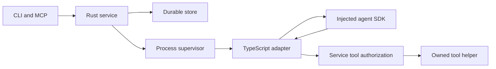

# Runtime architecture decision

The selected architecture uses a Rust service for durable session ownership and
process supervision, with a TypeScript adapter around an injected agent SDK.
The service owns attempts,
events, tool permissions, delivery receipts and checkpoint publication. The SDK
owns the model conversation inside its worker process. It cannot authorize tools
or declare its own exported state durably accepted.

The adapter interface and local CLI execution path are implemented. A production
model-provider binding and MCP-triggered execution are not included. The diagram
below shows the selected architecture, including those planned connections.
Selecting it does not approve a dependency for distribution or enable provider
calls.

## Alternatives considered

| Approach | Benefit | Limitation driving the decision |
| --- | --- | --- |
| SDK behind an owned adapter | Reuses conversation, streaming, steering and cancellation APIs | Requires explicit event translation, dependency review and native-state validation |
| Small independent provider loop | Direct control over dependencies and protocol | Requires new retry, context, model capability and continuation machinery |
| One-shot process runner | Simple task isolation and deployment | Cannot supply mid-attempt steering and durable conversation semantics alone |
| Hosted worker orchestrator | Useful for later remote execution | Does not replace local session and conversation ownership |

Use the SDK adapter approach for model integration. Keep its dependency boundary
replaceable; do not import an entire surrounding application. An independent
provider loop is a fallback only if the selected dependency cannot satisfy
distribution or behavioral requirements. It must meet the same contracts.

## Execution rules

- Select the model and effective configuration before admitting an attempt.
  A model change requires a new attempt; do not silently fall back.
- Supply credentials, settings and resources explicitly. Do not discover personal
  configuration, extensions or credentials from the worker's ambient environment.
- Route tools through service authorization and the owned helper. Builtin SDK
  tools must not bypass that boundary.
- Distinguish queue acceptance, durable receipt and completed execution. A text
  response or a single provider turn ending does not prove task success.
- Preserve native conversation state separately from public event projections.
  A payload digest alone does not prove native completeness or safe continuation.
- Keep cancellation and process cleanup under service control. A worker that
  stops producing output still needs lease and deadline supervision.

## Runtime and delivery gates

Bun 1.3.11 is the JavaScript tooling runtime. Node 22.23.1 is the initial SDK
deployment target; Bun is an alternate execution candidate. The SDK experiments
cover macOS arm64 only. Adapter deployment must validate the selected execution
runtime independently; passing TypeScript checks is not an executable
compatibility result. Platform-specific execution must pass before that platform
is offered.

Before shipping a provider binding, complete dependency and notice review,
credential delivery, model admission, usage limits and meaningful provider
integration tests. Fresh checkpoint publication additionally requires native
validation and atomic service publication. Restored execution also requires
owner-bound loading and durable continuation acceptance. These are delivery
requirements, not optional reductions in functionality.

See [current supervision behavior](runtime.md), [service ownership](service.md)
and [restoration guarantees](restoration.md). Detailed comparative research and
experimental evidence remain in the project tracker and external audit workspace.
