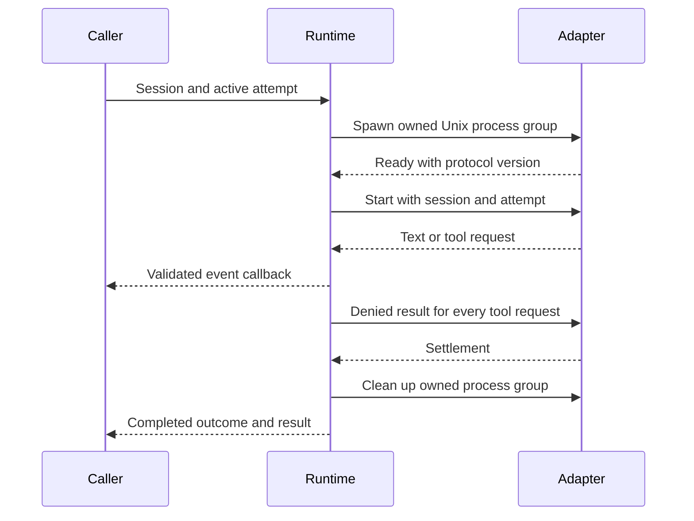

# Local adapter supervision

`foundry-runtime` supervises one explicitly configured adapter subprocess per
attempt. It does not contain a model implementation, provider authentication or a
general tool executor. Tests use an offline Python adapter to exercise process
behavior without model calls.

## Process and protocol

The caller provides an executable path, argument vector, session, active attempt
identifier, cancellation receiver and event callback. The working directory must
be absolute and the attempt identifier must match the session's active attempt.
The executable is resolved before changing directory. Arguments do not pass
through a shell.

The child inherits only `PATH`, `LANG`, `LC_ALL` and `TZ` when those values exist.
Other environment variables are cleared. This reduces inherited configuration;
it is not a filesystem sandbox or a network restriction. The adapter still runs
with the invoking operating-system user's permissions.

Messages use newline-delimited JSON and protocol version 1. Frames are bounded to
2 MiB. Events before readiness, duplicate readiness, unsupported versions and
foreign attempt identifiers fail explicitly. The supervisor drains and discards
stderr; it does not expose that stream through errors or callbacks. Failure
messages and malformed frame contents are withheld from runtime diagnostics.

## Message receipts

An explicitly prepared adapter can require a private configuration exchange before
Ready and Start. It uses the same process, pipes and original readiness deadline;
see [adapter configuration](adapter-configuration.md) for the one-use packet,
selection identity and credential boundary.

The base protocol remains version 1. Live instruction delivery separately requires
`ready.capabilities` to contain `message_ack_v2`; there is no fallback to the older
acknowledgement capability. Without it, messages are not forwarded.

Each `message` carries `attempt_id`, `message_id`, `text` and a fresh unpredictable
`receipt`. The receipt is serialized after the text. `message_accepted` must echo
the exact attempt ID, message ID and receipt. The reader validates receipts when
frames arrive, before events are queued for the supervisor. An early invalid
acknowledgement cannot become valid merely because that ID is submitted later.
Missing or mismatched receipts fail the protocol; valid duplicate acknowledgements
are accepted idempotently by the service.

A matching receipt proves knowledge of the frame's tail challenge, not successful
execution. It is neither a provider signature nor evidence of model output. The
service currently persists the acknowledgement, including its receipt. Uncertain
writes or crashes
can leave a durably claimed message in flight; the runtime cannot reconcile that
state or promise exactly-once delivery.

Each attempt accepts at most 1,024 distinct instruction messages. Message and
attempt identifiers must be nonblank, at most 128 UTF-8 bytes and free of control
characters. Both delivery and direct process submission enforce the limit before
pipe enqueue. Submitted identities and receipts remain retained for the attempt:
duplicate submissions fail without replacing receipts, while repeated matching
acknowledgements remain valid. The next distinct message fails deterministically;
history is never evicted to permit replay. Receipts also require nonblank,
control-free text of at most 128 UTF-8 bytes, checked before serialization or
history insertion; UUID syntax is not required. Retained string contents total
at most 384 KiB in process receipt history and 128 KiB in delivery identity
history. These bounds exclude collection/allocation overhead, transient frames,
the caller's input queue and total process memory.

## Private context transport

An internal, opt-in transport routes context control frames separately from
persistable `AdapterEvent` values. Ordinary events and private control frames share
one ordered output stream, with capacity two; the input queue also has capacity
two. Existing entrypoints retain their capacity-16 queues and reject unsolicited
context frames. The trusted library capture entrypoint below opts into this
transport; CLI capture and restore execution remain unavailable.

The codec rejects duplicate and unknown fields, including nested metadata,
noncanonical padded base64, invalid identifiers and mismatched candidate lengths
or SHA-256 digests. Bounds apply to serialized UTF-8 metadata and decoded payload:

| Item | Maximum |
| --- | --- |
| JSONL frame | 2,097,152 bytes |
| Nonempty opaque payload | 1,048,576 bytes |
| Base64 payload | 1,398,104 bytes |
| Format metadata | 16,384 bytes |
| Coverage metadata | 65,536 bytes |
| Identifier | 128 bytes, nonblank, without control characters |

Private payload-bearing commands and events have no general serialization or
debug-formatting implementation. Explicit wire encoders place transfer and
continuation receipts after their payload or text. These frames bypass ordinary
event callbacks and persistence; malformed frames produce fixed diagnostics
without payload excerpts. The transport checks the active attempt and preserves
joined worker cleanup even when its bounded output queue is full.

This is codec and transport support only. Capability negotiation, capture/restore
phase authority, operation correlation, one-use continuation, semantic validation
and checkpoint publication are not implemented by this layer. A valid digest or
receipt does not prove a completed turn. The
[restoration supervisor and service owner](restoration.md) enforce the declared
payload, native validation and continuation boundaries.

## Fresh capture supervision

`coordinated::run_fresh_capture` runs an initial attempt through the same process
supervisor as ordinary execution. Its linked owner selects the complete profile,
controls admission, supplies an atomic store cut and validates native semantics.
There is no default native validator or CLI selection for this entrypoint.

The validation binding includes the exact terminal lifecycle, outcome and result,
as well as the cut, trace and payload. Instruction receipts become durable only
after their persistence acknowledgement. Full helper-reply ledger hashes remain
distinct from the hashes of delivered result bodies. Cancellation, mismatched
replies, queued instructions and observed cleanup faults prevent a prepared result.

`PreparedCapture` is a private handoff after process cleanup, not a stored
checkpoint or completed session. The service must keep ownership alive through
atomic publication, check the exact accepted binding and preflight the store's
combined metadata and terminal size limit. The
[service capture and restoration path](restoration.md) supplies that ownership;
it still requires an explicitly registered native validator.

This entrypoint sends the original opening input. It rejects a cut with an
existing checkpoint head and does not implement restored execution. Historical
input and tool records require a separately validated baseline; they cannot be
represented as newly delivered input or omitted from durable coverage.

## Deadlines and cancellation

Default readiness, execution and graceful-cancellation deadlines are 10 seconds,
1 hour and 5 seconds respectively. Callers can configure them through
`AdapterSpec`. Callbacks are synchronous and must stay brief: the supervisor
cannot interrupt a callback that blocks.

A hard cancellation stops the owned group. Graceful cancellation requests a stop
and escalates when its deadline expires. Group cleanup also runs after normal
settlement so children do not become an implied persistent worker. A disconnected
cancellation channel does not cancel an attempt.

Process-group supervision is implemented for Unix. This is not containment for
hostile programs that escape their group, and it does not prevent an adapter
from making its own external calls. Descendants that detach into another process
group are outside the cleanup guarantee. SIGKILL cannot trigger cleanup.
Windows process supervision is unsupported.

## Integration boundary

The legacy entrypoints deny every protocol tool request. The opt-in coordinated
entrypoint can execute explicitly granted tools through an owned helper, with
durable claim and result acknowledgements supplied by the service. Neither path
infers interactive approval. The runtime does not persist sessions or renew
database leases. The caller must coordinate
[storage ownership](storage.md) with process cancellation and persistence.

The [application service](service.md) now provides tested coordination of these
components: it renews leases independently of adapter output, persists events,
and turns durable cancellation into a runtime stop request. Executable startup
also selects this path through `FOUNDRY_ADAPTER`; offline adapter tests verify the
wiring. No model-provider adapter is included. Offline supervisor tests
establish framing, deadlines, cancellation, environment handling and owned child
cleanup; they do not establish agent quality or hosted functionality.
