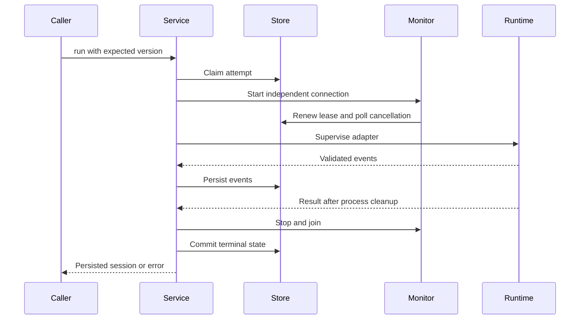
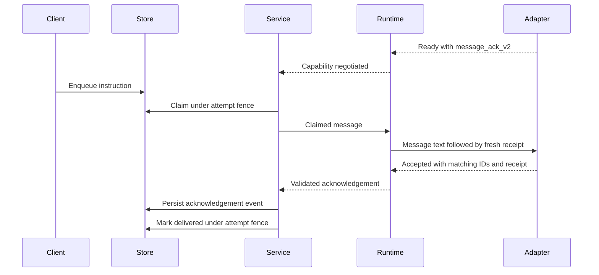
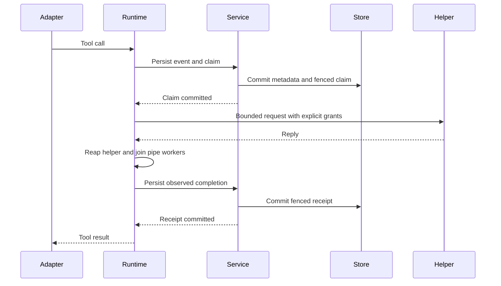

# Application service

`foundry-service` joins [session storage](storage.md) with
[subprocess supervision](runtime.md). It provides a synchronous library operation
for running an attempt and persisting its terminal state. It supplies no model
provider. Explicit configuration and consuming tool authority are available through
the [prepared adapter library path](adapter-configuration.md).

## Opening and running

`Service::open` requires a persistent database path; an in-memory database is
rejected. The parent directory must already exist. Default lease and polling
intervals are 60 seconds and 250 milliseconds. With `open_with_options`, polling
must be positive and shorter than one third of the lease duration.

The service exposes `create`, `get`, `list`, `events`, `cancel` and
`recover_expired`. `run` takes a session ID, expected session version and
`AdapterSpec`. It claims the attempt and waits for supervision to finish. Creation
alone never starts a process. Executable paths must be explicit; the runtime does
not search PATH for adapter names.

The monitor renews ownership even when the adapter emits no output. Another
process can record cancellation; the monitor delivers it to the supervisor.
Losing the lease requests a hard stop and prevents stale writes. SQLite writer
contention can delay polling, so lease settings need headroom.

## Completion and failure

Each accepted adapter event gets a unique event ID and revision zero. The store
assigns sequence numbers. Text is persisted as delivered; the service does not
assume that a text event is a delta or a full replacement.

An `adapter_settled` event records what the adapter reported. The committed
session lifecycle and outcome establish the service result. An event-write or
terminal-write failure cannot turn into successful completion, even if the
adapter reported success. Event persistence failure requests hard cancellation.

Observed cancellation settles as suspended after runtime cleanup. Runtime failure
settles as error when storage ownership still permits the write, and the service
returns an error. If the lease or storage is unavailable, terminal persistence
can itself fail; callers must inspect state and explicitly recover expired
attempts. Do not assume every returned error has already changed session state.

Recovery does not replay attempts or prove a crashed owner's external subprocess
has stopped. There is no automatic retry, rewind, fork or external-side-effect
reconciliation. The store also has a [durable instruction queue](storage.md#durable-instruction-queue),
with atomic claims that prevent withdrawal of in-flight instructions. This
service forwards claimed messages to an already running compatible adapter, but
does not reconcile uncertain claims after a crash. Recovering a session does not
clear its in-flight instruction.

## Instruction delivery

After `ready` advertises `message_ack_v2`, the monitor can claim a pending
instruction with the active attempt fence and pass it to the runtime. An adapter
without that capability, including one advertising only the older capability,
leaves instructions pending and withdrawable. A send command itself never starts
or resumes execution.

The runtime generates a fresh receipt, places it after the message text on the
wire, and requires the adapter to echo it with the message and attempt IDs.
Only a validated acknowledgement lets the service mark the record delivered.
The persisted `message_accepted` event contains the attempt ID, message ID and
receipt. Duplicate acknowledgements are idempotent. A missing,
malformed, guessed or mismatched receipt cannot establish delivery.

An acknowledgement demonstrates that the adapter knows the frame's receipt. It
is the adapter's claim of acceptance, not proof of instruction execution. A crash,
failed write or cancellation can leave delivery uncertain and the record
`in_flight`; later claims then remain blocked pending explicit reconciliation.
The event append and delivery-state write are separate operations. If the latter
fails, an acknowledgement event may exist while the message remains in flight;
inspect the message state rather than treating that event as committed delivery.
There is no automatic resend or exactly-once guarantee.

The monitor holds an admission permit across each durable claim and its runtime
queue submission. Freezing admission prevents new claims immediately, but reports
completion only after an existing permit is released. It never waits on SQLite
or discards a claimed instruction. Lease expiry, observed cancellation, terminal
events and fatal worker errors permanently freeze the gate. A stale readiness
flag cannot reopen it; a claim already holding a permit can still finish its
queue submission and must be reconciled separately. This is groundwork for checkpoint capture;
an acknowledged freeze does not prove that queued inputs were consumed or that
the durable context is complete. The capture handshake is not yet exposed.

The persistence worker has a separate capture setting that records and acknowledges
Ready without enabling message admission. A future capture owner must activate
delivery only after its correlated startup barrier. Ordinary execution retains
the readiness behavior described above; selecting the worker setting alone does
not enable checkpoint capture.

## Granted tool execution

`run_with_tools` accepts a trusted helper policy with an opened workspace directory,
explicit grants and resource limits. Ordinary execution remains default-deny.
The service persists a tool claim before dispatch and an observed completion
receipt before allowing the runtime to return the result to the adapter.

Rejected receipts and uncertain effects cannot authorize a successful tool result.
Cancellation observed by the coordinator stops further result admission. A
cancellation request, its observation, and pipe delivery are separate operations:
already queued or written results cannot be recalled. Cancelling does not undo a
filesystem effect or erase a previously committed receipt.

For capture integration, an explicit evidence-bearing completion request returns
the full helper-reply digest after the fenced ledger write. It shares the immutable
helper reply with the worker and retains the same identity and size checks. This
ledger digest is distinct from the digest of result bytes delivered to the adapter.
A real unknown-effect reply retains its digest but remains uncertain; a failure
before spawning or an unknown execution without a reply has no invented digest.
Failed writes return rejection rather than a completion receipt. These worker
checks do not prove native context inclusion or completed checkpoint publication.

New tool-request events retain identifiers, compact-JSON input byte count and
SHA-256 rather than raw input paths or contents. This event hash differs from the
typed, domain-separated ledger digest. Other text events keep their existing
contents, and historical rows are not rewritten. See the
[service API](../../crates/service/README.md#tool-request-event-retention)
for the exact metadata shape and retention boundary.

## Verification boundary

The service integration tests exercise persisted settlement after reopening,
lease renewal for silent adapters, cancellation from a separate process, runtime
failure, lease loss, failed event writes and failed terminal writes. A helper test
supports the cross-process cancellation fixture.

These tests use local offline Python adapters. They establish coordination of
storage and process supervision, not model-provider functionality, unrestricted
tools or hosted execution. The executable now selects this service for an
explicitly configured adapter and has offline integration coverage. Its MCP
backend deliberately uses storage-only operations and does not start an adapter.
See [local CLI workflows](../user/cli.md) for verified database operations.
