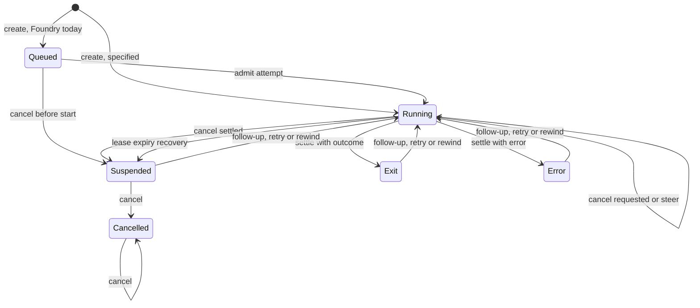

# Session API behavior specification

This page specifies the observable behavior of every session API operation that
the external capability audit still lists as not verified. For each operation it
records inputs, limits, defaults, error classes, idempotency, ordering and state
transitions, and it separates what Foundry implements today from behavior that is
only specified. A specified operation is not available until its implementation
and tests land. Nothing here claims parity with another product.

The neutral fixtures in [`tests/session_api`](../../tests/session_api/README.md)
encode the same rules as request, response and transition vectors. Their offline
validator runs in the shared Python check group.

## Authority and naming

The authority for scope is the external audit file
`~/.local/share/foundry-audit/capabilities.json`, rows whose
`owner.proposed_ticket_group` is `GAP-005`. Row identifiers such as `API-X031`
and `AG-07` are neutral and appear below; source identities, evidence and the
wire mapping stay in that external directory. Every row remains `not_verified`
or `unavailable` there. A label on this page does not change that status.

Operation names such as `session.create` are neutral Foundry names. **All wire
names are provisional pending the naming decision.** That covers transport
paths, HTTP methods, field names, error strings and cursor encodings. Field names
in this page and in the vectors reuse existing Foundry names where they exist
(`prompt`, `directory`, `idempotency_key`, `message_id`, `lifecycle`, `outcome`)
and otherwise use descriptive placeholders. HTTP status numbers are given only as
the provisional mapping for an HTTP transport, which is itself an open decision.

## Status labels

| Label | Meaning |
| --- | --- |
| Local foundation | Foundry implements a narrower local behavior, cited to tests in `crates/*/tests` or `apps/cli/tests`. The full specified behavior is still missing. |
| Specified | Behavior is defined here; no Foundry implementation exists. |
| Held | Specified, but implementation waits on a user decision or another ticket. |

## Coverage index

| Row | Operation | Label | Section |
| --- | --- | --- | --- |
| API-001 | `session.create` | Local foundation | [Create a session](#create-a-session) |
| API-X020 | `session.create` | Local foundation | [Create a session](#create-a-session) |
| AG-02 | `session.create` | Local foundation | [Create a session](#create-a-session) |
| AG-10 | `session.create` policy | Local foundation | [Execution policy and tool profiles](#execution-policy-and-tool-profiles) |
| AG-15 | `session.create` options | Held | [Isolated, prestart and experimental options](#isolated-prestart-and-experimental-options) |
| API-X022 | `session.prestart` | Held | [Isolated, prestart and experimental options](#isolated-prestart-and-experimental-options) |
| API-X023 | `session.get` | Local foundation | [Read a session](#read-a-session) |
| AG-03 | `session.get` | Local foundation | [Read a session](#read-a-session) |
| API-002 | `session.list` | Local foundation | [List sessions](#list-sessions) |
| API-X019 | `session.list` | Local foundation | [List sessions](#list-sessions) |
| API-X031 | `session.events` | Local foundation | [Read events](#read-events) |
| API-003 | `session.events` | Local foundation | [Read events](#read-events) |
| AG-07 | `session.events` | Local foundation | [Read events](#read-events) |
| AG-08 | projections | Local foundation | [Messages and conversation views](#messages-and-conversation-views) |
| API-X035 | `session.messages` | Local foundation | [Messages and conversation views](#messages-and-conversation-views) |
| API-X030 | `session.conversation` | Specified | [Messages and conversation views](#messages-and-conversation-views) |
| API-004 | `session.send` | Local foundation | [Send a follow-up](#send-a-follow-up) |
| API-X036 | `session.send` | Local foundation | [Send a follow-up](#send-a-follow-up) |
| AG-04 | `session.send` | Local foundation | [Send a follow-up](#send-a-follow-up) |
| API-X037 | `session.withdraw` | Local foundation | [Withdraw or steer a queued message](#withdraw-or-steer-a-queued-message) |
| API-X038 | `session.steer` | Specified | [Withdraw or steer a queued message](#withdraw-or-steer-a-queued-message) |
| API-005 | `session.cancel` | Local foundation | [Cancel a session](#cancel-a-session) |
| API-X028 | `session.cancel` | Local foundation | [Cancel a session](#cancel-a-session) |
| AG-05 | `session.cancel` | Local foundation | [Cancel a session](#cancel-a-session) |
| AG-06 | continuation operations | Local foundation | [Retry, fork, rewind and compact](#retry-fork-rewind-and-compact) |
| API-X041 | `session.retry` | Specified | [Retry, fork, rewind and compact](#retry-fork-rewind-and-compact) |
| API-X032 | `session.fork` | Specified | [Retry, fork, rewind and compact](#retry-fork-rewind-and-compact) |
| API-X042 | `session.rewind` | Specified | [Retry, fork, rewind and compact](#retry-fork-rewind-and-compact) |
| API-X029 | `session.compact` | Held | [Retry, fork, rewind and compact](#retry-fork-rewind-and-compact) |
| API-X025 | `session.archive` | Local foundation | [Archive, unarchive and delete](#archive-unarchive-and-delete) |
| API-X051 | `session.unarchive` | Local foundation | [Archive, unarchive and delete](#archive-unarchive-and-delete) |
| API-X024 | `session.delete` | Local foundation | [Archive, unarchive and delete](#archive-unarchive-and-delete) |
| API-X040 | `session.rename` | Local foundation | [Title, tags and project grouping](#title-tags-and-project-grouping) |
| API-X046 | `session.tags.list` | Local foundation | [Title, tags and project grouping](#title-tags-and-project-grouping) |
| API-X047 | `session.tags.append` | Local foundation | [Title, tags and project grouping](#title-tags-and-project-grouping) |
| API-X048 | `session.tags.replace` | Local foundation | [Title, tags and project grouping](#title-tags-and-project-grouping) |
| API-X049 | `session.tags.replace` | Specified | [Title, tags and project grouping](#title-tags-and-project-grouping) |
| API-X039 | `session.move_project` | Held | [Title, tags and project grouping](#title-tags-and-project-grouping) |
| API-006 | attachments and links | Held | [Attachments and shared links](#attachments-and-shared-links) |
| API-X026 | `session.attachments.list` | Held | [Attachments and shared links](#attachments-and-shared-links) |
| API-X027 | `session.attachments.get` | Held | [Attachments and shared links](#attachments-and-shared-links) |
| API-X043 | `session.links.list` | Held | [Attachments and shared links](#attachments-and-shared-links) |
| API-X044 | `session.links.create` | Held | [Attachments and shared links](#attachments-and-shared-links) |
| API-X045 | `session.links.revoke` | Held | [Attachments and shared links](#attachments-and-shared-links) |
| API-X021 | `session.list_insights` | Held | [Insights and trajectory export](#insights-and-trajectory-export) |
| API-X033 | `session.insight.get` | Held | [Insights and trajectory export](#insights-and-trajectory-export) |
| API-X034 | `session.insight.generate` | Held | [Insights and trajectory export](#insights-and-trajectory-export) |
| API-X050 | `session.trajectory` | Held | [Insights and trajectory export](#insights-and-trajectory-export) |
| API-008 | all operations | Specified | [Throttling, errors and retries](#throttling-errors-and-retries) |
| API-007 | machines | Held | [Rows routed to other tickets](#rows-routed-to-other-tickets) |
| API-009 | extended service | Held | [Rows routed to other tickets](#rows-routed-to-other-tickets) |

`UNK-002` (private harness internals and benchmark equivalence) is in the same
audit group but is not an API row. It stays unavailable: independent behavior can
be built, but no internal parity can be asserted.

## Shared rules

### Error classes

Every failure carries one neutral class. Clients decode the class tolerantly:
a string class and a nested object form are both acceptable until the wire format
is fixed. Unknown classes are treated as `unavailable` for retry purposes, never
as success.

| Class | Provisional HTTP | Meaning | Foundry today |
| --- | --- | --- | --- |
| `invalid_request` | 400 | Malformed body, unknown or conflicting fields, out-of-range value | `ContractError::Invalid`, CLI/MCP code `invalid` |
| `invalid_cursor` | 400 | A cursor this view could not have issued | Not distinguished |
| `unauthenticated` | 401 | Missing, invalid or expired credential | No authentication |
| `quota_exhausted` | 402 | Usage unavailable for the account; carries a cause code | Not implemented |
| `forbidden` | 403 | Authenticated caller lacks scope, role or ownership | Not implemented |
| `not_found` | 404 | Session, message, attachment or link is absent or not visible | `ContractError::NotFound`, code `not_found` |
| `conflict` | 409 | Idempotency key or message ID reused with different content; stale state | `ContractError::Conflict`, code `conflict` |
| `not_terminal` | 409 | Operation needs a settled session but a turn is running | Not implemented |
| `delete_blocked` | 409 | Deletion is protected by pending settlement or retention | Not implemented |
| `payload_too_large` | 413 | Prompt, message or whole request exceeds its byte limit; carries the limit | Reported as `invalid_request` |
| `unsupported_policy` | 422 | The target or execution policy cannot be honored | Not implemented |
| `rate_limited` | 429 | Caller must wait; carries a retry delay in seconds | Not implemented |
| `unavailable` | 503 | Temporarily unable; writes disabled or a preflight failed | Not implemented |
| `unsupported` | none yet | Operation or capability not built in this binary | `ContractError::Unsupported`, code `unsupported` |

Today the store maps the first four implemented classes in
[`apps/cli/tests/local_backend.rs`](../../apps/cli/tests/local_backend.rs)
(`validation_and_error_codes`). Oversize prompts are currently `invalid_request`;
the specified behavior reports `payload_too_large` with the exceeded limit.

### Idempotency

- Mutations that create something accept an optional caller key: the create key,
  the follow-up message ID, the fork client ID and the rewind request ID.
- A replay with an equivalent request returns the original result without a new
  side effect and reports that it was a replay. A reuse with a different request
  fails with `conflict`. A replay never resets later state, such as a withdrawn
  or in-flight message.
- Without a key, a retried mutation may duplicate work. Clients must not retry
  such a mutation automatically.
- State-setting operations (archive, unarchive, rename, tag replace, cancel with
  the same mode) are naturally repeatable and report the resulting state.
- Idempotency records are durable and survive restart.

### Cursors and ordering

- Every paged view has its own opaque cursor. A cursor from one view or session
  is rejected with `invalid_cursor`, never reinterpreted.
- Cursors are comparisons, not counts. Gaps are normal; clients never compute
  item counts from cursor values.
- Integer cursors use at least 64-bit unsigned range, and values that do not fit
  the durable range fail with `invalid_request` rather than truncating.
- An empty page does not mean the session is finished. Readers continue until
  the session lifecycle is terminal and the view is drained.

### Limits and defaults

| Limit | Value | Behavior outside the range |
| --- | --- | --- |
| Prompt and follow-up text | 1 to 262,144 UTF-8 bytes, not blank | Blank: `invalid_request`; larger: `payload_too_large` |
| Whole request body | 116,042,412 bytes | `payload_too_large` |
| Event page size | 1 to 1,000, default 200 | `invalid_request` |
| Event wait budget | 0 to 20,000 ms, default 0 | `invalid_request` |
| Session list page | default 50, at most 200 | Larger values are capped, not rejected |
| Session list page with title search | at most 24 | Capped |
| Title search text | 3 to 500 characters | `invalid_request` |
| Insight list page | default 20, at most 100 | Capped |
| Message and conversation pages | default 50 | Positive integers only |
| Caller message ID | 1 to 160 characters | `invalid_request` |
| Fork title | at most 120 characters | `invalid_request` |
| Shared-link label | at most 80 characters | `invalid_request` |
| Shared-link lifetime | 60 to 86,400 s, default 3,600 s | `invalid_request` |
| Prompt echo on read | first 16 KiB, with truncation flag and full byte count | Truncated, never rejected |
| Derived title | first 200 characters of the prompt | Truncated |
| Prestart reservation | create within 75 s; unused warm resources reclaimed after 90 s | Create proceeds cold |
| Caller agent label | at most 80 characters | `invalid_request` |

Foundry enforces the prompt and follow-up text limit today
(`MAX_PROMPT_BYTES`). The MCP tool interface advertises 65,536 Unicode scalar
values, a narrower bound tracked by NIC-42; see the [MCP boundary](mcp.md).

## Session lifecycle

Lifecycle (`running`, `exit`, `error`, `suspended`, `cancelled`) and outcome
(`success`, `failure`, `action_required`) are separate. Only `exit` carries an
outcome. `cancelled` is terminal: it is reached only by cancelling a suspended
session and is never resumed or continued.
Foundry additionally has an internal `queued` admission state; it must not
become part of the public lifecycle vocabulary by inference. Session identity is
stable across attempts; each admitted execution is a new attempt.



Fork is absent from the diagram on purpose: it creates a separate session that
starts its own lifecycle and leaves the source unchanged. Compaction does not
change lifecycle; it is accepted only for a settled session.

| From | Event | To | Foundry today |
| --- | --- | --- | --- |
| queued | admit | running | Implemented: `begin_attempt` with expected version |
| queued | cancel | suspended | Implemented |
| running | cancel request | running | Implemented: durable request only, upgrade-only |
| running | settle with outcome | exit | Implemented |
| running | settle with error | error | Implemented |
| running | cancel settled | suspended | Implemented |
| running | lease expiry recovery | suspended | Implemented, explicit recovery only |
| running | steer | running | Specified |
| exit, error, suspended | follow-up, retry, rewind | running | Specified; suspended continuation exists only as owner-fenced restoration |
| exit, error | cancel | unchanged | Implemented as a no-op |
| suspended | cancel | cancelled | Implemented: terminal; admission, restoration and new messages are refused |
| cancelled | cancel | cancelled | Implemented as a no-op |

The implemented transitions are covered by
[`crates/store/tests/durability.rs`](../../crates/store/tests/durability.rs)
(`cancel_only_upgrades_and_requires_suspended_completion`,
`expired_owner_is_fenced_and_recovery_does_not_invent_success`,
`forged_fence_and_stale_version_cannot_write`),
[`crates/store/tests/cancel_contract.rs`](../../crates/store/tests/cancel_contract.rs)
(`cancelling_a_suspended_session_is_terminal_and_blocks_later_continuation`,
`cancelling_a_settled_session_is_a_reported_no_op`) and
[`crates/service/tests/application.rs`](../../crates/service/tests/application.rs)
(`settled_result_and_events_survive_restart`,
`adapter_failure_is_durably_error_and_returns_error`). Restoration continuation
is described in [restoration](restoration.md).

## Operations

### Create a session

Audit rows (external `capabilities.json`, group GAP-005): API-001, API-X020, AG-02.
Vectors: `tests/session_api/vectors/create.json`.

**Foundry today.** `CreateSession` takes a prompt, a working directory, an optional
model selection and an optional idempotency key. Unknown fields are rejected. The
store validates the prompt bound, a nonblank directory and a nonblank key, then
records a `queued` session at version 0 without starting a process. An equal
complete request with the same key returns the original session; a different
request with that key is `conflict`. Concurrent creates with one key have one
winner. Evidence:
[`durability.rs`](../../crates/store/tests/durability.rs)
(`restart_preserves_session_idempotency_events_and_outcome`,
`concurrent_create_and_attempt_claim_have_one_winner`) and
[`local_backend.rs`](../../apps/cli/tests/local_backend.rs)
(`start_is_explicitly_a_local_queued_record`, `validation_and_error_codes`).

Contract v2 options are validated before any write. A workspace is scratch or a
repository with exactly one checkout selector (branch, reference or positive
change request); a second selector fails decoding as `invalid_request`. Tags are
at most 64 distinct labels of 1 to 64 bytes, a title has 1 to 200 characters, and
a tool profile is a reference of `/`-separated lowercase segments of letters,
digits, `-`, `_` and `.`. A machine target needs a name and is then
`unsupported` with no fallback; completion criteria are also `unsupported`. The
stored request remains the idempotency comparison, so changing any field
conflicts, and a replay reports that it replayed with the original metadata and
associations. Evidence:
[`create_v2.rs`](../../crates/store/tests/create_v2.rs)
(`legacy_and_v2_requests_replay_after_restart_and_conflict_on_any_changed_field`,
`every_rejection_is_typed_and_writes_nothing`) and
[`create.rs`](../../crates/service/tests/create.rs)
(`exclusive_checkout_selectors_are_invalid`).

**Specified.**

- Inputs: required nonblank prompt. Optional repository, branch, reference or
  change-request target; model, provider and effort; execution target; project
  grouping and persistent-assistant associations; tags; attachments; execution
  policy fields (next section); idempotency key in the request body, not in a
  header. Checkout selectors are mutually exclusive: supplying more than one is
  `invalid_request`. A machine target is an object with a kind and a name.
- Defaults: no repository selects a repository-neutral (scratch) start. Policy
  fields take the defaults in the next section.
- Limits: prompt and whole-request limits from the shared table.
- Response: session ID, a session link, lifecycle, effective policy and nullable
  associations. A new session reports `created`; a replay reports `replayed` with
  the original values (provisional HTTP 201 and 200).
- Errors: `invalid_request`, `unauthenticated`, `quota_exhausted`, `forbidden`,
  `not_found` for an inaccessible association, `conflict` for key reuse,
  `payload_too_large`, `unsupported_policy` for a target policy that cannot be
  honored, `rate_limited`, `unavailable`.
- Idempotency: durable key records; a replay never creates a second session or
  attempt. Adding optional request fields must not change the stored comparison
  of an older request, so omitted optional fields serialize as absent.
- Transitions: the specified operation starts execution asynchronously and
  reports `running`. Foundry's queued admission is a local difference that the
  naming and transport decision must resolve.

### Execution policy and tool profiles

Audit rows (external `capabilities.json`, group GAP-005): AG-10.
Vectors: `tests/session_api/vectors/create.json`.

**Foundry today.** Workspace tool grants (`read`, `list`, `write.create`,
`write.overwrite`) default to empty, are fixed per session start, and are
consumed through durable claims and receipts. Evidence:
[`tool_permissions.rs`](../../crates/service/tests/tool_permissions.rs)
(`allowed_call_consumes_permission_and_delivers_only_after_durable_receipt`,
`explicit_denial_retains_denied_delivery_without_a_helper_claim`).

**Specified.** A default tool surface of read, shell, edit, write and a
code-execution tool, each gated by policy. Independent policy switches cover
secret injection (default on), personal context (default on), physical-execution
permission, draft-only publication of change requests and workspace ownership
(managed by default). Child sessions inherit the parent's policy and cannot widen
it. The response echoes the effective policy with a version number. An
unsupported combination is `unsupported_policy` before any execution. The shell
tool stays held until its security model is decided.

### Isolated, prestart and experimental options

Audit rows (external `capabilities.json`, group GAP-005): AG-15, API-X022.
Vectors: `tests/session_api/vectors/create.json`.

**Foundry today.** None.

**Held specification.**

- Isolated (ephemeral) mode: a benchmark-style session that accepts no
  follow-ups; later sends fail with `conflict`. Redaction is narrower and limited
  to the run's own secrets.
- Caller-owned workspace: the caller controls the checkout; deleting the session
  must not remove it.
- `session.prestart`: the caller reserves a fresh session ID and warms execution
  resources while composing a prompt. The response is advisory: `starting` or
  `ready` with a remaining lifetime, or "not started" when disabled, at capacity
  or when the ID is taken. A create with the same ID within 75 seconds uses the
  warm resources; otherwise create behaves identically. Repeating prestart for the
  same ID is idempotent. Unused resources are reclaimed after 90 seconds.
- Experimental runtime profiles and feature flags are enumerated externally
  before any equivalent is built. Unknown values are `invalid_request`.

### Read a session

Audit rows (external `capabilities.json`, group GAP-005): API-X023, AG-03.
Vectors: `tests/session_api/vectors/read.json`.

**Foundry today.** `get` returns the stored session: ID, prompt, directory, model,
lifecycle, optional outcome and string result, active attempt ID and version. An
unknown ID is `not_found`; a blank ID is `invalid_request`. Lifecycle and outcome
stay separate: an expired or failed attempt never becomes success. Evidence:
[`local_backend.rs`](../../apps/cli/tests/local_backend.rs)
(`durable_create_list_get_and_snapshot`),
[`durability.rs`](../../crates/store/tests/durability.rs)
(`expired_owner_is_fenced_and_recovery_does_not_invent_success`),
[`application.rs`](../../crates/service/tests/application.rs)
(`failed_terminal_write_never_returns_adapter_success`).

**Specified.**

- Inputs: session ID; a previously returned attempt ID is accepted as an alias
  but the response always names the session. Optional sparse field selection;
  the session ID is always present and an unknown field name is
  `invalid_request`.
- Response: lifecycle, outcome, structured result, bounded redacted error text,
  best-effort failure diagnostics with unknown fields null, prompt echo (first
  16 KiB with a truncation flag and full byte count) and a title derived from the
  first 200 characters of the prompt when none was set.
- Outcome rules: never infer success from process exit or completed inference.
  The completion envelope that justifies an outcome is persisted with its
  diagnostics; its policy is drafted under NIC-91.
- Errors: `invalid_request`, `unauthenticated`, `forbidden`, `not_found`,
  `rate_limited`. Reads have no side effects.

### List sessions

Audit rows (external `capabilities.json`, group GAP-005): API-002, API-X019.
Vectors: `tests/session_api/vectors/read.json`.

**Foundry today.** The CLI `list` returns newest created sessions first with a
default limit of 100; zero is `invalid_request`, and it has no cursor, filter or
cap. Evidence:
[`local_backend.rs`](../../apps/cli/tests/local_backend.rs)
(`durable_create_list_get_and_snapshot`, `validation_and_error_codes`).

The service operation `Service::list_sessions` implements the specified query
but is not yet wired to the CLI, MCP or any transport:

- Order is newest created first; updates never reorder. The cursor names the
  last returned session and is bound to the archive, origin and search filter,
  so sessions created while a reader pages never shift or repeat later pages.
  A cursor from another filter, a forged cursor or one naming an unknown
  session fails with `invalid_request`; the contract has no distinct
  `invalid_cursor` class yet.
- Archive filter `active` (default), `archived` or `all`, and origin filters
  for interactive, any external, or one external interface. Filters read the
  schema v12 metadata columns. Sessions written before origins existed match
  no origin filter.
- Page size `page_size`, with `limit` as its alias, defaults to 50 and is capped
  at 200, or 24 with a title search; zero is `invalid_request`.
- Title search is a literal, case-insensitive substring of 3 to 500 characters
  over the stored title, or the first 200 prompt characters when none is set.
  It scans the filtered sessions in order, so its cost grows with the store.
- Sparse fields always keep `id`; an unknown name is `invalid_request`.
- Each page carries a weak validator over the query and the selected rows. It
  changes only when a selected value, the page membership or the next cursor
  changes, and a matching `if_none_match` returns "not modified".

Evidence: [`store session_query.rs`](../../crates/store/tests/session_query.rs)
(`cursor_pages_stay_stable_under_concurrent_creates`,
`title_search_is_literal_case_insensitive_and_title_only`,
`page_search_and_origin_bounds`),
[`service session_query.rs`](../../crates/service/tests/session_query.rs)
(`page_size_defaults_caps_and_alias`, `etag_is_stable_until_a_visible_change`).
Project grouping, the older archive spelling, account and workspace keyed
caching and search capacity limits are not implemented.

**Specified.**

- Filters: archive state `active` (default), `archived` or `all`, which is not an
  execution-status filter; origin, as one or several of interactive, external,
  or a specific external interface; project grouping. An older archive spelling
  is read only when the new one is absent.
- Search: literal, case-insensitive title search of 3 to 500 characters.
  Transcripts are not searched. Search pages hold at most 24 items.
- Paging: page size defaults to 50 and is capped at 200. When both the primary
  page-size field and its alias are present, the primary one wins. Follow-up
  attempts never appear as additional items.
- Sparse fields: as in read; the session ID is always returned.
- Caching: each page has a weak validator. A matching conditional request returns
  "not modified". Cached pages are keyed by account, workspace and query. Usage,
  context, cost, duration and model may be up to 10 seconds stale in a
  not-modified page; other fields up to 5 minutes.
- Errors: `invalid_request`, `unauthenticated`, `forbidden`, `rate_limited` when
  search capacity is busy.

### Read events

Audit rows (external `capabilities.json`, group GAP-005): API-X031, API-003, AG-07.
Vectors: `tests/session_api/vectors/events.json`.

**Foundry today.** Events have a stable ID, attempt ID, per-session sequence,
revision, kind and JSON data. Sequences start at 1 and continue across attempts.
A new revision of an existing ID gets a new, higher sequence, so a reader sees the
same ID more than once. Revisions are immutable and must increase; an exact retry
is idempotent and a changed retry is `conflict`. Reads take an exclusive cursor
(default 0) and a limit. The CLI watch polls in pages of 256 until the session is
terminal. Evidence:
[`durability.rs`](../../crates/store/tests/durability.rs)
(`duplicate_events_are_idempotent_and_conflicts_are_rejected`,
`concurrent_events_are_sequenced_without_lost_writes`) and
[`watch.rs`](../../apps/cli/tests/watch.rs)
(`drains_multiple_pages_and_honors_exclusive_cursor`,
`follows_concurrent_commits_and_streams_each_revision_once_before_terminal`).

Delivery reads are also implemented in the store and service, not yet on the CLI
or MCP surface. `Store::deliver_events` takes an exclusive delivery cursor
(`-1`, the default, precedes the first event), a page size of 1 to 1,000
(default 200) and a wait budget of 0 to 20,000 ms (default 0). Out-of-range values
are `invalid_request`. Each event carries an attempt ordinal, an immutable
position and a delivery sequence of `(attempt_ordinal - 1) * 2^32 + sequence`,
held in `u64` throughout. The page returns the current session and `next_seq`, the
last delivered value, or the request cursor when the page is empty.
`Service::read_events` long-polls a queued or running session: it rechecks
SQLite's commit marker every 20 ms, so a commit from another connection or
process wakes it, and it returns an empty page when the budget ends. A settled
session never waits. `transcript` keeps the highest-delivery copy of each event
ID ordered by position. The [storage page](storage.md#event-delivery-fields)
defines how rows without these fields are stamped. Evidence:
[`event_delivery.rs`](../../crates/store/tests/event_delivery.rs) and
[`event_wait.rs`](../../crates/service/tests/event_wait.rs)
(`commit_from_another_process_wakes_a_long_poll`). The conversation filter and
`invalid_cursor` for cursors from another view remain unimplemented.

**Specified.**

- Inputs: exclusive delivery cursor (the start value precedes the first event),
  page size 1 to 1,000 (default 200), wait budget 0 to 20,000 ms (default 0),
  optional conversation filter.
- Response: the current session plus a page of events and the next cursor. The
  next cursor is a position to resume from, not a count.
- Ordering: delivery order is by sequence. A growing event (text, model thinking, live
  tool output) keeps its ID and reappears with a higher sequence. To display a
  transcript, keep the highest-sequence copy of each ID and sort by its immutable
  position. Each attempt's sequence space is offset by 2^32; readers use types
  that do not truncate.
- Waiting: with a positive budget and nothing new for a running session, the
  server may wait for the next event. It may also answer early with an empty page.
- Conversation filter: only assistant text, thinking, tool use and tool result
  events with fixed data fields; no status, tracing or diagnostic events.
- Errors: `invalid_request` for out-of-range values, `invalid_cursor`,
  `unauthenticated`, `forbidden`, `not_found`, `rate_limited`.
- Constraint: Foundry's event sequence feeds checkpoint cut hashes and must stay
  unchanged. Attempt-scaled delivery cursors and immutable positions are new
  fields, not a reinterpretation of the stored sequence.

### Messages and conversation views

Audit rows (external `capabilities.json`, group GAP-005): AG-08, API-X035, API-X030.
Vectors: `tests/session_api/vectors/projections.json`.

**Foundry today.** The message view lists only follow-up instructions, never the
opening prompt or replies, so a new session has an empty view. It pages by an
exclusive sequence cursor. Delivery notes and the conversation view do not exist
yet; the conversation view is in progress under NIC-89. Evidence:
[`crates/store/tests/messages.rs`](../../crates/store/tests/messages.rs)
(`idempotency_pagination_and_withdrawal_survive_restart`).

**Specified.**

- Messages: follow-ups and mid-turn steers, each followed by a system note that
  says how it was delivered. Excludes the opening prompt and replies. Default page
  50, opaque cursor, with an older integer cursor accepted as an alias.
- Conversation: the opening prompt, each later message and one reply per
  finished turn, in order. Each item has a kind. A reply carries the turn's summary
  text (empty if none), lifecycle and outcome, so failed and cancelled turns are
  listed. A reply appears only after every earlier turn has finished. Delivery
  notes are excluded. Default page 50. A cursor from an item or page end resumes
  after it; polling with the last cursor returns what is said next. An invalid
  cursor is `invalid_cursor`.
- Events (previous section) carry intermediate activity. No view is rebuilt from
  another view's data, and each has its own cursor.

### Send a follow-up

Audit rows (external `capabilities.json`, group GAP-005): API-004, API-X036, AG-04.
Vectors: `tests/session_api/vectors/messages.json`.

**Foundry today.** `enqueue_message` stores an instruction with a caller message
ID and 1 to 262,144 bytes of text. It never starts or resumes execution. Reusing
an ID with the same text returns the current record; different text is `conflict`.
A retry does not reset an in-flight or withdrawn record. A running owner whose
adapter negotiated message acknowledgement claims the instruction, sends it, and
marks it delivered only after an exact receipt. Delivered means received, not
executed. A crash while in flight leaves the record blocking later claims until
reconciliation, which is not implemented. Evidence:
[`crates/store/tests/messages.rs`](../../crates/store/tests/messages.rs)
(`concurrent_retries_have_one_sequence`,
`uncertain_delivery_survives_recovery_without_requeue`),
[`crates/service/tests/messages.rs`](../../crates/service/tests/messages.rs)
(`running_adapter_receives_message_enqueued_by_another_process`,
`missing_malformed_or_wrong_receipt_never_marks_message_delivered`),
[`message_entrypoint.rs`](../../apps/cli/tests/message_entrypoint.rs)
(`cli_messages_persist_across_processes_without_resuming_stopped_session`).

**Specified.**

- Inputs: required nonblank text; optional caller message ID (1 to 160
  characters), attachments, model and effort override, model rollover permission,
  delivery mode `steer` or `queue`, and execution target. An optional caller agent
  label of at most 80 characters.
- Behavior: a running session receives a steer within the current turn or a
  queued message after it. A settled session resumes in the same session with a
  new attempt. Owned child sessions keep their original permissions.
- Response: accepted flag, delivery mode, message ID, the caller ID if supplied,
  an optional hold cause, and the continuation session ID when one was used.
- Errors: `invalid_request` for empty text or an invalid model or effort,
  `quota_exhausted`, `forbidden` (including a session the caller does not own),
  `not_found`, `conflict` for invalid child lineage or an unavailable target,
  `payload_too_large`, `rate_limited`, `unavailable` when the message cannot be
  recorded with its audit trail.
- Idempotency: the caller ID deduplicates within the session.
- Ordering: queued messages are delivered in send order; queue acceptance,
  delivery and completed work are distinct facts.

### Withdraw or steer a queued message

Audit rows (external `capabilities.json`, group GAP-005): API-X037, API-X038.
Vectors: `tests/session_api/vectors/messages.json`.

**Foundry today.** A pending message can be withdrawn; withdrawing it again
succeeds and leaves it withdrawn. An in-flight or delivered message cannot be
withdrawn (`conflict`), and a concurrent claim and withdrawal have one winner.
Steering a queued message is not implemented. Evidence:
[`crates/store/tests/messages.rs`](../../crates/store/tests/messages.rs)
(`claim_and_withdraw_cannot_both_win`),
[`crates/service/tests/messages.rs`](../../crates/service/tests/messages.rs)
(`inflight_withdrawal_fails_and_cancellation_retains_ambiguity`,
`adapter_without_capability_leaves_message_pending_and_withdrawable`).

**Specified.**

- Withdraw: removes a message from the queue and returns its ID. A message that
  already left the queue is left unchanged. Whether that case reports success or
  `conflict` is an open decision; Foundry currently reports `conflict`.
- Steer: hands a message sent with `queue` delivery into the running turn and
  returns the remaining queue depth. Only queued messages qualify.
- Errors: `invalid_request`, `not_found`, `conflict` or `not_terminal` when the
  session state does not allow it, `rate_limited`, `unavailable`.

### Cancel a session

Audit rows (external `capabilities.json`, group GAP-005): API-005, API-X028, AG-05.
Vectors: `tests/session_api/vectors/cancel.json`.

**Foundry today.** `Service::cancel` (`crates/service/src/cancel.rs`) returns
the `CancelReceipt` `{ok, requested, mode, status}`, and the CLI and MCP cancel
output include it as `receipt`. Cancelling a queued session marks it suspended at
once. For a running attempt or a live restore owner, cancellation is a durable
request that can upgrade from graceful to hard but never downgrade, and it does
not change lifecycle until the owner settles the attempt as suspended; the
receipt reports `running` (or `suspended` for a restore owner). A cancelled
attempt cannot publish a checkpoint, so after a hard cancel the head stays the
last checkpoint published before the request. A success reported after observed
cancellation is suppressed. Graceful cleanup records a workspace snapshot
artifact before suspension; hard cancellation records a skip without copying.
Cancelling a suspended session with no live owner makes it `cancelled`, a
terminal state: attempt admission, restoration and new messages are then
refused with the typed `ContractError::Cancelled`, reported as `conflict`.
Cancelling an exit, error or cancelled session is a no-op with
`requested: false`. The CLI and watch map `cancelled` to its own exit code 4 with the
text `Session cancelled`; MCP `session_get` reports `lifecycle: "cancelled"`.
Evidence:
[`cancel_contract.rs`](../../crates/store/tests/cancel_contract.rs)
(`graceful_then_hard_upgrade_while_running_reports_each_receipt`,
`cancelling_a_suspended_session_is_terminal_and_blocks_later_continuation`,
`hard_cancel_keeps_the_last_published_checkpoint_and_publishes_nothing`,
`cancelling_a_settled_session_is_a_reported_no_op`),
[service `cancel.rs`](../../crates/service/tests/cancel.rs)
(`graceful_then_hard_upgrade_settles_suspended_and_a_later_cancel_is_terminal`),
[`local_backend.rs`](../../apps/cli/tests/local_backend.rs)
(`cli_and_mcp_report_cancel_receipts_and_the_terminal_cancelled_state`),
[`watch.rs`](../../apps/cli/tests/watch.rs)
(`cancelled_session_has_its_own_exit_code_and_names_the_state`),
[`durability.rs`](../../crates/store/tests/durability.rs)
(`cancel_only_upgrades_and_requires_suspended_completion`),
[`control.rs`](../../crates/service/tests/control.rs)
(`cancellation_before_spawn_never_launches_adapter`,
`second_control_escalates_before_graceful_deadline`,
`success_after_observed_cancellation_is_suppressed`),
[`supervisor.rs`](../../crates/runtime/tests/supervisor.rs)
(`cancellation_timeout_and_hard_upgrade_are_bounded`,
`hard_cancel_stops_owned_descendants`),
[`workspace_snapshot_lifecycle.rs`](../../crates/service/tests/workspace_snapshot_lifecycle.rs)
(`graceful_cleanup_records_real_artifact_before_suspension`,
`hard_cancel_records_skip_without_copy_or_spawn`; integration group),
[`local_backend.rs`](../../apps/cli/tests/local_backend.rs)
(`active_cancel_does_not_claim_process_stopped`).

**Specified.**

- Inputs: optional mode, `graceful` (default, also when the body is absent) or
  `hard`. Any other mode or a non-object body is `invalid_request`.
- Response: accepted flag, whether this call newly flagged or upgraded the
  cancellation, the effective mode, and the lifecycle after the call. It is
  asynchronous: callers poll until the session is no longer running.
- Graceful stops the agent and attempts a final snapshot; hard stops immediately
  and later continuation uses the last verified checkpoint. A hard request
  upgrades a graceful one in progress.
- An explicitly cancelled running session ends `suspended`, never `error`.
  Cancelling a suspended session makes it `cancelled`, which is terminal and
  never resumed or continued.
- Idempotency: repeating the same mode reports "not newly requested".
- Errors: `invalid_request`, `unauthenticated`, `forbidden`, `not_found`,
  `rate_limited`.

### Retry, fork, rewind and compact

Audit rows (external `capabilities.json`, group GAP-005): AG-06, API-X041, API-X032,
API-X042, API-X029.
Vectors: `tests/session_api/vectors/continuation.json`.

**Foundry today.** None of these four operations exists. Continuation of a
suspended session exists only as owner-fenced restoration with a one-use permit,
not as a public operation. Evidence:
[`restore_lifecycle.rs`](../../crates/store/tests/restore_lifecycle.rs)
(`continue_is_once_only_and_historical_receipt_survives_reopen_and_later_attempts`).

**Specified.**

- Retry: starts the last turn again in the same session and workspace and returns
  the new attempt ID. A running session is `not_terminal`. `quota_exhausted` still
  reports the attempt it was recorded on.
- Fork: creates a new session from the conversation up to the latest reply; the
  source is unchanged. Optional first message, title (at most 120 characters) and
  caller session ID; repeating with the same caller ID returns the first fork.
  With no reply yet there is nothing to fork from: `not_found`. A running source
  is `not_terminal`. Oversized body or message is `payload_too_large`.
- Rewind: replaces a named message with new content and starts a new turn from it.
  A follow-up is named by its message ID or caller ID; the opening prompt only by
  the caller ID it was created with. An optional request ID deduplicates, and the
  response says whether the call was deduplicated. An unknown message is
  `not_found`. History stays auditable and there is no filesystem rollback.
- Compact: summarizes the conversation so far to free context for later turns.
  The response reports one of requested, queued, started, already compacted or
  usage exhausted. Compaction never deletes transcript history. A running turn is
  `not_terminal`. Held: verifying it needs model runs, which are not authorized.
- Shared errors: `unauthenticated`, `forbidden`, `rate_limited`, `unavailable`
  when writes are disabled.

### Archive, unarchive and delete

Audit rows (external `capabilities.json`, group GAP-005): API-X025, API-X051, API-X024.
Vectors: `tests/session_api/vectors/retention.json`.

**Foundry today.** Store and service operations only; no CLI, MCP or HTTP
surface exposes them yet. `Service::archive` and `Service::unarchive`
(`crates/service/src/session_meta.rs`) set the archive flag and return the
session. They are repeatable and never change lifecycle, outcome, attempts or
`Session::version`, so they are accepted while an attempt runs and do not
disturb its fence or an expected-version admission. `Service::delete` with
`DeleteMode::Preserve` archives. `DeleteMode::Tombstone` follows the approved
decision (2026-11-04, NIC-92): a session with a live attempt or restore owner is
refused with `conflict` (the specified `not_terminal` class is not distinct
yet). Otherwise one transaction (`Store::delete_session`,
`crates/store/src/session_meta.rs`) hides the session from every read and list
and drops its content: prompt, result, title, stored create request, tags,
message text and event data. The session row keeps its identity, lifecycle,
outcome, version, origin, lineage and idempotency key, and attempts, tool
receipts, checkpoints, witnesses, continuation and completion records are not
changed, so their digests and the witness integrity read
(`read_checkpoint_witness`) stay verifiable. A later create with the same
idempotency key reports `conflict`; deleting again reports `not_found`. Evidence:
`crates/store/tests/session_meta.rs`, `crates/store/tests/session_meta_delete.rs`
and `crates/service/tests/session_meta.rs`. Private checkpoint payloads are kept: the
schema requires a non-empty payload and its integrity read needs the bytes, so
dropping them needs a separate decision. Unarchive does not touch project
grouping, which does not exist yet; usage settlement and retention protections
(`delete_blocked`) and delete timeouts are not implemented.

**Specified.**

- Archive preserves the session and its history and removes it from the default
  list. Repeating it is safe.
- Unarchive restores it without deleting history and is repeatable. It does not
  unarchive the session's project grouping.
- Delete removes the session permanently, or archives it when the caller asks to
  preserve it. Deletion is `delete_blocked` while usage awaits settlement or
  history must be retained, and a timed-out deletion rolls back and reports
  `unavailable`. Delete is a tombstone (decided 2026-11-04).
- None of these change lifecycle, outcome or attempt history.

### Title, tags and project grouping

Audit rows (external `capabilities.json`, group GAP-005): API-X040, API-X046,
API-X047, API-X048, API-X049, API-X039.
Vectors: `tests/session_api/vectors/metadata.json`.

**Foundry today.** Store and service operations only, with no CLI, MCP or HTTP
surface yet (`crates/service/src/session_meta.rs`). `Service::rename` stores a
title of 1 to 200 characters, or clears it for an empty or absent title, and
reports the stored or derived title. `Service::tags`, `append_tags` and
`replace_tags` read and write `session_tags` and return the stored list; append
is an ordered union, replace drops duplicates and an empty list clears. Each
write is one IMMEDIATE store transaction, so concurrent patches from separate
connections serialize and none is lost. None of these changes lifecycle or
`Session::version`, and none waits for a running turn. The second replace wire
form (API-X049) has no transport yet. Evidence:
`crates/store/tests/session_meta.rs`, `crates/store/tests/session_meta_races.rs`
and `crates/service/tests/session_meta.rs`.

**Specified.**

- Rename sets a title visible to the whole workspace. An empty or null title
  restores the derived one. The response returns the stored title.
- Tags: listing returns the current tags or an empty list and has no side effect.
  Append is a set union without duplicates. Replace sets the whole list, and an
  empty list clears it. Two provisional wire forms reach replace; neither is a
  partial edit. Responses return the normalized stored list. Workspace tag policy
  applies.
- Move to project files the session under a project grouping; later turns follow
  that grouping's instructions. Held for the entity ownership split under NIC-43.
- Shared errors: `invalid_request`, `not_found`, `not_terminal` when a turn is
  running and the change must wait, `rate_limited`, `unavailable`.

### Attachments and shared links

Audit rows (external `capabilities.json`, group GAP-005): API-006, API-X026,
API-X027, API-X043, API-X044, API-X045.
Vectors: `tests/session_api/vectors/artifacts.json`.

**Foundry today.** None. Held for ownership coordination with NIC-45.

**Held specification.**

- Attachment list: the session's retained artifacts (diffs, logs, screenshots,
  build outputs). A files-only view omits bookkeeping rows that have no file.
  Each file link either is permanent or expires one hour after the response; a
  new call issues a fresh link.
- Attachment download redirects to a fresh short-lived link that needs no caller
  credential.
- Shared links register an HTTPS address with an optional label (at most 80
  characters) and lifetime (60 to 86,400 seconds, default 3,600). The address is
  stored encrypted and never returned; the agent sees only an opaque reference it
  can open once. Status moves from active to opened, revoked or expired. A
  session at its active-link maximum is `conflict`. Lists are newest first and
  never include addresses. Revoking an opened link only records the revocation.
- Server-side authorization and lifecycle must be implemented, not a placeholder.

### Insights and trajectory export

Audit rows (external `capabilities.json`, group GAP-005): API-X021, API-X033,
API-X034, API-X050.
Vectors: `tests/session_api/vectors/insights.json`.

**Foundry today.** None. Held for ownership coordination with NIC-45.

**Held specification.**

- Insight read returns a stored summary, category, outcome and headline metrics,
  or a `not_generated` placeholder without detail fields.
- Insight generate returns the stored insight unchanged (provisional 200), or
  builds one from the session record, stores it and returns it (201). It makes no
  model call.
- The insight list pages like the session list with a default page of 20 and a
  cap of 100, attaching each stored insight or the placeholder. It never generates.
- Trajectory export returns one document with steps, user messages, model thinking,
  tool calls and results, and token and cost metrics. Standard sessions mask the
  run's secrets, known credential shapes and long unbroken token-like runs;
  isolated sessions mask only the run's secrets. The interchange format and its
  version are an external selection.

### Throttling, errors and retries

Audit rows (external `capabilities.json`, group GAP-005): API-008.
Vectors: `tests/session_api/vectors/errors.json`.

**Foundry today.** Local operations return the four implemented error classes and
never throttle.

**Specified.** Any authenticated operation may return `rate_limited` with a delay
in seconds; clients wait at least that long. Error bodies are decoded tolerantly.
Clients retry reads freely, retry keyed mutations with the same key, and never
retry an unkeyed mutation automatically.

### Rows routed to other tickets

Audit rows (external `capabilities.json`, group GAP-005): API-007, API-009.

- API-007 (machine enrollment, device grants and worker transport) belongs to
  NIC-37. This page specifies only that a session's machine target is a kind
  plus a name and that an unavailable target fails without fallback.
- API-009 (persistent agents, loops, memory, repositories and plugins) belongs to
  NIC-43 and NIC-44. No session operation here implies those services.

Neither row has vectors here.

## Fixture vectors

Each vector file lists cases with an operation, audit rows, an optional given
state, a request and the expected result. A case marked implemented must cite a
test that exists; the validator checks the file and function name. Limit cases
name the limit and value so the validator can check the expected error. Transition
cases must match the lifecycle table above. Run the validator with:

```sh
python3 -m unittest discover -s tests/session_api -v
```

## Open decisions

These need a user or owner decision before the held parts are built:

1. Whether to ship a local HTTP session transport, and its wire names (NIC-34,
   NIC-36 for authentication).
2. Resolved 2026-11-04: cancelling a suspended session makes it the terminal
   `cancelled` state (implemented).
3. Resolved 2026-11-04: delete is a tombstone (implemented). Retention
   protections and whether private checkpoint payloads are dropped remain open.
4. Create idempotency equivalence: the complete-request comparison Foundry uses
   today, or prompt-only conflict.
5. Whether create starts execution or keeps Foundry's queued admission, and
   whether `queued` ever becomes public.
6. The wire encoding of event cursors. The store now fixes the origin (`-1`) and
   keeps attempt-scaled delivery sequences beside the stored sequence that
   feeds checkpoint cut hashes.
7. Withdrawal of a message that already left the queue: success or `conflict`.
8. The default list page size: 50 specified, 100 in the CLI today.
9. Ownership split for attachments, links, insights and trajectory (NIC-45),
   project grouping (NIC-43) and machines (NIC-37).
10. The shell-tool security model.
11. Authorization for any real-provider runs that compaction or outcome policy
    verification needs; the default is a deterministic local provider.
12. Accepting UNK-002 as unverifiable.
