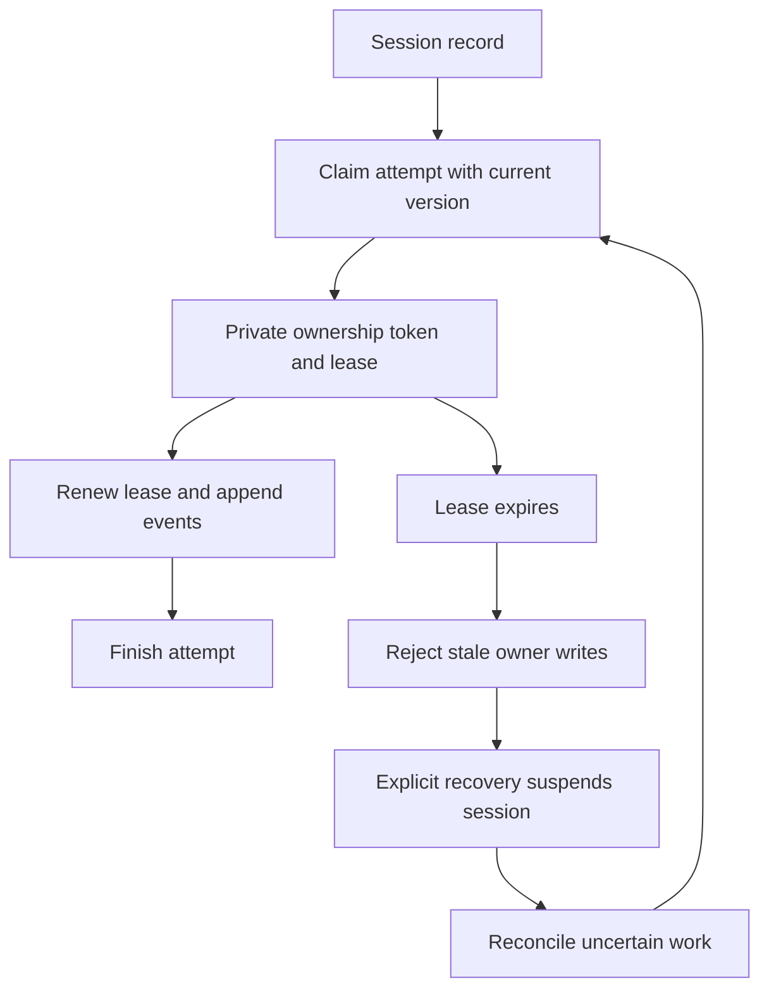
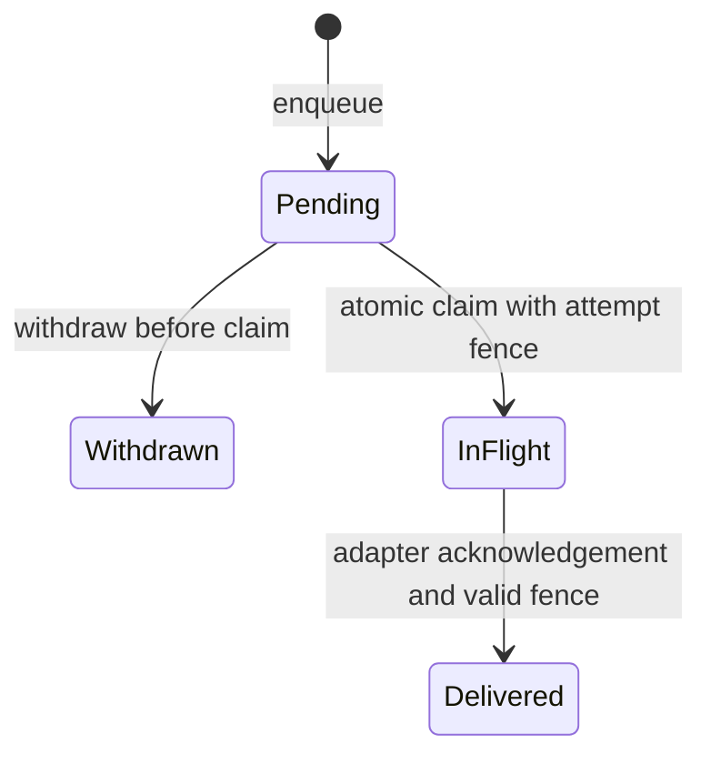

# Durable session storage

`foundry-store` persists sessions, attempts and event revisions in SQLite. The
caller chooses a database path whose parent directory already exists. There is
no implicit default data directory. The executable selects a database through
`--database` or `FOUNDRY_DATABASE`; see [local CLI workflows](../user/cli.md).

The database uses WAL, full synchronization, foreign keys and versioned schema
migration. Writes use immediate transactions. A database with a newer schema
version is rejected rather than silently interpreted.

## Ownership and concurrency

Creating a session with the same idempotency key and identical request returns
the existing session. Reusing the key for a different request is a conflict.
Claiming an attempt requires the expected session version and no active attempt.

The ownership token is private. A stale or forged token cannot renew a lease,
append events or finish an attempt. The default lease lasts 60 seconds; callers
may configure another duration and must renew it while working. Lease expiry
uses system UTC time, so clock adjustments affect it.

Opening another connection does not recover attempts. Explicit recovery only
releases expired ownership and marks affected sessions suspended. It cannot stop
an external process. The application must stop execution after losing ownership.

### Initial capture admission

`begin_fresh_attempt` atomically checks that a queued session has no retained
execution history before admitting its first attempt. An absent checkpoint head
alone is insufficient: a previous attempt blocks fresh admission even if it
produced no events. Pending and never-claimed withdrawn instructions may remain
in the queue; this operation does not claim or deliver them.

The consuming `FreshAttempt` value returns the exact session read during admission
alongside its private fence. The caller must launch it once, check cancellation
and lease ownership before launch, and hold queued instructions until activation.
Extracted credentials remain copyable by trusted code; this is not an exactly-once
execution guarantee. A committed admission consumes eligibility across restart,
including when its response was lost or no process is known to have started.
There is no automatic retry through ordinary admission. Service capture integration
remains separate from this storage API.

## Events and outcomes

Events have a per-session sequence, event ID, attempt ID, revision, kind and JSON
payload. A matching retry returns the original event while ownership is valid.
Conflicting retries fail; later revisions are separate immutable records. Event
IDs remain associated with their original attempt and kind.

Session versions track lifecycle and cancellation changes. Event sequence numbers
are independent and remain monotonic across attempts. Readers can request records
after an exclusive cursor with a limit. Zero limits produce empty pages.

Finishing with `exit` requires an outcome. Finishing with `error` or `suspended`
requires no outcome. Once cancellation has been recorded for an active attempt,
only suspended completion is accepted. Cancelling a queued session with no active
attempt immediately marks it suspended. Requests against other settled states
leave them unchanged. A cancellation request for an active attempt is not a
process-stop acknowledgement.

## Durable instruction queue

Schema version 3 provides `enqueue_message`, `messages`, `withdraw_message`,
`claim_next_message` and `acknowledge_message`. Migration preserves existing
sessions. `Message` records carry an ID, session ID, sequence, text,
`MessageState` and optional delivery attempt ID.

Message IDs are idempotent within a session. Repeating the same ID and text returns
the existing record in its current state, including withdrawal; changing the text
is a conflict. Listing uses an exclusive sequence cursor and includes pending,
in-flight, delivered and withdrawn records. Enqueueing does not start an attempt
or change the session outcome.

Claiming requires a valid attempt fence. It atomically selects the next pending
instruction, changes its state to `in_flight` and records the owning attempt.
Only one message may be in flight per session. A concurrent withdrawal can win
before the claim; after the claim it is rejected. Delivered messages also cannot
be withdrawn.

The application must obtain an adapter acknowledgement before recording delivery;
the database method itself does not contact the adapter. Acknowledgement requires
the same valid attempt fence that claimed the instruction. Pending and withdrawn
messages cannot be acknowledged. Repeating an acknowledgement by the same valid
attempt is idempotent; another attempt cannot claim its delivery.

After an uncertain crash, the in-flight record remains and blocks later claims.
There is no automatic redelivery. Explicit reconciliation is required but not
implemented, so do not assume recovering a session also releases its instruction
queue. The claim method returns no next message both when the queue has no pending
work and when an in-flight instruction blocks it; inspect records to distinguish
the two cases.

The CLI and MCP backend now expose enqueueing through send operations. CLI calls
generate fresh message IDs; MCP callers supply IDs for idempotent retries. Neither
path starts or resumes execution. A running [application service](service.md)
claims messages only after adapter capability negotiation and records delivery
after the runtime validates a matching receipt. The store itself does not
validate wire receipts; its acknowledgement method enforces attempt ownership.
Delivery acknowledgement is not execution success, and there is no exactly-once
delivery guarantee.

Tests cover reopening, idempotent enqueue, cursor ordering, fenced claims and
acknowledgement, claim/withdraw races, uncertain delivery and schema migration.

## Durable work revision

Schema version 5 records a separate per-session work revision. It advances in the
same transaction as an attempt starts, an instruction or tool is claimed, a
delivery or tool receipt changes, or a new event is appended. This records an
execution admission even if the owner crashes before producing its first event.
Read it through `Store::work_revision(session_id)`.

Exact retries, enqueueing, withdrawal, heartbeats, cancellation requests and reads
do not advance it. A failed transaction rolls back both the operation and its
revision increment. Exhausting the signed SQLite integer range rejects new work
without partially changing state. Recovery preserves the counter.

Existing sessions receive a zero baseline during migration; this does not
reconstruct their earlier execution. The counter is groundwork for detecting
work admitted after a saved context. It does not itself save conversation state,
validate tool effects or enable resume.

## Opaque context checkpoints

Schema version 6 stores immutable private payloads with a per-session checkpoint
head. The caller captures a consistent durable cut, then publishes bytes under a
live, uncancelled attempt fence and the expected previous head. Publication
rechecks the work revision, events, delivered inputs and tool records in the same
transaction as the payload and head update. In-flight inputs and unresolved tool
effects prevent publication. A competing head update is a conflict.

The store computes payload and record digests and verifies them on reads. Payloads
are limited to 1 MiB, metadata to 16 KiB, and coverage manifests to 64 KiB. Logical
storage quotas are 256 MiB per session and 1 GiB per database; these are not bounds
on SQLite files, WAL size or process memory. Publication never discards an older
checkpoint to make room. Payloads and producer annotations are not included in
ordinary session or event output.

Identical publication retries return the original reference without moving the
head backward. For a lost response, retain
`OpaqueCheckpointInput::request_digest(&fence)` before sending the request and
compare it with the reference returned by `checkpoint_request`. Finding a request
ID alone does not establish that the intended content committed. Lookup does not
require a live fence and does not grant permission to execute or publish again.

These APIs preserve opaque bytes, not proof of native conversation completion.
The caller supplies a configuration digest; the store preserves it but does not
verify model, workspace or tool-policy compatibility. Producer annotations are
untrusted data. A service must validate native context and explicitly authorize
restore and continuation. CLI resume and workspace rollback are not yet
implemented. Integrity checks detect
inconsistent records; they cannot detect restoration of an entire older database.

Schema version 7 adds `finish_with_opaque_checkpoint`: checkpoint publication,
terminal session state, a historical receipt and attempt deactivation commit in
one transaction. The terminal proposal is included in the request digest and the
16 KiB metadata limit; oversized results are rejected, not truncated. Ordinary
completion and checkpoint completion share lifecycle and ownership checks.
Checkpoint completion additionally requires an uncancelled owner and clean cut.

Retain `input.finalization_request_digest(&fence, &terminal)` before submission.
After a lost response or owner deactivation, use `finished_checkpoint_request`
with that digest. It returns the immutable historical terminal result and session
version, even if a later attempt changed the current session. This read-only
recovery cannot authorize another execution. Failed publication leaves the old
head and session intact; ordinary error or suspension cleanup remains available
when the attempt still owns its lease.

## Recovery limits

Schema version 8 adds separate loading ownership and one-use continuation
authorization. See [checkpoint restoration](restoration.md) for transaction,
retry and cancellation semantics. These storage APIs do not enable CLI resume.

Reopening preserves stored state, event history and idempotency. The store does
not implement fork, rewind, automatic resumption or exactly-once external tool
execution. It does not reconstruct missing results or roll back external effects.

Storage tests cover reopening, concurrent claims and writes, event revisions,
lease expiry, stale ownership, cancellation escalation and schema rejection. The
[application service](service.md) connects storage to
[runtime supervision](runtime.md); its integration tests cover cancellation from
another process, lease loss, silent adapters and failed persistence. These tests
use offline adapters and do not verify provider execution.
