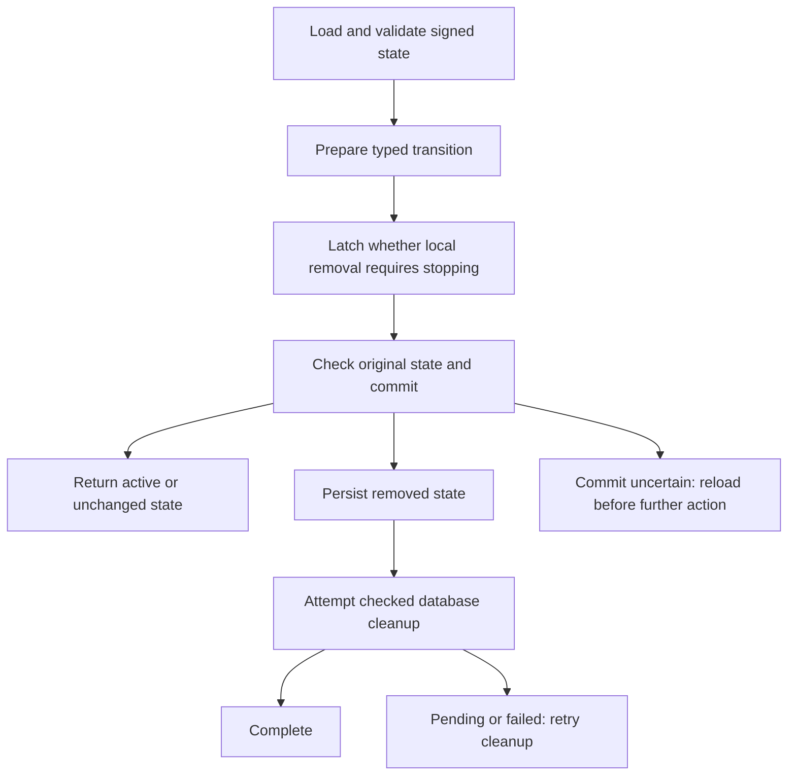
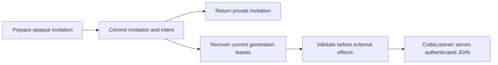

# Durable team state

The network library's `FullTeamStore` preserves signed team state in a private
SQLite database. It supports formation, invitations, admission, key rotation,
configured identity proofs and member removal. These are library operations;
network CLI commands, automatic listener recovery and daemon delivery integration
remain unfinished.
The smaller [membership projection store](../../crates/network/docs/persistence.md)
is a separate format and is not automatically promoted into full-team state.

## Prepare and commit

Preparation uses the selected local identity and a state loaded by the same store
instance. Commit checks the original revision and digest inside an immediate
transaction. Even an unchanged result must pass that comparison. A conflicting
caller reloads and reconsiders the operation; the library does not silently retry
with new randomness. Cold loading retains validated historical membership.

## Local removal

Callers must read `requires_quiescence()` before consuming a prepared transition.
Validated local removal requires stopping activity even if commit later fails.
This signal does not prove that removal was stored. Accepted removal is determined
from verified membership before incoming replacement secrets are merged or encoded
into a checkpoint.

Committed removal leaves a minimal tombstone. It cannot reopen as an empty team
or authorize new active transitions. Cleanup has a separate outcome: `Complete`,
`PendingBusy`, or `Failed`. A busy reader can delay cleanup; callers can retry
without changing the tombstone. Completion checks the WAL checkpoint result and
file synchronization, but does not guarantee forensic erasure from backups,
snapshots or storage hardware.

An `Indeterminate` commit result requires reloading state. Neither a failed commit
nor a removal signal authorizes broadcasting secrets or treating an operation as
successfully delivered. Service generation checks and recipient authorization are
still required when these storage operations are connected to live peers.

## Invitation-code derivation

The library's `code_invite` module accepts an explicitly supplied dictionary and
its expected SHA-256 digest. `CodePolicy` uses the invitation contexts from a
validated `WireProfile`; it supplies no default dictionary or discovery service.
Normalization splits on non-ASCII letters, lowercases the remaining words and
requires exactly four dictionary entries. Generation samples four words with
replacement. Derivation produces an endpoint key and a bearer secret; callers
must treat the code, keys and code-derived endpoint identity as private values.
These types have no debug or generic serialization implementation.

Dictionary input is limited to 256 KiB and 4,096 unique lowercase ASCII words,
each at most 1,023 bytes. Code input is limited to 4,096 bytes. Digest mismatch,
invalid entries and entropy failure return errors. Derivation alone does not
publish an invitation, persist its intent, bind a listener or establish discovery.

## Durable invitation intents

A store policy configured with `with_codes` binds the ordered dictionary and both
derivation contexts. `prepare_code_intent` creates an opaque candidate;
`commit_code_intent` atomically persists the invitation, local intent and control
effects before returning privileged invitation material. A conflict requires a
fresh load and explicit preparation. An uncertain commit requires recovery.

Recovery validates committed state and returns generation-bound leases. The host
must serialize lease validation with revocation before binding and before
publication. Expired, consumed or revoked invitations cannot authorize a new
listener. Existing join replies need separate host-owned draining authority.
Private-relay invitations return long tickets without a code-listener intent.
Control effects contain identifiers, not captured secrets or wire snapshots;
acknowledging an exact effect is a checked durable mutation. `CodeListener` binds
from a fresh permit, revalidates before publication, and serves JOIN with the
committed admission guard held through reply output. Pending exchanges stop when
the listener stops; already-started commits and replies retain their ownership.
Foreground daemon routing, discovery/publication and automatic recovery scheduling
remain separate integration work.

## Migration and limits

Schema version 2 opens directly without a code policy. Enabling codes on an
existing store uses explicit `enable_codes`, preserving its signed records while
atomically migrating to version 3. Ordinary open does not perform that migration.
Older full-team version 1 requires explicit
`migrate_v1`; ordinary open never rewrites it. Migration verifies the old signature,
policy and complete records, preserves membership and revision, and commits the
new representation atomically. Migration errors after commit may be indeterminate.

Typed incoming collections are bounded to 4,096 entries and full checkpoint
encoding to 4 MiB. Unsupported or oversized state is rejected, not truncated.
Local tests cover migration, stale candidates, durable invitation intents,
generation fencing, removal, reader contention and process exit between commit
and cleanup; they do
not establish two-machine compatibility or hardware power-loss guarantees.
