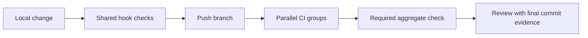

# Development checks

Local hooks and CI execute the same Python orchestration script. CI installs pinned tools directly; local checks use your prepared environment. JavaScript documentation tooling uses Bun; Rust uses Cargo. Cargo and Bun lockfiles must be current before CI can pass. A resolved Flox environment is an optional local setup; see [environment setup](environment.md).

```sh
bun install --frozen-lockfile --ignore-scripts
bun run docs:browser
python3 scripts/checks/all.py
```

## Check groups

| Group | Checks |
| --- | --- |
| `rust` | Formatting, Clippy with warnings denied, workspace tests |
| `dependencies` | Locked Cargo advisory, dependency-ban and source checks |
| `python` | Repository validation tests and catalog fixture validation |
| `adapter` | Strict TypeScript checking, ESM build and offline adapter protocol tests |
| `integration` | Fresh CLI/adapter subprocess tests, Rust/compiled-TS private bootstrap, and real helper writes with durable receipts and consuming permissions |
| `mcp-sdk` | Official Python SDK against a fresh CLI subprocess, using hash-pinned test dependencies |
| `docs` | Documentation tooling tests, Markdown, links and rendered diagrams |
| `hygiene` | License digest, whitespace, LOC, external naming policy and workflow syntax |

Use `--group rust`, for example, to run one group. `--fast` skips Rust test execution but retains lint and complete documentation validation. Before pushing, run the full suite. A missing tool or policy is an error, not an implicit skip.

Dependency checks use the pinned cargo-deny tool and `deny.toml`. Unresolved
advisories fail the check; duplicate-version warnings remain visible. This group
does not approve licenses or replace the separate release notice review.



## Hooks

Install hooks explicitly after preparing the environment:

```sh
pre-commit install --hook-type pre-commit --hook-type pre-push
pre-commit run --all-files
```

Pre-commit runs the fast suite; pre-push runs the full suite. Main-branch pushes
and manual CI runs execute all eight groups on Linux x64 and additionally require
the integration group on Linux
arm64 and macOS arm64. Those integration jobs build both executables and run the
real-helper tests that the ordinary Rust suite skips. The aggregate gate requires
every matrix job to succeed. Release packaging remains a separate check; local
tests do not establish hosted CI or release-platform success.

## Pull request scope

Pull requests always run documentation and hygiene checks. Changes under `docs/`
need only those groups. CLI and Rust crate changes also run the whole Rust
workspace, integration and MCP SDK checks. Adapter changes add Rust, adapter and
integration checks. Mixed changes combine their groups; integration always runs
on all three platforms above.

Root files, shared contracts, workflows, scripts, tests, vendor code, Flox files
and dependency manifests require the complete matrix. Unknown paths and empty
comparisons also select everything. Renames include both old and new paths;
comparison errors fail CI. The required aggregate checks both scope selection
and every selected job, so failed planning cannot silently skip validation.

## Parallel contribution policy

Assign one integration owner for each delivery batch in the project tracker.
That owner coordinates root manifests, lockfiles, shared contracts and final
merges. Contributors claim a ticket and its owned paths before editing, use a
focused branch, and use separate worktrees when working concurrently. Do not
share a mutable checkout or overwrite another contributor's changes.

Shared-file changes go through the integration owner before merging. Respect
ticket dependencies and hand off interfaces explicitly. Move tickets to In
Progress when work starts, In Review after implementation and local checks, and
Done only after acceptance criteria and final-commit CI pass. Record remaining
gaps without treating partial implementation as completion.

## External naming policy

The maintained naming policy is distributed outside this repository. Load the approved JSON into `FOUNDRY_NAMING_POLICY` locally; CI receives the same policy as a repository secret. Do not commit the policy or copy its excluded matches into test fixtures. The scanner reports neutral rule identifiers.

Git history validation needs a complete clone. Binary or otherwise uninspected assets require additional review; incomplete inspection is not a clean result. Keep externally held evidence in the assigned project ticket.

For visually inspected SVGs, the external policy can carry `svg_reviews` entries
with the exact `sha256` and an external `evidence` identifier. Changed bytes need
a new review. These entries cover visual inspection only: text, paths and
encoding still pass through the scanner. They cannot clear binary image formats
or executable contents.

## Completion evidence

After the final push, monitor all applicable checks until they pass. Record the final commit SHA and run links in the ticket. A green earlier commit, missing required package lockfile, cancelled job or unverified release artifact does not satisfy completion.
