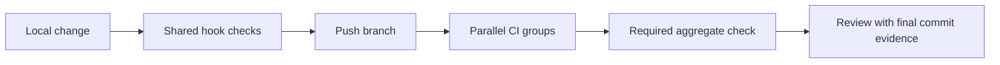

# Development checks

Local hooks and CI execute the same Python orchestration script through Flox. JavaScript documentation tooling uses Bun; Rust uses Cargo. Environment and package lockfiles must be current before CI can pass.

```sh
flox activate -- bun install --frozen-lockfile --ignore-scripts
flox activate -- bun run docs:browser
flox activate -- python3 scripts/checks/all.py
```

## Check groups

| Group | Checks |
| --- | --- |
| `rust` | Formatting, Clippy with warnings denied, workspace tests |
| `dependencies` | Locked Cargo advisory, dependency-ban and source checks |
| `python` | Repository validation tests and catalog fixture validation |
| `adapter` | Strict TypeScript checking and offline adapter protocol tests |
| `integration` | Fresh CLI/adapter subprocess tests and a real tool-helper write through durable session records |
| `mcp-sdk` | Official Python SDK against a fresh CLI subprocess, using hash-pinned test dependencies |
| `docs` | Documentation tooling tests, Markdown, links and rendered diagrams |
| `hygiene` | License digest, whitespace, LOC, external naming policy and workflow syntax |

Use `--group rust`, for example, to run one group. `--fast` skips Rust test execution but retains lint and complete documentation validation. Before pushing, run the full suite. A missing tool or policy is an error, not an implicit skip.

Dependency checks use the pinned cargo-deny tool and `deny.toml`. Unresolved
advisories fail the check; duplicate-version warnings remain visible. This group
does not approve licenses or replace the separate release notice review.



## Hooks

Install hooks explicitly after preparing the environment:

```sh
flox activate -- pre-commit install --hook-type pre-commit --hook-type pre-push
flox activate -- pre-commit run --all-files
```

Pre-commit runs the fast suite; pre-push runs the full suite. CI runs all eight
groups on Linux x64 and additionally requires the integration group on Linux
arm64 and macOS arm64. Those integration jobs build both executables and run the
real-helper tests that the ordinary Rust suite skips. The aggregate gate requires
every matrix job to succeed. Release packaging remains a separate check; local
tests do not establish hosted CI or release-platform success.

## External naming policy

The maintained naming policy is distributed outside this repository. Load the approved JSON into `FOUNDRY_NAMING_POLICY` locally; CI receives the same policy as a repository secret. Do not commit the policy or copy its excluded matches into test fixtures. The scanner reports neutral rule identifiers.

Git history validation needs a complete clone. Binary or otherwise uninspected assets require additional review; incomplete inspection is not a clean result. Keep externally held evidence in the assigned project ticket.

## Completion evidence

After the final push, monitor all applicable checks until they pass. Record the final commit SHA and run links in the ticket. A green earlier commit, missing lockfile, cancelled job or unverified release artifact does not satisfy completion.
