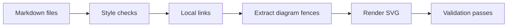

# Development environment

Foundry uses Rust for production code and Bun for repository tooling. Node runs
browser-backed documentation tools. These tools are development dependencies;
they are not requirements for users of a compiled binary.

## Set up the environment

CI and local hooks enter the checked-in Flox environment through
`scripts/ci/flox.sh`. Use Flox 1.19.1; the wrapper rejects other CLI versions,
missing locks, unexpected tool origins and lock changes. The public immutable
flake inputs avoid Catalog resolution and require no FloxHub login.

From the repository root:

```sh
bash scripts/ci/flox.sh bun install --frozen-lockfile --ignore-scripts
bash scripts/ci/flox.sh bun run docs:browser
bash scripts/ci/flox.sh python3 scripts/checks/all.py
```

If Flox 1.19.1 is installed outside PATH, set `FOUNDRY_FLOX` to its absolute
executable path. The wrapper selects this executable without changing a global
installation. Initial activation downloads public dependencies or builds missing
outputs; allow network access and time for source builds.

The browser command downloads the Chrome headless shell revision selected by the locked
Puppeteer dependency into `.flox/cache/puppeteer`. It does not install a global
browser. Dependency installation deliberately disables lifecycle scripts; browser
provisioning is an explicit step. Allow network access during initial setup.

Ubuntu CI installs an AppArmor profile permitting user namespaces only for the
downloaded headless browser executable. This lets Chromium retain its sandbox
while rendering diagrams; the profile is confined to the ephemeral runner.

The environment pins Rust 1.95.0 with Clippy and rustfmt, Bun 1.3.11,
Node 22.23.1, Python 3.13.13 and the repository validation tools. Its original
recipes and Nix-generated input lock live in `.flox/toolchain/`. The environment
manifest references a public immutable recipe commit; its Flox-generated lock
records selected outputs for Apple silicon, Intel macOS, Linux x86_64 and Linux
ARM64. Native Windows is not supported.

Four native CI activation jobs check actual tool origins and versions and compile
application dependencies. Package evaluation alone does not establish execution
on another platform. These checks remain required alongside the existing
integration tests; release packaging has separate acceptance gates.

## Verify the selected compiler

```sh
bash scripts/ci/flox.sh python3 scripts/ci/flox_verify.py --smoke
```

The verifier checks the activated executable paths against locked package outputs.
A matching version from an ambient installation is insufficient. Avoid overriding
compiler or linker selection when running the canonical checks.

## Check documentation

Run these commands from the repository root in your prepared environment:

```sh
bun run docs:fast
bun run docs:check
bun run docs:test
```

`docs:fast` and `docs:check` run the same checks: recursive Markdown linting,
local files and heading links, and every Mermaid fence rendered to SVG with the
actual browser. Neither command skips diagram validation.
`docs:test` tests nested documents, links, diagram extraction, successful rendering
and rejection of malformed diagrams. Missing browsers fail full validation.

Checks cover Markdown throughout the repository, excluding dependency, build,
Git and Flox cache directories. Local links are resolved relative to their source
document; root-relative links refer to the repository root. External URLs are
not fetched. The checker verifies Markdown heading fragments, including duplicate
headings, but does not validate fragments in non-Markdown files.



## CI and hooks

Use the same commands in CI and local hooks. The fast command is suitable for a
pre-commit check; full documentation validation and tests belong in pre-push and
CI checks. Formatting is never applied implicitly.

Run the shared checks through the wrapper:

```sh
bash scripts/ci/flox.sh python3 scripts/checks/all.py --fast
bash scripts/ci/flox.sh python3 scripts/checks/all.py
```

Provision the browser before full checks. Cache `.flox/cache/puppeteer` by
operating system, architecture and `bun.lock` digest. A cache hit is an
optimization, not permission to skip validation. Linux runners also need the
native libraries required by Chrome; a missing library must fail visibly.

## Update dependencies

Update exact versions in `package.json`, regenerate `bun.lock` with the pinned
Bun version, and run both documentation checks and tests. Update Flox packages
and its lockfile together using public immutable recipe inputs. Generate the Nix
input lock before publishing a new recipe commit, then resolve the Flox lock
against that commit with the pinned CLI. Never edit generated lock records. Check the
Rust minimum version against the workspace before upgrading or downgrading.
Do not run package upgrades from activation hooks or validation commands.
