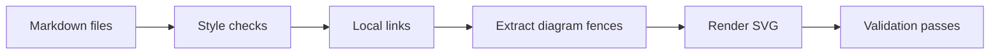

# Development environment

Foundry uses Rust for production code and Bun for repository tooling. Node runs
browser-backed documentation tools. These tools are development dependencies;
they are not requirements for users of a compiled binary.

## Set up the environment

Required CI installs explicitly pinned tools and runs `scripts/checks/all.py`
directly. It does not require a Flox account. Local hooks run that same checker
in the current environment, so activate your chosen toolchain before committing.
The Cargo and Bun lockfiles remain required and frozen in CI.

Flox is an alternative local environment. Its manifest declares the development
tools, but the repository does not yet include a resolved Flox lockfile. Do not
treat the manifest alone as a reproducible environment.

Install Flox 1.19.1 through its official installation instructions. From the
repository root:

```sh
flox activate
bun install --frozen-lockfile --ignore-scripts
bun run docs:browser
```

The browser command downloads the Chrome headless shell revision selected by the locked
Puppeteer dependency into `.flox/cache/puppeteer`. It does not install a global
browser. Dependency installation deliberately disables lifecycle scripts; browser
provisioning is an explicit step. Allow network access during initial setup.

Ubuntu CI installs an AppArmor profile permitting user namespaces only for the
downloaded headless browser executable. This lets Chromium retain its sandbox
while rendering diagrams; the profile is confined to the ephemeral runner.

The environment declares Rust 1.95.0, Bun 1.3.11 and Node 22.23.1. A complete
Flox lockfile is required before the environment can be treated as reproducible.
Catalog-based resolution requires authentication. If you choose that setup,
authenticate with `flox auth login`, then run `flox activate`. Commit the generated
`.flox/env/manifest.lock` with its manifest after verifying the toolchain. Do not
substitute an empty lockfile. Revision-pinned flake packages support resolution
without Catalog authentication, but a matching environment for the declared
versions and platforms has not yet been validated here.
An up-to-date lockfile allows ordinary activation without catalog authentication.

The declared platforms are Apple silicon, Intel macOS, Linux x86_64 and Linux
ARM64. Package declarations alone do not establish build or browser compatibility
on every platform. CI must verify each supported target. This environment does
not provide native Windows support.

## Verify the selected compiler

Check `command -v cargo`, `command -v rustc`, `cargo --version` and
`rustc --version` after activation. Cargo launches the compiler selected by its
process environment; a different compiler earlier in PATH can defeat an intended
toolchain selection. In a mixed Homebrew/rustup setup, `rustup run 1.95.0 cargo`
alone has not reliably selected the matching compiler. For an external fallback,
prefix PATH with the actual installed 1.95.0 toolchain's `bin` directory for both
commands and verify their versions. Do not treat that fallback as a resolved
Flox environment or a cross-platform verification.

## Check documentation

Run these commands from the repository root in your prepared environment:

```sh
bun run docs:fast
bun run docs:check
bun run docs:test
```

`docs:fast` and `docs:check` run the same checks: recursive Markdown linting,
local files and heading links, and every Mermaid fence rendered to SVG with the
actual browser. Neither command skips diagram validation.
`docs:test` tests nested documents, links, diagram extraction, successful rendering
and rejection of malformed diagrams. Missing browsers fail full validation.

Checks cover Markdown throughout the repository, excluding dependency, build,
Git and Flox cache directories. Local links are resolved relative to their source
document; root-relative links refer to the repository root. External URLs are
not fetched. The checker verifies Markdown heading fragments, including duplicate
headings, but does not validate fragments in non-Markdown files.



## CI and hooks

Use the same commands in CI and local hooks. The fast command is suitable for a
pre-commit check; full documentation validation and tests belong in pre-push and
CI checks. Formatting is never applied implicitly.

With tools already on PATH, run the shared checks directly:

```sh
python3 scripts/checks/all.py --fast
python3 scripts/checks/all.py
```

For noninteractive execution in a resolved Flox environment:

```sh
flox activate -- bun run docs:fast
flox activate -- bun run docs:check
```

Provision the browser before full checks. Cache `.flox/cache/puppeteer` by
operating system, architecture and `bun.lock` digest. A cache hit is an
optimization, not permission to skip validation. Linux runners also need the
native libraries required by Chrome; a missing library must fail visibly.

## Update dependencies

Update exact versions in `package.json`, regenerate `bun.lock` with the pinned
Bun version, and run both documentation checks and tests. Update Flox packages
and its lockfile together through an authenticated maintenance session. Check the
Rust minimum version against the workspace before upgrading or downgrading.
Do not run package upgrades from activation hooks or validation commands.
