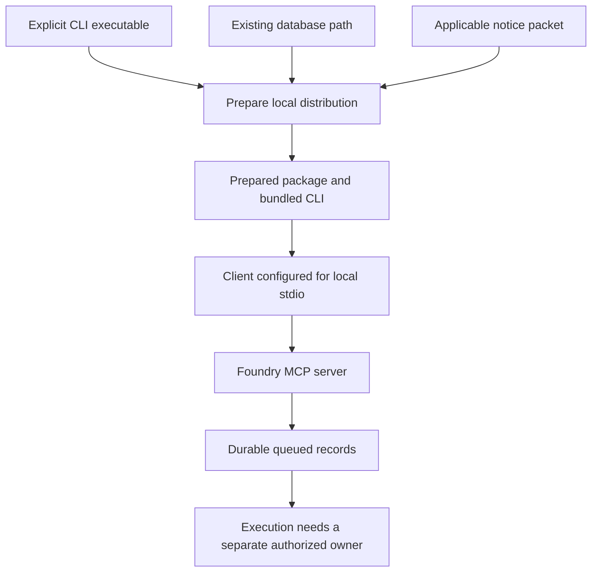

# Client packages

Foundry ships workflow content and client discovery metadata in
`plugins/foundry`. The source package is unprepared: it contains no bundled CLI
or MCP connection files. Preparing a local distribution adds an explicitly
selected executable and database connection. Preparation does not install a
client extension, edit client settings, authenticate an account or start a task.

The separate [plugin command surface](plugins.md) parses `plugins list`,
`plugins add` and `plugins remove`. The local backend still returns unsupported
for those management operations. Use the preparation tool below to create
package files; do not treat `plugins add` as a working installer.

## Prepare a local distribution

Use a CLI built for the machine that will run the client. Select an existing
local database and the applicable notices for that exact executable build.
The database remains outside the distribution and is not copied into it.

From the repository root, replace each example path with your own absolute path:

```sh
python3 scripts/clients/prepare.py \
  --binary /absolute/build/f5y \
  --database /absolute/state/foundry.db \
  --notices /absolute/build/notices \
  --output /absolute/packages/foundry-local
```

The output must be a new directory outside the source checkout, with an existing
parent directory. The tool copies the fixed reviewed file
inventory, including hidden discovery metadata, rather than taking a snapshot
of every file in your checkout. It includes the unchanged root `LICENSE`, copies
the supplied notices into `THIRD_PARTY_NOTICES`, and bundles the selected CLI as
`plugins/foundry/bin/f5y`. A root `prepared.json` records the copied executable
hash and selected database path; it is not an installation or rights certificate.

Supplying a notices directory does not establish that its contents cover every
dependency or that distribution rights have been cleared. Keep the notices tied
to the selected executable's build and dependency evidence. Package preparation
is separate from release clearance.

The resulting directory is a local, machine-specific distribution. Native client
configuration contains the absolute path to its bundled executable and all
connection forms contain the selected absolute database path. Keep the output
at that location; prepare a new directory if the executable location or database
selection changes. A bundle for one operating system or architecture does not
become executable on another by copying its metadata.



## Package layout

Paths in this table are relative to the distribution root.

| Path | Content |
| --- | --- |
| `.agents/plugins/marketplace.json` | Local package discovery metadata |
| `.claude-plugin/marketplace.json` | Claude discovery metadata |
| `.cursor-plugin/marketplace.json` | Cursor discovery metadata |
| `plugins/foundry/plugin.json` | Portable package descriptor |
| `plugins/foundry/.claude-plugin/plugin.json` | Claude descriptor |
| `plugins/foundry/.codex-plugin/plugin.json` | Codex compatibility descriptor |
| `plugins/foundry/.cursor-plugin/plugin.json` | Cursor descriptor |
| `plugins/foundry/commands/` | Ask, build, fix, fix-ci, review and status workflows |
| `plugins/foundry/skills/foundry/SKILL.md` | Shared orchestration guidance |
| `plugins/foundry/skills/foundry/agents/openai.yaml` | Skill display metadata |
| `plugins/foundry/rules/foundry-handoff.mdc` | Opt-in handoff guidance |
| `plugins/foundry/assets/` | Original package and workflow artwork |

Prepared output adds these files:

| Package-relative path | Connection representation |
| --- | --- |
| `bin/f5y` | Selected executable bytes |
| `mcp.json` | Portable stdio server using `./bin/f5y` |
| `.mcp.json` | Claude/Codex compatibility stdio server using the absolute bundled path |
| `.cursor-plugin/mcp.json` | Cursor native server using the absolute bundled path |

Each server is named `foundry` and receives the same argument vector:
`--database`, the selected absolute database path, then `mcp`. The files describe
one logical connection in different client formats. They are not instructions
to start multiple servers for the same client. Prepared descriptors select the
appropriate native file; client precedence still needs installed-client testing.

No hosted URL, OAuth endpoint, shell launcher or executable search is supplied.
The portable connection resolves its executable from the package root. Native
connections use the fixed absolute bundled path.

## Client setup and removal

Keep the complete distribution, including hidden directories, license and
notices. Give the client the package or discovery root supported by its local
plugin interface. Exact installation commands and settings locations are not
certified here: this baseline does not establish a tested installed version of
Claude, Codex, Cursor or Grok.

Claude, Codex and Cursor have separate descriptors. Grok remains an explicit
shared-layout compatibility target; the Cursor layout alone does not prove Grok
can discover, install or connect to this package. Packaged commands, skills,
display metadata and opt-in rules are distinct components. Presence in the
archive does not prove that every client exposes each component.

After a client connection is configured, verify initialization and `tools/list`
before attempting a workflow. Report the client version and the actual tools
returned. A parsed descriptor or an executable MCP smoke check is not an
installed-client result. If connection or capability checks fail, report that
failure instead of claiming the requested work ran.

To remove a prepared distribution, first detach any client registration and stop
client-owned server processes using that client's controls. Then remove only the
output directory you prepared. This does not remove the external database or
undo work recorded there. The preparation tool does not maintain an installation
receipt or reverse user-edited client settings.

## What the connection can do

The current [MCP interface](../architecture/mcp.md) exposes five local tools:

| Tool | Current effect |
| --- | --- |
| `session_create` | Creates a queued local session |
| `session_list` | Lists stored local sessions |
| `session_get` | Reads a stored session |
| `session_send` | Queues an instruction with an explicit message identity |
| `session_cancel` | Records a graceful or hard cancellation request |

Creating or sending through this MCP backend does not start or resume an adapter,
even if adapter configuration exists in the environment. Queue acceptance,
delivery acknowledgment and completed work are different states. A cancellation
request is not proof that the process stopped. Inspect the stored state and
actual owner outcome before reporting completion or suspension.

For configured local execution, use the actual [CLI workflows](cli.md),
[local adapter setup](local-adapter.md) and [resume flow](resume.md). Workflow
content must identify the available route and obtain the required authorization;
it does not grant tool permission merely by being installed.

Remote targeting, cloud execution, scheduling, attachments, hosted authentication,
automatic pull-request review and other unavailable operations are not enabled
by these files. Preserve the requested goal, identify the missing capability and
report the boundary. Do not invent tool names, successful results or session links.

## Validation and licensing

Package checks can establish that descriptors parse, versions agree, references
stay inside the package, required files exist and prepared connection arguments
match the chosen inputs. A local stdio smoke can establish that the bundled
executable serves the selected database. Neither check establishes installed
client discovery, account authentication or a completed agent workflow.

The original package artwork is described in the
[asset inventory](../../plugins/foundry/assets/README.md) and is covered by the
unchanged root [LICENSE](../../LICENSE). Retain the root license and applicable
third-party notices with a distributed bundle. No registry publication or
marketplace approval is implied by a local prepared directory.
