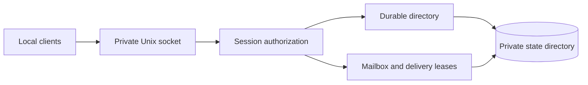

# Local foreground daemon

The development `f5y-daemon` executable provides local session registration,
directory lookup and durable messaging over a private Unix socket. It runs in the
foreground. [Explicit peer configuration](peer-configuration.md) enables
[team joins and durable peer messaging](peer-network.md). Network CLI commands
are not yet connected to this executable. Hosted identity and client injection
require further integration.



## Start a development instance

Create existing directories owned by your account with mode `0700`. Select a
short socket directory when the state directory exceeds the operating system's
Unix socket path limit. Supply an explicit configuration file:

```json
{
  "state_directory": "/absolute/private/state",
  "socket_directory": "/absolute/private/ipc",
  "person": "alice",
  "machine": "laptop",
  "network": "disabled",
  "folders": []
}
```

The configuration must be a regular, single-link file owned by your account and
not writable by other accounts. Unknown fields, invalid values and malformed
JSON fail explicitly. No personal profile or default hosted service is loaded.
An empty folder list allows existing repositories. Folder rules contain `path`
and `allow`; the deepest canonical matching directory rule wins.

With the [pinned development tools](../development/environment.md), run:

```sh
bash scripts/ci/flox.sh cargo run --locked -p foundry-network \
  --bin f5y-daemon -- --config /absolute/private/daemon.json
```

Startup writes one JSON readiness event containing the socket path. A second
daemon cannot own the same state directory. Keep retained lock files in place.
Use the authenticated shutdown operation or interrupt the foreground process.
Termination signals also drain connections before releasing ownership.

## Local protocol

Requests and replies are newline-delimited JSON with a numeric `id`. For example:

```json
{"id":1,"op":"who","filter":{"online_only":true}}
```

Requests are limited to 1 MiB. Inbox replies have a separate ceiling derived from
the mailbox's 10,000-row and 64 MiB stored-body quotas, including JSON escaping
and the rendered text. Clients must not apply the request limit to these replies;
Rust clients can use `ipc_codec::read_reply`. Reads have a whole-record deadline
and writes have a bounded wait. Unknown operations return an error with the
request ID when it is valid. Malformed records close the connection after a
bounded error response.

Registration accepts a conversation name, an existing repository directory and
an optional path-sharing choice. Person and machine come from configuration.
The reply issues a secret credential scoped to that conversation; keep it private.
A new connection must attach with that credential before acting for the
conversation. Credentials cannot authorize another conversation, even when one
connection is associated with several sessions. The socket's local account check
does not replace session authorization. Adapter capability is currently pull-only.

Implemented operations cover registration and attachment, directory and status
queries, sending and polling mail, stopping inbox waits, delivery acknowledgement
and failure, and authenticated shutdown. Inbox waits default to zero seconds and
are capped at 600 seconds. Waiting does not hold the database lock; an authorized
`stop_waiting` request ends waits for its conversation.

## Mail and restart behavior

Local sending persists a message before replying. An exact message-ID retry preserves
its current state; changing its recipient, contents, reply target or delivery
intent returns a conflict. Wake defaults to `true` and notify to `false`; these
intents are retained, not evidence of client injection.

An inbox reply contains an ordered `messages` array and a plain sender/body `text`
rendering; both are empty when no messages are pending. A poll returns the entire
eligible snapshot in one reply, without pagination or silent truncation. Every
selected payload and the complete serialized response must validate before any
message is consumed. Validation or sealing failure leaves mail unread. A commit
or sync failure requires recovery and cannot promise rollback.

The host prepares the reply in a private file, removes its temporary pathname
before writing payload bytes, and seals it before committing read state. One
owned reply slot bounds preparation and queued output across connections. Empty
long polls release that slot while waiting. Socket output streams the committed
file without holding the mailbox lock or building another complete JSON buffer.

An ordinary inbox poll consumes read state before replying. Read is distinct from
reported adapter delivery; a lost reply can therefore leave mail already read.
Use `peek` to retain unread mail and obtain an acknowledgement token. Only its
owning session and connection can acknowledge that token. Failed or disconnected
peek delivery leaves mail unread. Polling does not spend push retries or inherit
push backoff; exhausted push retries retain mail for polling.

For embedded hosts, `Daemon::spawn()` returns an owned task whose `abort()` closes
inbox cancellation gates synchronously before requesting task cancellation.
Aborting a raw Tokio task takes effect when its future is dropped. Neither path
rolls back a database commit that has already passed its final cancellation check.

Peer envelopes have an explicit stored format. Inbox display extracts their text
while retaining the complete envelope for retry/conflict checks. Plain text that
looks like JSON remains plain text. Unsupported file or approval payloads fail
before consuming read state.

Restart preserves credentials, status and mail, while clearing live connection
associations. Corrupt or insecure state fails explicitly. Storage checks Unix
ownership and modes; Windows ACL and named-pipe support remain unimplemented.
Socket publication requires Linux or macOS exclusive-rename support and eight
extra address bytes for staging. A distinct socket directory is also leased, so
two daemons cannot share that namespace. Conflicting replacement sockets are
preserved; interrupted namespace changes can leave private staging directories
for manual inspection. Cleanup failures report the retained path.
Peer messaging uses a separate durable transport outbox. Approval, attachment and
client-adapter workflows require further integration and validation.
