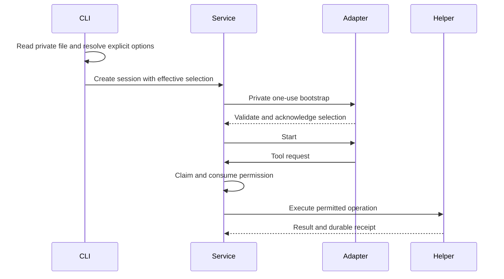

# Configure a local adapter

An explicitly provisioned adapter can receive a selected model, private resources
and workspace permissions through the CLI. Foundry supplies the CLI and helper;
the installation owner supplies a compatible adapter and its provider dependencies.
This setup does not discover accounts or install a provider package.

## Select the installation

Set `FOUNDRY_ADAPTER` to one absolute executable path. Use a fixed launcher when
the adapter requires an interpreter. The value is never parsed as a shell command.
Set `FOUNDRY_ADAPTER_CONFIG` to an absolute path to your private configuration file.
The installed `f5y-toolhost` must be beside `f5y`, or explicitly selected with the
absolute development override `FOUNDRY_TOOLHOST`.

```sh
export FOUNDRY_ADAPTER=/absolute/installation/bin/foundry-adapter
export FOUNDRY_ADAPTER_CONFIG=/absolute/private/adapter.json
export FOUNDRY_DATABASE=/absolute/state/sessions.db
f5y --dir /absolute/workspace --model selected-model --effort high "Inspect this task"
```

The paths and model above are placeholders for your installation. The database's
parent directory must exist. The configured agent directory must also exist.
Prepared execution requires the paired helper even when no tools are granted.

## Supply one private snapshot

The configuration file is a UTF-8 JSON object with exactly three fields:

| Field | Contents |
| --- | --- |
| `version` | Integer `1` |
| `selection` | The complete public [adapter selection](../architecture/adapter-configuration.md), including provider, model, effort, canonical workspace directory, owner-issued identities, profile, tool catalog and output bounds |
| `private` | Exactly `credential`, `system_prompt` and `agent_directory` |

An API-key credential has `kind: "api_key"`, a matching `provider`, and a nonempty
`value`. `{"kind":"none"}` is accepted only when the selected adapter supports
credential-free preparation. The system prompt is explicit; the adapter decides
whether an empty prompt is supported. The agent directory is an absolute path.
Obtain profile and resource settings from the trusted installation owner; do not
derive workspace or policy identities from credentials.

On Unix the file must be owned by your user, a regular file with mode `0600`, have
one hard link, and contain at most 64 KiB. Final-component symlinks, named pipes,
unknown or duplicate fields, invalid versions and malformed values are rejected.
Parent-directory aliases are not prohibited. Configuration is read once for each
execution; it is not a secure credential store or protection against another
process running as your user. Other platforms reject this private-file path.

Private values travel over the adapter's existing stdin bootstrap. They are not
included in the task request, session metadata, arguments or inherited adapter
environment. Diagnostics do not echo configuration contents. Treat the file and
any native exports as confidential.

## Model selection and permissions

For fresh execution, explicit `--model` and `--effort` replace only those values
from the file. Omitted options retain the file's explicit values. Model strings
are opaque; a slash or colon does not choose a different provider. The provider
always comes from the file. `session start --provider github|gitlab` selects a
repository host and remains unsupported by this local execution path.

The effective directory must match the canonical workspace in the configuration.
Changing model or effort recomputes the complete selection identity and records
the effective values in the session. It does not grant additional tools.

Tool availability in `selection.tools` is a ceiling. Grant individual operations
with `--tool-grant read`, `--tool-grant list`, `--tool-grant write.create` or
`--tool-grant write.overwrite`. `--yes` grants nothing. A requested grant outside
the configured ceiling fails before session creation. A tool request without a
grant stops with action-required, status `3`, without claiming or executing that
helper operation.



Local file, workspace and helper preflight happens before opening task storage.
The adapter's own model support check happens after attempt admission but before
Start or provider/tool execution. Its rejection therefore leaves a durable error
session; it does not fall back to unconfigured execution or retry automatically.

Help/version bypass configuration. Storage queries, send and watch do not read
the private file or invoke a provider. With no private configuration selected,
the existing [executable-only workflows](cli.md#configure-local-execution) remain
available. Selecting an invalid private file never silently chooses that path.

## Interrupt a configured task

Graceful cancellation stops the adapter and helper, then attempts a private copy
of the workspace before settling the session as suspended. The owner retains its
lease throughout the attempt. Hard cancellation skips a new copy or interrupts
one already running. A hard signal can arrive after an artifact has been published;
the recorded outcome describes what actually happened.

Artifacts live in `.f5y-workspace-snapshots` beside the selected database. The
directory must be private and outside the workspace. If the database is inside
the workspace, the copy fails explicitly; Foundry does not silently omit that
directory. CLI defaults limit an attempt to 1 GiB, 100,000 entries, depth 128 and
30 seconds. Content and manifest bytes count toward the byte limit.

The copy includes uncommitted and untracked files, including `.git`. Symlink
targets are recorded without following them; special files fail the attempt.
Artifacts use private permissions and can contain confidential workspace data.
Other programs can still change files during the copy, so it is not a globally
atomic filesystem snapshot.

A stored `workspace_snapshot` event reports the artifact identity and manifest
digest, or a fixed failure code. A bounded copy failure can still settle as
suspended after verified cleanup. Unverified worker cleanup or failure to record
the outcome returns an error. Existing verified conversation checkpoints remain
unchanged. These artifacts do not automatically restore files or authorize a
conversation continuation.
