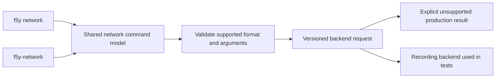

# Network command interface

Foundry provides a shared network parser through `f5y network` and the
source-buildable `f5y-network` executable. Command parsing, help and backend request
handling are implemented. Network service execution is not integrated: production
commands return an explicit unsupported error rather than simulate a directory,
message delivery, team change or setup operation. The standalone executable is
not yet included in release artifacts.

## Inspect the interface

From a development checkout:

```sh
cargo build -p f5y --bins
./target/debug/f5y network --help
./target/debug/f5y help network send
./target/debug/f5y-network --help
./target/debug/f5y-network --version
```

Help and version require no database, account or adapter configuration. The
standalone executable does not select a database. Valid composed calls currently
follow `f5y`'s existing local configuration path; this does not connect a network
service.

## Commands and namespace

| Purpose | Commands |
| --- | --- |
| Directory and activity | `who`, `status` |
| Messages | `send`, `held`, `approve`, `reject`, `listen` |
| Team membership | `init`, `invite`, `link`, `join`, `team`, `remove`, `leave` |
| Identity and transport settings | `proof`, `endpoint`, `relay`, `folder` |
| Installation and service control | `setup`, `doctor`, `upgrade`, `daemon`, `stop` |
| Protocol interfaces | `mcp`, `bridge` |
| Operational entrypoints, hidden from short help | `hook`, `tray` |

The two entrypoints generate the same versioned request for these named commands.
Bare invocation retains an absent command; it does not implicitly perform
onboarding or directory access. `f5y network serve ADAPTER` and
`f5y network ADDRESS MESSAGE` are separate wrapper requests, unavailable through
the standalone parser. Their execution also remains unimplemented.

Network `status`, `stop`, `upgrade`, `serve` and `mcp` are distinct from the
similarly named root operations. In particular, network `upgrade` is not a product
update alias, and network `serve` is not a machine-worker command.

## Inputs and output

`who`, `init`, `join`, `link` and `team` accept command-local `--json`.
Composed calls also accept the global JSON selectors for those commands; JSON
selection for other network commands fails before backend dispatch. Standalone
calls do not inherit root `--output-format` or database options.

`send` preserves message words and repeated `--file` paths for its future backend.
An omitted message or sole `-` represents stdin input; the shell does not read it
or open attachments. Explicit blank message words are rejected. `--fyi` and
`--notify` conflict. `approve` and `reject` require IDs or `--all` at dispatch;
IDs and `--all` may coexist. Parsing these requests does not settle messages.

`invite --hours` defaults to 24. `listen --as` defaults to `agent` and `--wait`
to 600; zero remains a valid requested wait. These are parsed values, not evidence
of running timers, invitation issuance or network registration. Runtime input
handling, clamping, delivery acknowledgements and protocol streams remain
backend responsibilities.

## Integration boundary



The parser tests cover all named commands and compare standalone/composed
requests. They do not establish live messaging, interactive onboarding, service
installation, updater behavior, hook success, tray availability or network
protocol execution. The private relay command schema remains unavailable.
