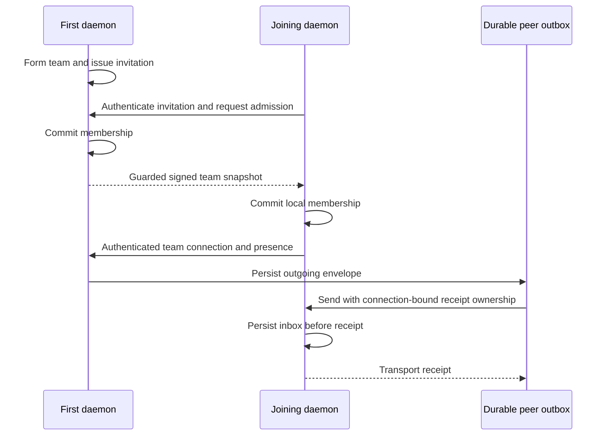

# Join a team and exchange peer mail

Peer messaging is available through the development daemon's private Unix IPC.
Configure [explicit transport](peer-configuration.md), then use the
[local protocol](daemon.md#local-protocol) to register a session. Keep the returned
credential private and attach it when opening another connection.

## Network controls

Send a normal numeric `id`, `op` equal to `network`, the actual registration
`auth` object, and a `command` object. The credential must be attached to that
same local connection. Commands reject unknown fields.

| Command `kind` | Fields and purpose |
| --- | --- |
| `status` | Current public endpoint address, team, revision and roster peers |
| `form` | `name`: explicitly form an unjoined daemon's team |
| `invite` | `hours`, `own`, `short`: intentionally return an invitation |
| `join` | `ticket`, optional `address` and `founder` |
| `join_code` | `code`, derived endpoint `address`, optional `team` and `founder` |
| `connect` | Current admitted peer `address` |
| `remove` | `endpoints` public-key array |
| `rotate` | Rotate the reusable invitation link |
| `depart` | Leave and scrub local team authority |
| `code_publications` | Obtain eligible short-code listener addresses |

`connect` records an admitted peer's explicit address for background connection
and retries. Success acknowledges that request. Existing live and pending
connections retain their ownership; a later attempt uses the updated address.
Use `who` to observe authenticated presence and transport receipts to track mail.

Successful replies retain `id` and contain `result.status` and `result.value`.
Network status has `value.kind` equal to `network_status` and its fields under
`value.status`. Invitation output has `kind` equal to `invitation`, with `ticket`
and `endpoint`. Short invitations also include `code` and `intent`; find that
intent in `code_publications` to obtain its live derived `endpoint`.

An invitation is privileged output. Only share it with the intended joining
participant. Status and readiness output do not contain its secret. Short-code
listeners are bound to their invitation, current generation and eligibility;
their derived endpoints do not become team members.

## Directory and durable delivery

Use ordinary `who`, `send` and `inbox` operations after admission. Remote session
names are attributed to authenticated team members. Shared repository paths
appear only when their owner chooses path sharing. A stopped or removed peer
cannot acquire new delivery authority from a cached directory entry.

A remote send returns `kind` equal to `transport_queued` after persisting the
complete envelope. A transport receipt acknowledges the receiving daemon's
decision; client read state and adapter injection are separate. Use a fresh ID
for new content. Reusing a queued peer-message ID replaces its pending envelope,
so receipts must remain bound to the exact connection and replacement version.

Outgoing transport retains at most 10,000 envelopes and 64 MiB. Queued envelopes
older than seven days expire; the exact seven-day boundary survives. Text bodies
are limited to 64 KiB. Escaped wire JSON has the peer frame's separate 4 MiB
ceiling. Retry and reconnect retain the original timestamp and bytes. Receiver
deduplication keeps replay from producing a second inbox message.

Local inbox polling, peek acknowledgement and restart behavior follow the
[daemon guide](daemon.md#mail-and-restart-behavior). Approval, attachment and
client-adapter delivery require further integration; a transport receipt does not
claim those workflows completed.
