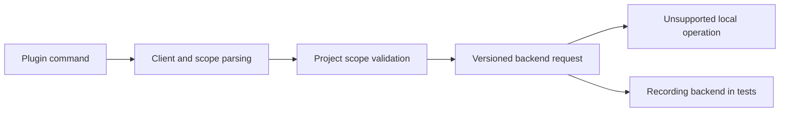

# Plugin command surface

Foundry parses plugin-management requests for client adapters. Installation,
removal, catalog discovery and client registration are not implemented by the
local backend. A parsed command does not install a package or authenticate a
connector.

## Inspect command help

From a development checkout with the CLI built:

```sh
./target/debug/f5y plugins list --help
./target/debug/f5y plugins add --help
./target/debug/f5y plugins remove --help
```

Help works without a database. Valid management requests still follow the local
backend configuration path and return an unsupported-operation error once that
backend is configured. They do not report successful installation or removal.

## Request options

| Command | Required arguments | Options |
| --- | --- | --- |
| `plugins list` | None | `--available`, `--client`, `--scope`, `--project` |
| `plugins add` | Package and `--client` | `--version`, `--scope`, `--project`, `--replace`, `--dry-run`, `--yes` |
| `plugins remove` | Package ID and `--client` | `--scope`, `--project`, `--dry-run`, `--yes` |

Client values are `claude`, `codex`, `cursor` and `grok`. These parser choices do
not certify support for installed client versions. Mutations require an explicit
client; there is no implicit mutation of every client.

Scope defaults to `user`. Listing accepts `user`, `project` or `all`; add and
remove accept `user` or `project`. An explicit `--project PATH` requires project
scope, or all scope when listing. Invalid combinations fail before backend
configuration or dispatch.

Paths and package references are passed to the backend as supplied. The shell
does not canonicalize project paths, search for a repository, resolve package
versions, fetch catalog data, inspect manifests or write installation receipts.
Those checks belong to the future management backend.

`--dry-run`, `--replace` and `--yes` are retained in the request. They do not
activate an installer in this build. The intended management operation is
authorized by the explicit add/remove command; `--yes` does not grant permission
to overwrite unrelated or modified files.

The shared `--json` and `--output-format json` selectors control response
rendering. They do not turn an unsupported request into a successful result.



See [CLI workflows](cli.md) for output rules and supported local operations.
