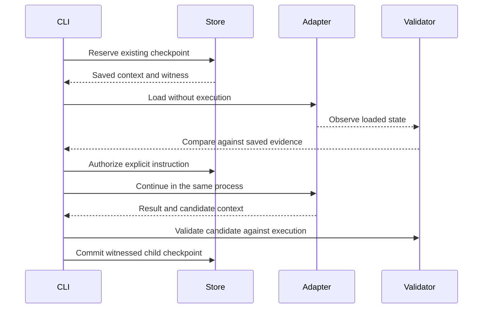

# Resume a local session

Native continuation requires an explicitly installed, compatible adapter and
profile host. Configure the private inputs described in
[local adapter setup](local-adapter.md), then set `FOUNDRY_NATIVE_PROFILE` to the
installation's private registration file. Use its native adapter launcher as
`FOUNDRY_ADAPTER`. Foundry does not discover or install this binding automatically.

## Select the installed profile

The registration is an absolute-path, owner-only `0600` JSON file. It uses the
same regular-file, size and symlink checks as private adapter configuration.
Its fields are `version` (`1`), `executable`, `stored`, `wire`, `validator_id`,
`validator_version`, `observation_profile_digest`, `registration_digest` and
`api`. Obtain the complete file from the trusted installation owner. The host
executable and identities are fixed installation inputs; model output cannot
select them.

The adapter's private system prompt supplies the host's policy configuration.
Provider credentials remain in the adapter bootstrap. The native launcher takes
only the private plan path selected by Foundry; do not put arguments or shell
text in `FOUNDRY_ADAPTER`.

## Inspect or continue

Use an existing database and the session ID returned by an earlier native run:

```sh
f5y --database /absolute/state/sessions.db --resume SESSION_ID --json
f5y --database /absolute/state/sessions.db --resume SESSION_ID "Continue the task" --json
```

The first command only displays the stored session. It reads no private adapter
configuration, starts no provider process and creates no instruction or attempt.
The second queues an explicit instruction and attempts a continuation within the
same session. It requires a compatible witnessed checkpoint. A missing database,
checkpoint, witness or registered validator produces an error.

Continuation preserves the original session directory and selected provider,
model and effort. Omitted directory uses the stored directory; explicit conflicting
selection is rejected. It does not create a replacement session or replay old tool
effects. An error after queueing can leave the new instruction pending: inspect
the session before retrying, since another invocation creates a new instruction.



Loading alone authorizes no model call or tool effect. Continuation must pass
validation and durable admission before effects are accepted. Tools still require
the explicit grants described in [adapter setup](local-adapter.md).

Cancellation retains the last verified conversation checkpoint. Configured
[workspace snapshot attempts](local-adapter.md#interrupt-a-configured-task) record
filesystem artifacts separately. Loading conversation context does not roll back
workspace files. Failed cleanup or publication is reported explicitly; an adapter
exit or a saved file alone is not a committed checkpoint.
