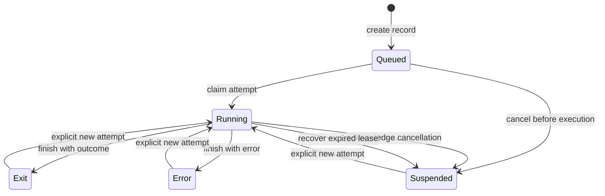

# Sessions and attempts

Foundry has a tested application service joining session storage and subprocess
supervision. The [local CLI](cli.md) persists records across processes and runs
an explicitly configured adapter synchronously. Execution tests use offline
adapters; no model-provider integration is implied.

## Session state

A session records a prompt, working directory, optional model selection, lifecycle,
optional outcome and result, active attempt identifier and version. Creating the
record queues it; it does not start a process or call a model.

| Lifecycle | Meaning |
| --- | --- |
| `queued` | A record exists without an active execution attempt |
| `running` | An attempt owns the session through a valid lease |
| `exit` | An attempt finished with an explicit outcome |
| `error` | An attempt ended with an execution error and no outcome |
| `suspended` | Execution was suspended or an expired attempt was recovered |

An `exit` lifecycle does not itself mean success. Its outcome is separately
`success`, `failure` or `action_required`. Error and suspended states have no
outcome. This separation keeps an interrupted process from looking successful.

This diagram describes library operations, not an automatic scheduler. The store
can claim another attempt only when there is no active attempt and the caller
supplies the current session version. Starting another attempt requires an
explicit application decision; the store does not resume execution by itself.

## Cancellation and recovery

Cancelling a queued session immediately marks it suspended because no attempt
is active. For a running attempt, cancellation is first a durable request. It
can escalate from graceful to hard;
it cannot downgrade an existing hard request. Recording the request does not
prove that a process has stopped. An execution owner must stop its process and
finish the cancelled attempt as suspended.

After a crash, opening the database preserves its state. Explicit recovery marks
expired attempts suspended and retains their event history. It does not replay
tools, invent a successful result or undo external side effects. An application
must reconcile uncertain work before starting a replacement attempt.

The subprocess supervisor supports graceful cancellation with a deadline and
hard cancellation of the owned Unix process group. It suppresses a settlement
received after cancellation has been observed. The [application service](../architecture/service.md)
renews leases, observes durable cancellation through another connection, and
persists terminal state after supervision returns. Its offline integration tests and CLI wiring
verify local coordination, not model-provider integration.

## Reading progress

The store can return events after an exclusive sequence cursor. Sequences are
per session and continue across attempts. Updates to an event are immutable
revisions, so consumers can retain history instead of treating each new revision
as a separate task.

The event-watch library replays durable events after a cursor and polls for a
terminal session. Text progress uses stderr and the final result uses stdout;
JSON mode emits JSONL event records followed by a result record. Its tests cover
both library and executable behavior. Interrupting watch returns 130 without
cancelling execution. Explicit CLI continuation through a configured native
binding is described in [resume a local session](resume.md). Queue submission
alone does not continue a session. For persistence guarantees and limitations,
see [storage](../architecture/storage.md).

## Stored instructions

The storage library can persist follow-up instructions with idempotent message
IDs and pending, in-flight, delivered or withdrawn state. CLI send commands now
queue instructions with fresh IDs, and MCP send accepts a caller-supplied ID for
idempotent retries. Queue submission does not restart execution. An already running service can
claim and deliver instructions only after its adapter advertises `message_ack_v2`.
Marking a message delivered records a validated adapter acknowledgement;
it does not mean the instruction was executed successfully. The acknowledgement
must echo the runtime's per-delivery receipt; it establishes knowledge of the
message frame, not successful work or model-provider integration.

An atomic claim prevents withdrawal once delivery is in flight. After an uncertain
crash, that record remains and blocks later claims. Explicit reconciliation is
required but not implemented; messages are not automatically resent. See the
[durable instruction queue](../architecture/storage.md#durable-instruction-queue)
for the current library boundary and recovery limits.

## Workspace tool grants

The CLI accepts repeatable `--tool-grant` values on a task prompt, `run`, or
`session start`: `read`, `list`, `write.create`, and `write.overwrite`. Grants are
independent and default to empty; `--yes` never grants filesystem access.

With a configured adapter, granted calls run through the sibling `f5y-toolhost`
executable. The CLI opens the effective task directory once and passes that
directory capability only to the helper. Each call has a 30-second timeout.
A durable claim precedes execution, and a durable completion receipt precedes
delivery of its result. Uncertain effects block further tool dispatch and normal
session completion; they are not silently retried.

The helper is located beside the CLI, never through `PATH`. For development,
`FOUNDRY_TOOLHOST` may select an absolute path to a trusted helper executable;
this override does not verify release provenance. IPC version validation is
separate from release version checks. Missing helper/configuration fails before
creating a database. `--yes` and adapter-supplied fields cannot add grants.

These controls govern host tools; they do not sandbox arbitrary adapter code.
See the [tool permission model](../../crates/tools/PERMISSIONS.md).
